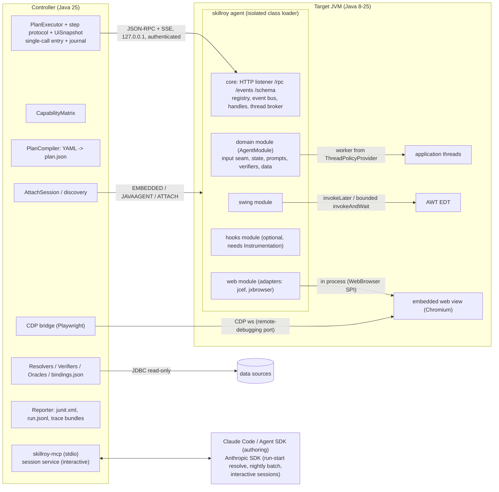

# Skillroy Test (Java): AI-driven testing of Java applications. Base framework design

**Status:** design for all phases; **Phase 1 is built and verified** (2026-10-02) on the sample lending desk (§4). The controller side is Java 25, and the gates are a Java 8 target and a Java 25 target in the Linux test image (JDK 25, display); the configurations that were run and their counts are in [`../TODO.md`](../TODO.md). Results measured on Java 21 targets before the controller moved to Java 25 stay recorded there as measurements. **Phase 1.x** (contract amendments A17-A33 and the hardening H1-H3 that followed the security review of 2026-10-02) is built and verified (2026-10-02): the agent's own HTTP listener, HMAC authentication with protocol 0.2, the fixes of the 34 review findings (the Windows ACL path not verified on Windows), and the amendments; `phase1-contracts.md` states it as built; where a passage of this document still describes 1.x as specified, it was written before the build and the contract has the last word. **Phase 2** (resolution and sample scenario A: tier (a) resolvers, in-process verifiers and oracles, bindings files with `replay`, `approve` and `live`, `credentials.yaml`, stored-row checks and the cost ledger) is built and verified (2026-10-02); `phase2-contracts.md` states it as built, and where this document and that contract differ on a Phase 2 detail, the contract wins. **Phase 3** (oracle cross-checks and sample scenario B) is built and verified (2026-10-03), and **Phase 4** (embedded web views: `skillroy-cdp`, the web SPI and `skillroy-agent-web`, §3.8) is built, reviewed and fixed (2026-10-07); `phase3-contracts.md` and `phase4-contracts.md` state them as built and win over this document on their details. **Phase 5** (the AI layer: the inference gateway with its recorded and scripted doubles, model-written SQL behind the guard, approval and budgets, batch re-resolution, the MCP server, the planner, triage and the interactive profile) is built, reviewed through three lenses with sceptics and fixed the same day (`phase5-contracts.md`, 2026-10-08; its answers B23 and the decisions of its build and review, B24, confirmed by the owner the same day; its passages here are marked "(Phase 5, built 2026-10-08; P5 §n)" and the contract wins over this document on its details; what needs a live model is marked there and listed under "Walls" in `../TODO.md`); **Phase 6** (hooks, Byteman, Windows, OpenTelemetry export, hardening) is built, reviewed and fixed (2026-10-09: six packages on the contract's then provisional answers B26, a code review of three lenses with a sceptic each and its four-package fix wave, and the repeat security review's two passes with their six fix rounds; the decisions of the build, the review's fixes and the security fixes, D160-D286, are B27): `phase6-contracts.md` states it as built and wins over this document on its details, its passages here are marked "(Phase 6, built 2026-10-09; P6 §n)", the security frame is in `threat-model.md`, and the Windows items are built where Linux can test them and marked not verified; the repeat review is signed off by the owner (B28, 2026-10-10); the Linux matrix of the final tree is recorded in `../TODO.md`; **Phase 7** (the vision bolt-on and the vision loop of interactive sessions: the extended `swing.capture`, `swing.hitTest` and `swing.pointer`, their `web.*` counterparts, `skillroy-vision` with the tiers V1-V3, pixel-anchored replay, `expectImage`, plans skipped in `replay`) is built, reviewed, fixed and security-reviewed (built 2026-10-10 in four packages merged into `main` the day its contract was specified and reviewed; code-reviewed (three lenses with a sceptic each) and fixed in three packages and a race fix the same day, then security-reviewed (a delta review of eight lenses with a sceptic each, S101-S148) and fixed in four packages on 2026-10-10/11: `phase7-contracts.md` states it as built and wins over this document on its details, its passages here are marked "(Phase 7, built 2026-10-10; P7 §n)", its answers are B29 and the 128 decisions of its build, its code review's fix wave and its security fixes are B30, both provisional while the build ran on them and confirmed by the owner on 2026-10-11; the delta review was signed off by the owner on 2026-10-11, B31; the Linux matrix of the final tree is recorded in [`../TODO.md`](../TODO.md)). Decisions B1-B25 are answered or confirmed by the owner (B23 and B24 on 2026-10-08, B25 on 2026-10-09); B26 and B27 are confirmed and B28 is signed off by the owner on 2026-10-10, B29 and B30 are confirmed and B31 is signed off by the owner on 2026-10-11, B32-B37 are answered or confirmed by the owner between 2026-10-11 and 2026-10-13, and B38 and B39 are confirmed and B40 is signed off by the owner on 2026-10-20 (§11, [`../DECISIONS.md`](../DECISIONS.md)). The project is licensed under Apache-2.0; the initial commit was made on 2026-10-06, 0.1.0 was released on 2026-10-12 as the tag `v0.1.0`, which was pushed with `main` to the private remote on 2026-10-13 (B36, after the email rewrite of B37), and nothing of Phase 8 is pushed.
**Date:** 2026-10-01, updated 2026-10-02, 2026-10-03, 2026-10-06, 2026-10-07, 2026-10-08, 2026-10-09, 2026-10-10, 2026-10-11, 2026-10-12, 2026-10-13, 2026-10-19 and 2026-10-20.
**Relation to the Phase 1 contract.** This document is the overview for all phases. Exact Phase 1 wire shapes, SPI signatures, primitive parameters and the sample lending desk's classes and schema are fixed in [`phase1-contracts.md`](phase1-contracts.md); where the two differ on a Phase 1 detail, that file wins. The Phase 1.x amendments and hardening are written into that file as built, each marked "(1.x, built 2026-10-02)"; this document gives only their outline.
**For a layer on this base.** How a private repository builds an application's agent module, domain pack, hook catalogues and tenant overlays on the base is mapped in [`../guides/integration-guide.md`](../guides/integration-guide.md); the contracts stay the specification.

**Citation convention.** `(topic §Fn)` is finding `n` in `docs/research/<topic>.md`; `§Rn`, `§Cn` and `§Riskn` are that note's recommendations, constraints and risks. Topics: `attach-instrumentation` (abbreviated `attach`), `control-channel`, `swing-driving` (`swing`), `embedded-browser-cdp` (`browser`), `embedded-browser-spi` (`browser-spi`), `ai-inference`, `vision-input` (`vision`). Ids are stable and non-contiguous. A bare `§Fn` refers to the topic last named in the same paragraph. `needs spike` marks anything unverified and names the spike (BS1-BS12, §8). `An` is a contract amendment, `H1`-`H3` are the hardening items and `Sn` is a finding of the security review of 2026-10-02; their exact text is in `phase1-contracts.md` and under decisions B17 and B18.

**Glossary.**

| Term | Meaning |
|---|---|
| CDP | Chrome DevTools Protocol, exposed by Chromium on a remote-debugging port |
| JCEF | the open-source Java binding of the Chromium Embedded Framework (`org.cef.*`) |
| OSR | off-screen rendering: an embedded browser paints into a lightweight Swing component |
| DKFM | `java.awt.DefaultKeyboardFocusManager` |
| XTEST | the X11 extension `java.awt.Robot` uses to inject native input |
| WM | X11 window manager (CI Xvfb usually has none) |
| ZDR | zero data retention (Anthropic API) |
| EDT | the AWT event dispatch thread |
| HMAC | keyed hash; here HMAC-SHA256 over request and reply fields with the agent's token as the key (§2.3) |
| SPI | an extension point the base defines and a pack implements |
| rung | one level of the input ladder (§3.7) |
| load mode | how the agent gets into the target JVM: `EMBEDDED`, `JAVAAGENT` or `ATTACH` |
| domain pack | what teaches the framework one application: an `AgentModule` (target JVM) plus a `DomainPack` (controller) |
| tenant pack | a `DomainPack` overlay for one deployment variant of an application |
| capability matrix | per run, each primitive is `OK`, `DEGRADED` or `UNAVAILABLE` |
| binding | a resolved, verified value for a scenario slot, frozen in `bindings.json` |
| oracle | a committed Java function that computes an expected outcome from bindings |
| profile | one of the two ways of running: CI (`replay`, no model) or interactive (a model may act between steps) (§3.4) |
| session service | the controller-side component that runs an interactive session: it subscribes to events, calls the model and acts through primitives (§5) |
| journal | the record of every call an interactive session made through the executor; it exports scenario steps and bindings (§3.4) |

---

## 1. Summary

Skillroy Test tests long-lived Java desktop applications (Swing, optionally with embedded web views) whose correct test inputs depend on the environment: which user has which permission, which item triggers which rule. A scenario states what it needs ("a staff member whose return limit is below this item's deposit"). The framework finds a matching value in the environment at hand, proves it with the application's own code, and freezes it.

The design has two planes.

1. A **Java 8 in-JVM agent**: no third-party classes visible to the host (unless the optional Byteman module is enabled), a JSON-RPC and SSE control channel on loopback (built on the JDK's `HttpServer`; Phase 1.x replaces that with a listener of the agent's own and HMAC authentication, §2.3), Swing, web-view and data primitives, an optional Byte Buddy hook module, and a module SPI. It loads three ways with identical primitives.
2. A **Java 25 controller**: attach, the capability matrix, the scenario compiler (YAML to a committed `plan.json`), the deterministic step protocol, resolvers, verifiers and oracles, Playwright over CDP for embedded web views, the JUnit 5 contract and the MCP server.

**Claude is never in the CI loop.** A model compiles plans at authoring time and resolves environment bindings once at run start. Every binding is verified in-process and frozen into `bindings.json`. CI replays with zero LLM calls and asserts that.

**Interactive use is the second way of running** (B15, §3.4, §5). A person, an authoring tool or an assistant inside the target application drives a live target with a model in the loop. It goes through the same step protocol, everything it does is journaled, and the journal exports an ordinary scenario, which is how interactive work becomes a CI test.

Everything application-specific lives in a domain pack. The base is proven on its own sample application, the sample lending desk (§4). Vision-driven steps and human-like input are a bolt-on, reserved by name in the first phases and built in Phase 7 (2026-10-10; B16, §3.10).

### 1.1 Stack

| Layer | Choice | Version | Java | Grounding |
|---|---|---|---|---|
| Target JVM | HotSpot, Java 8 through 25 | – | 8-25 | B4 |
| Agent build | `maven-compiler <release>8</release>` on a current JDK, which also rejects post-8 APIs. The agent-side tests additionally run on a real Java 8 JVM in the Linux test image. A JDK 8 toolchain is the fallback compiler should javac drop the flag (not configured yet). No `sun.*`, `jdk.jfr`, `com.sun.tools.attach` | – | 8 | BS7; attach §F24 |
| Agent transport | JSON-RPC 2.0 + SSE on loopback, served by the agent's own minimal HTTP/1.1 listener on a `ServerSocket` (H1, built 2026-10-02; it replaced the JDK `HttpServer` of the first build), with HMAC-SHA256 authentication of every request and reply, the token never on the wire (H2, protocol 0.2) | JDK built-ins only (`java.net`, `javax.crypto`) | 8 | attach §F24; control-channel §F1, §F2; B17 |
| Agent JSON | hand-rolled minimal reader/writer in `skillroy-protocol`, shared with the controller (built; no fallback library was needed) | – | 8 | control-channel §F9 |
| Hooks (optional) | Byte Buddy, shaded and relocated; RETRANSFORMATION + `disableClassFormatChanges` + inline Advice. **Phase 6, built 2026-10-09 (HK):** relocated under `ai.skillroy.testjava.agent.hooks.shaded` by the shading module `skillroy-agent-bytebuddy` and merged into `optional/skillroy-agent-hooks.jar`, which loads only when the agent option `optionalModules` names it; the transformer is taken with `makeRaw()` and registered behind the engine's name pre-filter, after the `Nexus` measure (`phase6-contracts.md` §2.1, §3.2) | 1.18.14 | 8 | attach §F13-F15 (verified on a toy class in a JDK 8 target); BS3 |
| Ad-hoc rules (optional, LGPL-2.1-or-later, host-visible) | ~~Byteman as a second agent jar, listener on 127.0.0.1, curated Helper~~ Byteman **in process, no listener** (Phase 6, built 2026-10-09, BW; P6 §7, D132): the user's jar (agent option `byteman.jar`, never bundled) loaded through the agent's own `Instrumentation` on the first confirmed `rule.submit`, its rule base reached through Byteman's `manager:` option and the project's `skillroy-agent-byteman-sys.jar` on the system class path, a curated helper | 4.0.27 | 8 | attach §F18, §F19; B8; spike BS14 |
| Controller | Java 25 bytecode (`--release 25`), built and run on any JDK >= 25 (developed on JDK 26; the Linux test image is JDK 25); Maven 3.9. The build and the CLI launcher refuse an older Java. A JDK 8 toolchain is needed only as the agent fallback above | 25 | 25 | attach §R0; control-channel §F18; B3 |
| Attach | `jdk.attach`, byte-buddy-agent emulated attach (JNA), jattach binary | 1.18.14 / JNA 5.12.1 / jattach 2.2 | 25 | attach §F1, §F3, §F6 |
| Controller JSON/YAML/schema | Jackson, snakeyaml-engine, victools jsonschema-generator | 2.22 / 2.9 / 5.x | 25 | control-channel §F9, §F35 |
| Test runner | JUnit 5 `@TestFactory` dynamic tests; Surefire junit.xml | 5.14 in use | 25 | ai-inference §F22 |
| Embedded web views | Playwright Java `connectOverCDP` from the controller where a debug port exists; in process, one SPI (`WebEngineAdapter`, `WebBrowser`) with reflective `jcef` and `jxbrowser` adapters (Phase 4, built 2026-10-07) | Playwright 1.63.0; a pack may pin older (§3.8) | 25 / 8 | browser §F7, §F8; browser-spi §R0; B9 |
| MCP | MCP Java SDK, spec 2025-11-25 line; stdio, or Servlet transport on embedded Jetty 12 for a remote controller | 2.0.1 | 25 | control-channel §F18 |
| Model | Anthropic Java SDK; `claude-opus-5-5` (plan compile, oracle drafts), `claude-sonnet-5-5` (resolvers, interactive sessions), `claude-haiku-4-5` (triage) | 2.34.0 | 25 | ai-inference §F10-F13; vision §R6; B7 |
| Vision (optional bolt-on) | `skillroy-vision` in the controller plus three small agent primitives; built 2026-10-10 (Phase 7; P7 §2, §6), no new dependency | – | 25 / 8 | vision §R0-R10; B16 |
| SQL guard / DB | JSqlParser AST allow-list; read-only roles, statement timeouts; JDBC drivers come from the pack | 5.4 | 25 | ai-inference §F24 |
| Observability | `run.jsonl` + `agent-events.jsonl` (W3C `traceparent`); JFR via `jcmd`; OpenTelemetry 1.66.0 in Phase 6. (Phase 6, built 2026-10-09, TL; P6 §10, D140-D143) OpenTelemetry Java **1.66.0**, pinned at build time, **controller only** in `skillroy-telemetry` (spans over OTLP/HTTP through the JDK sender, or the project's `skillroy-spans/1` file), off by default, no autoconfiguration and no `OTEL_*`; nothing of it in a target JVM | 1.66.0 | 8/25 | control-channel §F16, §F24, §F26; B11 |
| CI display (Linux) | image `eclipse-temurin:25-jdk` with a JDK 8 mounted for legacy targets; Xvfb, 24-bit depth, fontconfig + a font family such as DejaVu, no WM | – | – | swing §F21, §F22 |
| Licence | Apache-2.0: `LICENSE`, `NOTICE` and `CONTRIBUTING.md` (DCO sign-off, no CLA) in the repository root; every source file carries the header (`ci/license-headers.sh` checks it); the dependency audit is `../licence-audit.md` | – | – | B1 |

### 1.2 Architecture



### 1.3 Design choices where the research pointed two ways

| Topic | Options | Decision, because |
|---|---|---|
| Loading in CI | attach-only vs launch-time loading | Launch-time loading in CI: `EMBEDDED` where the host has a plugin mechanism (zero bytecode change), `JAVAAGENT` for hook-dependent suites and Java 21+ targets. `ATTACH` is for ad-hoc work on running targets. The capability matrix keeps modes honest: `hook.*` is `UNAVAILABLE` without `Instrumentation` (in Phase 1 the one such capability is `jvm.instrumentation`). |
| Byteman line | 4.0.27, verified on a JDK 8 target (attach §F19), vs "3.x for JDK 8" (control-channel §F36, which over-reads the downloads page) | Ship 4.0.27 only; it also serves JDK 9+. Byteman cannot be loader-isolated (its injected triggers resolve `org.jboss.byteman.*` from the host loader), so it is an optional, host-visible LGPL jar under B8. |
| Playwright pin | newest vs an older release closer to the embedded Chromium | Newest (1.63.0) as baseline: `setIsLocal` (1.58) and `setNoDefaults` (1.60) do not exist earlier (browser §F7). A pack pins older only when a spike shows the newest cannot attach, and then reads guide §10.3's floor (§3.8; Phase 8, built 2026-10-19, EW: the attach calls each option's setter only where the line has it, records what it could not apply, and below 1.60 the CDP path is not used without the operator's opt-in). |
| Mode-dependent expectations | assert a hook-only event conditionally vs declare it | Hook-dependent expectations are `requires:` capabilities. A pass means the same thing on every target. |
| Agent HTTP server | the JDK's built-in `HttpServer` (what Phase 1 built) vs a listener of the agent's own | The agent's own minimal HTTP/1.1 listener, specified for Phase 1.x (H1, B17). The JDK server parses the request head before the agent can authenticate or bound it, has no cap on open connections, initialises `java.util.logging` in `premain` on Java 8 and writes each response as two segments (the 45 ms finding). Details in §2.3, reasons in §10. |
| In-process web access | a module per browser vendor vs one SPI | One SPI and one module with two reflective adapters (B9, §3.8). JCEF and JxBrowser differ in how browsers are found and in how one browser is operated, and in nothing else that the `web.*` primitives need (browser-spi §F30). |
| Default click | `COMPONENT` with window activation as the default vs `ACTION` | `ACTION` stays the primitive's default; `COMPONENT` with activation is an opt-in default per scenario (B12, §3.7). Activation moves a window to the front, which suits a UI-verification suite and not interactive use beside a person. |
| A model while steps run | never vs in every mode | Never in CI. Allowed in the interactive profile, through the step protocol and journaled (B15, §3.4, §5). |

---

## 2. Agent (in-JVM, Java 8)

### 2.1 Modules (all `--release 8`)

| Module | Contents |
|---|---|
| `skillroy-protocol` | wire DTOs, JSON-RPC and event envelopes, error codes, schema-catalogue format. Shared with the controller. Phase 1.x adds the shared HMAC helpers and the secret-key rule here, so that agent and controller cannot disagree (H2, A17; built 2026-10-02) |
| `skillroy-agent-api` | the SPI: `AgentModule`, `Primitive`, `EventSink`, `HandleRegistry`, `ThreadPolicy`, `HookSpec`, `ProbeResult`, `Capability` and the interfaces of §2.6; since Phase 4 (built 2026-10-07) the embedded-browser SPI in package `…agent.api.spi.web` (§3.8). Lives in the isolated loader, never on a class path |
| `skillroy-agent-spy` | only `Spy`: static handler slots, no reference to other skillroy types. Appended to the bootstrap search path in hooks mode only. Separate because bootstrap appends are permanent (attach §C4) and a type defined in two loaders fails with `LinkageError` (Arthas precedent, attach §F25). **Phase 6, built 2026-10-09 (HK):** one class with `Spy.Handler` and `Spy.Stub`, a set-once weak handler slot released by identity only (D117), counters, `VERSION = 1`; it ships as `skillroy-agent-spy.jar` at the home's root, is appended by the hooks module at its first `hook.install` after a content check of the jar, at most once per JVM, and its package is parent-first in every agent loader (D116; `phase6-contracts.md` §3.1) |
| `skillroy-agent-bootstrap` | manifest `Agent-Class`, `Premain-Class`, `Launcher-Agent-Class` (takes effect only when the target is started with `java -jar`), `Can-Retransform-Classes`, `Can-Redefine-Classes`, `Can-Set-Native-Method-Prefix` (attach §F17: retransformation is unsupported without the `Can-Retransform-Classes` entry). A handful of classes: idempotent `agentmain`, `premain`, and an idempotent, re-entrant `EmbeddedAgent.start` that is callable by name; stores `Instrumentation`, creates the isolated loader, applies the enable rule and the main-class guard. Versioned by protocol major, never renamed: re-attach re-runs `agentmain` and a newer jar with the same `Agent-Class` is shadowed (attach §F4) |
| `skillroy-agent-core` | ControlServer (on the JDK `HttpServer` as built; the agent's own listener in Phase 1.x, §2.3), JsonRpcDispatcher, SseBroadcaster (ring buffer, `Last-Event-ID`), PrimitiveRegistry and schema catalogue, EventBus, ObjectRegistry (weak handles), ThreadBroker, ProbeRunner, HealthWatchdog, ModuleLoader, SafetyGuard |
| `skillroy-agent-swing` | window/tree/accessibility snapshot, locators, click rungs, non-posted key dispatch, dialogs, `printAll` and Robot capture, AWT event tap, EDT state and settle. **Phase 7, built 2026-10-10, VS (P7 §3):** the capture painted from the root pane and redacted by default, with its geometry, marks, carets, focus and raster hash; `swing.hitTest`; `swing.pointer` routed through the window, and through `java.awt.Robot` behind the agent option `robot` (JDK API in this module, loaded lazily behind `RobotFactory`, D290); `swing.rendering` |
| `skillroy-agent-web` (B9; Phase 4, built 2026-10-07) | replaces the earlier plan of a vendor-specific in-process module. The generic `web.*` primitives written once against the `WebEngineAdapter` / `WebBrowser` SPI; the injected script library (`ariaSnapshot` walker, DOM click/fill/text, CustomEvent dispatch, in-page event tap; the library itself lives in `skillroy-protocol`, shared with `skillroy-cdp`); and two built-in reflective adapters: `jcef` (in process, no debug port needed: as built through JCEF's own raw DevTools methods and a message observer of the adapter's, with `CefBrowser.getDevToolsClient()` as the existence check and the fallback, §3.8) and `jxbrowser` (lines 7, 8 and 9 through one adapter). Neither adapter has a compile-time dependency; no vendor code or licence ships; no Advice on vendor classes. Its `test-jar` is the adapter contract kit |
| `skillroy-agent-data` | `data.query` over the `DataSourceProvider` SPI (one guarded SELECT, row cap, timeout, `MaskPolicy`) |
| `skillroy-agent-hooks` (optional) | HookEngine on shaded Byte Buddy: probe, install, health, remove; touched-class ledger; runtime registry behind `Spy`, so reconfiguring needs no retransform. **Phase 6, built 2026-10-09 (HK):** `optional/skillroy-agent-hooks.jar`, loaded only with `optionalModules=skillroy-agent-hooks` (D114); the six primitives `hook.probe`, `hook.install`, `hook.stub`, `hook.remove`, `hook.health`, `hook.events`; the modes `OBSERVE`, `CAPTURE`, `STUB` behind one advice pair; the recorder ahead of the hook and the restore that is its own verification (D122); the `HookEngine` SPI (`phase6-contracts.md` §3, §4) |
| `skillroy-agent-bytebuddy` (Phase 6, built 2026-10-09, HK) | the shading module: Byte Buddy and its ASM relocated under `ai.skillroy.testjava.agent.hooks.shaded`, JNA references renamed to a package that exists nowhere, the dependency's notices kept once under `META-INF/third-party/`; no code of its own; `ShadedContentIT` reads the jar (D115) |
| `skillroy-agent-byteman` (optional, B8) | ~~a second agent jar on the target's system class path (`JAVAAGENT`/`ATTACH` only), host-visible for the life of the JVM; only its rules unload (attach §F19, §C4). `rule.*` wraps Byteman's `Submit` client against a 127.0.0.1 listener, per-session port, with a type-check pass and a curated Helper~~ **Phase 6, built 2026-10-09, BW (P6 §7, D132-D134; spike BS14):** a module in `optional/`, loaded only when `optionalModules` names it, Apache-2.0, no compile-time dependency on Byteman. It loads the user's Byteman jar (agent option `byteman.jar`, no environment fallback) **in process**, through the agent's own `Instrumentation`, only under a confirmed `rule.submit` (`JAVAAGENT`/`ATTACH` only): the sys jar and the Byteman jar appended to the system class path for the life of the JVM, `Main.premain("listener:false,manager:…RuleManager")` called by reflection, the `Retransformer` handed over in the manager's `initialize`. **No listener is ever opened; no port exists**: every rule travels over the agent's HMAC-authenticated channel. `rule.check` (the lint, then Byteman's `RuleCheck` once loaded), `rule.submit` (lint, class bound, type check; every submit needs `confirm`), `rule.unload` (a restore with the byte check of the hooks), `rule.list`. Only the rules unload; Byteman stays loaded, and a later agent instance reuses its parked `Retransformer` (attach §F19, §C4) |
| `skillroy-agent-byteman-sys` (optional, Phase 6, built 2026-10-09, BW) | the project jar the Byteman module appends to the system class path: `RuleManager` (the `manager:` class; no public accessor of the `Retransformer`) and `RuleHelper` (the curated helper every rule of the module names: observe-only `fired`, counters and flags, a bounded `format`; none of Byteman's `Helper` built-ins). Compiled against Byteman at `provided` scope; nothing of Byteman is in it |
| `skillroy-agent-dist` | assembly only: the agent home as a directory and a zip (the bootstrap jar, `lib/` with protocol, API and core, `modules/` with the module jars), jar names without versions. **Phase 6, built 2026-10-09 (HK):** also `skillroy-agent-spy.jar` at the root and `optional/`, never scanned (D114); `HomeConstantPoolIT`, `OptionalModulesIT` and `SharedLoadersIT` guard what a target JVM sees (D152) |

### 2.2 Load modes and lifecycle

**1. Load.** Three modes, identical primitives; the handshake reports the mode in use.

- **`EMBEDDED`.** The host's own plugin mechanism calls `EmbeddedAgent.start(Properties)`, optionally with the host's class loader and a host object that the domain module receives as `AgentContext.hostContext()`. The call is idempotent and re-entrant (a host may call its plugin hook twice, or configure `-javaagent` as well), never throws, and can be made by reflection so that the plugin class links without the bootstrap jar. No launch-command or bytecode change, and no `Instrumentation` unless self-attach succeeds (self-attach is not built in Phase 1: `jvm.instrumentation` is `UNAVAILABLE` in this mode). A Java 8 target hosted on a JDK (not a JRE) can self-attach: `ByteBuddyAgent.install()` through `tools.jar` (attach §F16), or `VirtualMachine.attach(<own pid>)` + `loadAgent(bootstrap.jar)`; JDK 8 does not restrict it (attach §F9). JDK 9+ needs `-Djdk.attach.allowAttachSelf=true` (attach §F9) and JDK 21+ prints the JEP 451 warning, so modern targets use `JAVAAGENT`. The matrix reports `hook.*` as `OK(strategy=SELF_ATTACH)` or `UNAVAILABLE(reason=jre-only host)`. *(Phase 6, built 2026-10-09, HK: self-attach is still not built; in this mode `hook.engine` is `UNAVAILABLE("no Instrumentation in EMBEDDED mode")`, the core's wording for `jvm.instrumentation`, and `hook.remove` and `hook.health` answer `CAPABILITY_UNAVAILABLE` themselves; `phase6-contracts.md` §3.2, §4.2.)* Phase 1.x adds a non-blocking `EmbeddedAgent.startAsync` for plugin hooks that must return quickly or run on the EDT (A22, built 2026-10-02).
- **`JAVAAGENT`.** `-javaagent:<bootstrap.jar>=<options>`: `premain` stores `Instrumentation` and starts the core. When the launch command cannot be edited, the flag goes into `JAVA_TOOL_OPTIONS`. Every JVM started in that environment then loads the agent jar (build tools included), so `premain` has a **main-class guard** (option `mainClassGuard`): it returns immediately unless `sun.java.command` starts with the configured main class. For the same reason the agent argument string, and the options file it names, can never enable the agent in this mode (step 7). Launch-time loading is exempt from JEP 451 (attach §F12).
- **`ATTACH`.** For targets that are already running.
  - *Pid discovery:* `VirtualMachine.list()` (same OS user only), ~~falling back to `/proc/<pid>/cmdline` or `tasklist`,~~ matched against the configured main class. If a launcher JVM supervises and respawns the application, attach to the child, never the launcher. (Phase 6, built 2026-10-09, BW; P6 §9.4, D139: the `/proc/<pid>/cmdline` / `tasklist` fallback is dropped; `VirtualMachine.list()` and the discovery files served five phases, and `jvms` already lists agents the attach API cannot see.)
  - *Same-user rule:* on a JDK 8 Linux target the attacher needs the target's euid/egid; root is rejected too (attach §F5). jattach 2.2 switches ids itself and works as root (attach §F6).
  - *Argument limits:* the attach protocol caps each argument at 1024 bytes, three per request (HotSpot `attachListener.hpp`; raised in JDK 24, JDK-8319055). The `loadAgent` argument is `<jar path>=<options>`, so the options carry only `t=<options-file>`. The token, the nonce, the module list and every other option come from that file, and the controller refuses a combined length of 1024 bytes or more before attaching. Measured in BS1 on Java 8 and Java 21.0.12 targets alike: 1024 characters arrive intact; from 1025 the load is refused with an `IOException` and `agentmain` is never called. It is a refusal, not a truncation.
  - *Start-up margin:* the attach signal ends a JVM that is still starting (a raw SIGQUIT killed a Java 8 JVM up to about 130 ms after spawn). `AttachSession` therefore gives a target younger than 5 s that long first. The JDK 21 Linux attach client already waits until the target catches the signal; the margin is a safety net for clients that do not.
  - *The `0` reply:* a JDK 10+ client throws `AgentLoadException` after a successful load into a JDK 8 target, because JDK 8 replies with a bare `0` (attach §F1). For targets at or below Java 8, `AttachSession` treats a message of `0`, or one ending `: 0`, as success; it maps 100/101/102/-4 to `BADJAR`/`NOTONCP`/`STARTFAIL`/`ENOMEM` and any other code to `AGENT_LOAD_FAILED(code)`. Against a target newer than Java 8 the exception keeps its normal meaning: the load failed.
  - *JEP 451:* a JDK 21+ target warns on every dynamic load and refuses under `-XX:-EnableDynamicAgentLoading`; a future release will refuse by default (attach §F12). `ATTACH` to such a target is dependable only when it was launched with `-XX:+EnableDynamicAgentLoading`; otherwise use `JAVAAGENT`.
  - *Windows:* same user and session (or elevation) and matching bitness; analysed from source, not executed (attach §F11). Phase 6. (Phase 6, built 2026-10-09, BW, documentation; P6 §9.4, D139; not verified on a Windows host.) The controller must run as the same user, in the same logon session and at the same integrity level as the target, with matching bitness; attaching across logon sessions is not supported and not detected (no Win32 calls), and `JAVAAGENT` is the path for services and for CI. `ATTACH` on Windows is best effort, with the 5 s start-up margin kept until it is measured on the host. The CLI ships `bin\skillroy.bat` (P6 §9.1), `skillroy author` resolves `claude` through `PATHEXT` and starts the planner's server as `cmd.exe /c <launcher>` (P6 §9.2), and every owner-only file the controller writes takes the ACL branch through the public `SecureFiles` (P6 §9.3).

Every branch ends in the handshake; only a successful `/ping` counts as attached. BS1 ran this matrix on stock Java 8 and Java 21 JVMs on Linux (results in `../TODO.md`). Since the gates moved (B3) the modern target of the end-to-end acceptance is Java 25; what that run showed is recorded in `../TODO.md` as well. jattach, cross-user attach and Windows are still open.

**2. Handshake.** A mandatory `GET /ping?nonce` echo plus a protocol-major check; the attach reply is never trusted (attach §R0). Address, nonce and token-file path are system properties, read per pid with `VirtualMachine.getSystemProperties()` (control-channel §F27), and are also in a 0600 discovery file `skillroy-<pid>-<jvmStartTimeMs>.json` in a per-user directory (`${java.io.tmpdir}/skillroy-<user>`, owner-only; the agent refuses a directory that another user owns or that others may write to, and the controller ignores one). The file is stale once pid and start time no longer match a live JVM. A restarted target has a new pid and, in `ATTACH` mode, no agent: `TARGET_RESTARTED`. Since Phase 1.x (built 2026-10-02) the handshake is mutual (the ping carries an HMAC over a fresh client nonce and the controller verifies the reply's MAC before it reads anything else; H2, §2.3), the agent's per-start session id is in the discovery file, and stale discovery files are removed instead of only ignored (A23: the agent deletes files that carry its own pid and another start time; the controller's discovery deletes files whose process is gone).

**3. Readiness gate.** Touching application singletons too early can create stray instances or deadlock start-up. A module's `install` runs at agent start and may only register primitives, SPIs and capabilities. The core then polls every registered `ReadinessSource` (250 ms) and calls each module's `onTargetReady` only once all report ready. After `readyTimeoutMs` (default 120 s) it reports `target.ready` as `UNAVAILABLE` once and keeps polling, so a slow application start does not leave a permanently unready agent.

**4. Module wiring.** Done in `onTargetReady`, which runs on an agent worker thread, never on the EDT or an HTTP handler thread; calls into the application go through the module's `ThreadPolicyProvider`. Listeners are registered at a quiescent point (the application is waiting for input) when its listener lists are not thread-safe. A seam the module occupies (an input source, a prompt answerer) chains to its previous occupant and is restored on detach. An application that sits in a modal question when the agent arrives has no quiescent point until somebody answers; the module must then be ready without its listener, so that the agent can answer (the sample lending module shows the pattern, `phase1-contracts.md` §9.2).

**5. Probes -> capability matrix.** Every primitive, grabber and hook declares a probe. Results are `OK | DEGRADED(reason) | UNAVAILABLE(reason)`, published at `/capabilities`, archived per run, and placed in the authoring prompt. *(Phase 6, built 2026-10-09, HK: the hooks module declares `hook.engine` with the probe of `phase6-contracts.md` §3.2 (Instrumentation, retransformation, the spy jar or the `Spy` already on the bootstrap path, its version, its slot) and one `hook.<id>` per installed hook with a probe that reads its health: `OK(advice)` while installed or firing, `DEGRADED` when stale, `UNAVAILABLE` in error; a hook that failed the install's checks is not declared, D120.)* (Phase 6, built 2026-10-09, CP; P6 §6.4, D130: "archived per run" is `capabilities.json` beside `run.jsonl`, in the wire shape of `/capabilities`, with a `capabilities {hash, ids, file}` record, written by the executor after step 0b, by `ExecutorSession.open` and by the MCP server into its `--out`; the hooks leg and the other legs are told apart by it.)

**6. Disable/detach.** In reverse order: restore seams, remove listeners, `removeTransformer` + `retransformClasses(touched)`, stop the server, drop the loader. By specification this restores the original bytes (attach §F17); a post-detach probe compares class bytes with the originals captured at first transform. The bootstrap jar stays on the class path, a JVM rule (attach §C4). A disable flag file triggers the same sequence. In Phase 1 the triggers are the `agent.disable` primitive, `EmbeddedAgent.stop()` and the agent argument `cmd=stop`; there are no hooks to remove yet and no flag file. After `agent.disable` no agent thread remains, and a later attach starts a fresh agent. *(Phase 6, built 2026-10-09, HK: the hooks module's uninstall disarms its handler first, keeps it in `Spy`'s slot, and restores class by class within `hooks.detachBudgetMs` (8 s inside the core's 10 s); the restore is one retransformation with the engine's recorder registered last, compared with the bytes captured at the first transform, and reports the count of foreign transform events beside the comparison (D122); a class not restored in time keeps an inert advice and the slot stays held for the JVM's life, so that a re-attached agent is refused rather than given a free slot beside a live advice (D117). The disable flag file is still not built. `phase6-contracts.md` §3.5.)*

**7. Safety (B13).** Two gates, in this order.

- *The enable flag* is checked before anything is started (no thread, no port). The agent does nothing unless it is enabled: the system property `skillroy.agent.enabled=true`, the environment variable `SKILLROY_AGENT_ENABLED`, or `enabled=true` in the `EMBEDDED` properties. The `-javaagent` argument string and the options file it names cannot enable it, because `JAVA_TOOL_OPTIONS` may hand them to JVMs that never asked for the agent. In `ATTACH` mode `enabled=true` in the attach options or the options file is accepted: attaching is itself a deliberate act by a process of the same OS user.
- *The production marker* can only be evaluated once the application is initialised. Until every `ProductionMarker` has passed, the agent serves read-only primitives only (mutating calls answer `NOT_READY`); the check runs when the target is ready and before any module's `onTargetReady`. A marker that matches, or throws, makes the agent refuse to serve: it records the reason in `skillroy.agent.error` and shuts down. With no marker registered the agent serves and logs a warning.

Read-only mode disables mutating primitives and `STUB` hooks. Destructive primitives need `confirm:true`. Every wait is bounded. No primitive calls application code known to end the JVM; a layer names such code's controls with `InputVeto`, and no route reaches them *(Phase 8, built 2026-10-19, EA; `phase8-contracts.md` §3.2)*. The agent never initialises AWT before the application does, and secret-looking values in JVM arguments, system properties and agent options are redacted before they leave the JVM.

The security review that B13 asked for was run on 2026-10-02. It confirmed 34 findings (S1-S34: four of medium severity, thirty low). The hardening that closes them (H1-H3) was built and verified in Phase 1.x the same day; §2.3 and §6 outline it.

### 2.3 Control channel and protocol

**As built (Phase 1).** A loopback `HttpServer` on an ephemeral port with `setExecutor(daemon thread pool)`: the default executor is single-threaded and an SSE stream would starve `/rpc` (control-channel §F2). The pool is bounded (option `httpThreads`, default 32) and has no queue: a connection that finds every thread busy is closed at once, and at most 8 `/events` streams are open at a time, so a local process without the token cannot make the target create threads without limit. A bearer token (32 random bytes, 0600 file) is required on every request, `/events` and `/ping` included (401 without it). Requests whose `Host` is not `127.0.0.1:<port>` or `localhost:<port>`, or that carry a browser `Origin` header, get 403 (a guard against DNS rebinding and CSRF). A rebinding page's same-origin GETs carry no `Origin`, so the token is the actual defence. Remote reach is only by `ssh -N -L 127.0.0.1:P:127.0.0.1:P` (control-channel §F33).

**Built in Phase 1.x (H1 and H2; decision B17, built and verified 2026-10-02, confirmed by the owner 2026-10-06).** The security review showed that the thread bound above was the only bound the agent had: everything before the token check belonged to the JDK server. Two changes followed; the wire protocol version is 0.2 (the major stays 0; nothing was released on 0.1). The exact limits, status codes and header formats are in `phase1-contracts.md` §5 and §7.

| Item | What changes | What it closes |
|---|---|---|
| H1: the agent's own HTTP listener | `agent-core` no longer uses `com.sun.net.httpserver`. A minimal HTTP/1.1 server on a loopback `ServerSocket`: Java 8 API only, no third-party classes, no `java.util.logging`, no reflection into `sun.*`. One acceptor thread; one thread per connection from the same bounded pool without a queue, so open connections never exceed `httpThreads`, and when the pool is full the oldest connection that has not authenticated is closed in preference to the new one. The request head is read into a fixed 16 KB buffer (at most 64 header fields) under an absolute 5 s deadline; the `Authorization` header is checked on the head alone, a request without a body is verified at once, and a request with a body once the body is in (the MAC covers it), with a shared 16 MB budget for the bodies of connections that have not authenticated yet (Phase 6 security fix, pass 2, P2-L1-F1, built 2026-10-09, SA: the body hash now travels in `X-Skillroy-Body-Sha256`, the MAC is verified on the head alone and a body is read only for a request that holds the key, because two stalled bodies of a process without it could hold the budget and fail the controller's calls; P1 §5); a body needs `Content-Length`, at most 8 MB, under a 30 s deadline. Keep-alive only for authenticated connections (idle for `httpIdleTimeoutMs`, default 120 s, longer than the controller's 30 s keep-alive). `TCP_NODELAY` on every socket, and each response and each SSE frame in one write | With the JDK server the request line and headers were parsed before any handler, and so before the token check, could run: unbounded on older Java 8 and without a time limit (S3, S4); there was no cap on open connections, so a local process without the token could use up the host's file descriptors (S4, S11), and stalled connections held every pool thread (S10); the server's own limits were JVM-global system properties, read once and partly absent on Java 8; creating the server in `premain` initialised `java.util.logging` before the application's `main` on Java 8 (S12, S16, S29); and its two-segment responses caused the 45 ms stall below |
| H2: the token never travels | The 32-byte token stays the shared secret, generated, stored and discovered as before, and is the HMAC key. Every request carries `Authorization: Skillroy-HMAC` with a fresh nonce and a MAC over the agent's session id, that nonce, the method, the path and query, and the hash of the body. Every reply to an authenticated request carries a MAC (`X-Skillroy-Mac`) and the session id (`X-Skillroy-Session`) that the controller verifies before it parses the body; refusals the agent sends before it could authenticate a request carry none, and the client fails such a call without concluding anything about the peer. The session id is random per agent start and not secret, so anything captured is useless against a later agent instance and the agent keeps no replay cache. `/ping` is authenticated in both directions. The controller's client has a terminal *lost* state (a refused connection, a reset after which the port refuses connections, a 401, a wrong MAC, a changed session, `agent.disable`, an `agent.stopping` event, the target process gone), after which it sends nothing. The old `Bearer` header is answered with 401 and `WWW-Authenticate: Skillroy-HMAC` | With a bearer token the controller sent the secret to whatever listened on the remembered port, before and without verifying the peer: a process that bound the port after the target exited received the token and every request body, and could answer with forged results (S1) |

(Phase 6, built 2026-10-09, CP; P6 §4.5, §5.3) The controller reaches the hook primitives through `HookInstaller` (a run's step 0b, a session's open, the MCP server's start, `skillroy hooks install`): `hook.health {}` first, then `hook.install` under the diagnostic timeout plus 60 s; `HOOK_CONFLICT`, `HOOK_VERIFY_FAILED`, a transport error or a timeout from that install is a run's ERROR / ENVIRONMENT with the agent's error as the detail.

H3 is the disposition of the remaining findings (bounded log lines, confined token-file reading, owner-only files where the file system has no POSIX view, reply and SSE size caps in the controller, bounded regular expressions, bounded worker and caller pools with a `BUSY` error, a production gate that fails closed, and others), all built; the list is in `phase1-contracts.md` and under B17, and the ACL path for file systems without POSIX permissions is not verified on Windows. The endpoints, the JSON-RPC shapes and the event envelope below did not change with H1 and H2.

```
POST /rpc           JSON-RPC 2.0 (single or batch)
GET  /events?since=<seq>&topics=state.*,input.*,prompt.*,web.*,hook.*   SSE, id=seq, 15 s heartbeat,
                    Last-Event-ID resume from a 10k ring, explicit "gap" event on overflow
GET  /schema        primitive catalogue (JSON Schema 2020-12 in/out, annotations, timeoutMs, thread, capabilityId)
GET  /capabilities  matrix {id: {state, reason, strategyInUse}}
GET  /ping?nonce    handshake      POST /modules  upload + install     POST /shutdown {mode}
```

`/modules` and `/shutdown` arrive after Phase 1. In Phase 1, module jars are named in the load options and the agent is stopped with the `agent.disable` primitive.

```json
{"jsonrpc":"2.0","id":"c-17","method":"lending.input","params":{"source":"Key.DUE",
  "ackTimeoutMs":5000,"_meta":{"correlationId":"s1-step4","traceparent":"00-...-01"}}}
{"jsonrpc":"2.0","id":"c-17","result":{"value":{"accepted":true,"acked":true,"ackMs":38},
  "events":[{"seq":1042,"topic":"state.changed","payload":{"from":"LOAN","to":"DEPOSIT"}}],
  "seq":{"before":1041,"after":1043},"durationMs":41,"thread":"skillroy-lending-worker"}}
{"jsonrpc":"2.0","id":"c-18","error":{"code":-32011,"message":"capability UNAVAILABLE",
  "data":{"primitive":"hook.observe","reason":"no Instrumentation in EMBEDDED mode"}}}
```

`seq.before` is the event sequence number immediately before the primitive ran. A wait that starts "since `seq.before`" cannot miss a consequence of the call.

**Error codes.** JSON-RPC reserved (`-32700..-32600`), `-32001 TIMEOUT`, `-32002 FORBIDDEN_THREAD`, `-32003 STALE_HANDLE`, `-32004 MODAL_OPEN` (a modal dialog blocks the target's window), `-32005 INPUT_REJECTED` (the application did not accept the input), `-32006 NOT_FOUND` and `-32007 AMBIGUOUS` (a locator matched nothing, or more than one component), `-32010 CAPABILITY_DEGRADED`, `-32011 CAPABILITY_UNAVAILABLE`, `-32020 HOOK_VERIFY_FAILED`, `-32030 CONFIRM_REQUIRED`, `-32031 READ_ONLY`, `-32032 NOT_READY` (the target is not ready, so the capability has not been probed yet).

**Events.** `{seq, ts, topic, source, correlationId, traceparent, payload}`. The controller mints `correlationId` and `traceparent` per call (MCP reserves `traceparent` in `_meta`, control-channel §F16); the agent stamps them on every event emitted while that call is active.

**Transport SPI.** HTTP + SSE is the first implementation. The SPI reserves a second for firewalled Windows hosts: newline-delimited JSON-RPC over TCP or a Unix socket, with agent-initiated dial-out (control-channel §R1). (Phase 6, BW: still reserved, not built; P6 §1. The optional Byteman module adds no listener of its own: its rules travel over this channel, P6 §7.1.) The POST + SSE shape maps one-to-one onto MCP Streamable HTTP (control-channel §F14). BS2 soaked the JDK server for three minutes per JDK and checked the loader isolation (`../TODO.md`).

**The 45 ms finding and where it led.** BS2 also found that each call costs about 45 ms on Linux: the JDK server writes a response as two segments and Nagle's algorithm holds the second until the client's delayed ACK; with `-Dsun.net.httpserver.nodelay=true` on the target it is 1-2 ms. Three remedies were on the table: the launcher adds that flag (no help in `ATTACH` and `EMBEDDED` modes), the agent sets the JVM-global property itself (a side effect on the host's own JDK HTTP servers), or the agent brings a small server of its own. The security review settled it as the third, for reasons that weigh more than latency (H1 above): the agent's listener sets `TCP_NODELAY` and writes each response in one write. Built in Phase 1.x: a call now costs about 1.4 to 5 ms on a Java 8 target, and a scenario about a tenth of its old time there (`phase1-implementation-notes.md`).

### 2.4 Primitive catalogue (Java-ish signatures; `*` = requires `Instrumentation`)

```java
agent.info() / capabilities(reprobe) /*OK|DEGRADED|UNAVAILABLE*/ / log(n) / modules.install(jar,id,cfg) / selftest / disable / shutdown
jvm.info() / threads(stacks) / properties(names) / logTail(path,n,regex) / classes.find(glob,limit)*
app.state()                                                                        // merged from every AppStateProvider
obj.grab(GrabSpec /*StaticField|StaticCall|Registry(key)|FromHook(id,THIS|ARG[i]|RETURN)*/) / call(h,m,args,ThreadPolicy /*CALLER|EDT_SYNC|EDT_ASYNC|WORKER|APP*/,timeout) / describe / get / release
hook.probe(HookSpec)* / install(HookSpec /*OBSERVE|CAPTURE|STUB, fallbacks[]*/)* / remove / health() /*ARMED|FIRING|STALE|ERROR*/ / events(since,id,limit) / waitFor(id,cond,timeout)
rule.check(rule) / submit(rule, checkOnly) / unload(name) / list()                // optional Byteman module (P6 §7.3, built)
// (Phase 6, built 2026-10-09, CP; P6 §4.2) no hook.* or rule.* primitive takes its arguments from an MCP client or a
// model: ToolProjection.NEVER_OFFERED names hook.probe/install/stub/remove and rule.check/submit/unload; hook.health,
// hook.events and rule.list are offered as reads; PlanPolicy refuses the seven in a client's plan
swing.windows() / snapshot(SnapshotSpec) / find(Locator /*ref|id|name|text|class|path|<domain strategy>, plus role and index*/)
swing.click(h, Rung /*AUTO|ACTION|COMPONENT|DISPATCH|ROBOT*/, activateWindow, force, fallback /*ACTION; 1.x, A28*/) / type(h,text,TypeMode /*SET|DISPATCH|ROBOT*/,enter,force) / key(key,target,modifiers,force)
swing.dialogs() / dismiss(d, DismissBy /*BUTTON_ACTION|OPTION_VALUE|CLOSE*/) / capture(target, PAINT|ROBOT, annotateRefs) / events(since,mask) / edtState() / settle(timeout)
swing.hitTest(point, space | target) / pointer(action, point+space | target+region|row+at, via /*ROUTED|ROBOT*/) / rendering()
// (Phase 7, built 2026-10-10, VS; phase7-contracts.md §3: capture also takes scope, region, scale, redact (default
// true) and answers captureId, seq, space, origin, scale, windows, surfaces, marks, carets, focus, redacted, hash;
// swing.type without a target types at the focus owner; ROBOT stays an opt-in mode of capture, a person's evidence)
web.browsers() /*{browserId,url,visibleInSwing,cdpTargetId,tag}*/ / evaluate / ariaSnapshot / dom.click|fill|text / dispatchEvent(name,detail) / tap(patterns) / resize / bitmap / cdp.status()
// (Phase 4, built 2026-10-07; phase4-contracts.md §4.2: adds web.waitFlag and web.reload; frames are part of
// web.browsers (no web.frames); browser selection, parameters and results are as stated there)
web.hitTest(browser, point /*{x,y}*/, space /*VIEWPORT|COMPONENT*/, frame) / pointer(browser, action /*MOVE|PRESS|RELEASE|CLICK|DOUBLE_CLICK|WHEEL*/, point, space, button, clickCount, modifiers, wheel, force)
// (Phase 7, built 2026-10-10, VW; phase7-contracts.md §4: hitTest is a read that answers the element's role, name, tag,
// rectangle and the locators that find exactly it, and for a frame element the child frame to descend in; pointer is
// mutating, sends the events of a person's pointer through the page's input path (the SPI's WebBrowser.dispatchPointer,
// capability INPUT, or Input.dispatchMouseEvent on the CDP path) and answers MODAL_OPEN for a browser a modal dialog blocks
// unless force; capabilities web.hittest and web.pointer)
data.sources() / query(sourceId, sql, params, QuerySpec /*maxRows<=200,timeout*/)
device.list() / state(id) / act(id,action,args)
sync.await(EventFilter,timeout) / quiescence()
evt.query(seq,filter,limit)
trace.mark(label,attrs) / bundle(spec)
```

This is the catalogue for all phases. The Phase 1 subset, with exact parameters and results, is in `phase1-contracts.md` §5, §6 and §9.2. The `web.*` primitives have one implementation, written against the embedded-browser SPI of §3.8.

Every call returns `{value, events[], seq{before,after}, durationMs, thread}`; click, type and dismiss results report the rung or mode that fired. Controller-side (Java 25): `cdp.attach(endpoint, opts)`, `cdp.pageFor(browserId|targetId)`, `cdp.snapshot(page, scope)`, `cdp.act(page, action)`. A domain module adds its own namespace (`lending.*` in the sample), including its semantic input primitive (`lending.input`) and its prompt primitives (`lending.prompt`, `lending.prompt.answer`).

**Reserved for the vision bolt-on (B16; built in Phase 7 for the Swing side, 2026-10-10, VS: the primitives, parameters, result fields and capability ids of the Swing rows below are built as `phase7-contracts.md` §3 states them; the web rows are VW's).** Reserving means that the name is written here and is not used for anything else; signatures are fixed when the bolt-on is built, through the contract's amendment process (§3.10).

| Reserved | Names |
|---|---|
| Primitives | `swing.hitTest` (read-only: a point to a component ref, its locators and the point inside it), `swing.pointer` (mutating: pointer action at coordinates, routed through the window or through Robot); `web.hitTest`, `web.pointer` |
| `swing.capture` parameters | `scope`, `region`, `scale`, `redact` (beside `mode: ROBOT` and `annotateRefs`, already named) |
| `swing.capture` result fields | `captureId`, `seq`, `space`, `origin`, `scale`, `windows`, `surfaces`, `marks` (the result as built is `format, width, height, base64`, which cannot be mapped back to a point) |
| `swing.type` | an omitted target means the focus owner, as for `swing.key` |
| Capability ids | `swing.hittest`, `swing.pointer.routed`, `swing.pointer.robot`, `swing.capture.robot`, `swing.capture.screen`, `web.hittest`, `web.pointer` (beside the existing `swing.click.robot`); the prefix `inference.` for capabilities the controller contributes to the matrix, first `inference.vision` |

### 2.5 Observation model and step protocol

One `UiSnapshot {seq, ts, app{...}, surfaces[SWING nodes | WEB browsers + aria | DEVICE nodes], text}` with stable refs is consumed identically by the runner, the trace viewer and the model. The `app{...}` section comes from the domain module's `AppStateProvider`: state name, current prompt, accepted inputs. The text rendering is scoped and capped at about 4k tokens. A Swing node's name is the first non-empty of `NameEnricher` output, the `AccessibleContext` name and `Component.getName()`, because image-only buttons often have empty accessible names (swing §F18).

The step protocol has no sleeps. It is parameterised by the pack's `SyncPolicy`, which names the topics meaning "action acknowledged" and "the application is waiting for input again":

> **act -> await an ack topic -> await the first of {ready topics, `web.ready`, `window.opened`} -> settle (EDT marker round-trip, no `WINDOW_OPENED` since the ack) -> snapshot -> evaluate expectations, retried until the step timeout (default 10 s)**

For the sample lending desk the ack topic is `input.acked` and the ready topics are `input.requested` and `prompt.waiting`. The module emits them from the application's own seam when the engine thread blocks for input, so "ready" is a fact, not a guess from quiet time.

Every event payload is masked before the agent stores it (Phase 8, built 2026-10-19, EW; `phase8-contracts.md` §5.1): on the publishing thread, outside the ring lock, the core's secret-key rule turns the value under a secret-looking key into `<redacted>` and every registered `MaskPolicy` sees every scalar as `event:<topic>` and its dotted column, at most 10,000 scalars per event; the one masked payload is what the ring, every subscription and the SSE stream, `evt.query`, `sync.await` and so every run output and client see. A module still masks before it publishes; the ring pass is the backstop.

The executor must also know which ready topics are application prompts, so that it can apply the pack's `PromptPolicy` to a prompt no step expected. The well-known topic is `prompt.waiting`. A module that publishes its prompts under other topic names lists them in `SyncPolicy.promptTopics` (default `["prompt.waiting"]`).

Each call in a plan carries a `sync` level chosen by the pack verb that emitted it: `NONE` (return when the call returns), `ACK` (await the ack topic), `READY` (ack, then the first ready topic), `SETTLE` (then `swing.settle`) or `EVENT` (await the event the call itself names, with a payload match). `EVENT` exists because an application's acknowledgement can mean only "consumed", not "accepted", and some primitives publish no acknowledgement at all. Every wait starts from the call's `seq.before`. Phase 1.x lets the base UI verbs `click`, `type` and `press` name such an event themselves (`await:`), followed by a settle (A32, built 2026-10-02).

(Phase 8, built 2026-10-19, ES, EX; P8 §7.1, §7.4, §8.6, §8.9.) **Acknowledgements are correlated by input** when the
pack says so (`SyncPolicy.ackByInputId`, which the sample sets): the module mints an `inputId` per input, returns it
and puts it in the acknowledgement's payload, publishing an acknowledgement that comes after the call from the
application's own callback; `ACK` and `READY` then wait for the ack topic with `match: {inputId}`, so an earlier
input's late acknowledgement never completes a later call's wait. A payload match entry is a scalar (equal by text) or
`{has: scalar}` (a list member equal by text), one Java 8 rule (`PayloadMatch`) shared by the agent and every
controller-side wait. **The step protocol carries warnings**: a call that did what it was asked with a caveat (the
input queued, its value coerced or dropped, another question answered by it, a pack's own code) says so in its
result's envelope, and the step accepts the code (`accept: [CODE]`) or fails. **The agent's events are also a fact**:
the base root `events` is the bus's window since the run's start mark, so a count, a delta or "this never happened"
(`{size: 0}`) is an expectation, and a window the ring no longer holds whole, or one with an event cut at publish
(Phase 8 security fix, S151, FC), is a refusal, never a wrong pass.

### 2.6 Extension SPI and hook policy

```java
interface AgentModule {
  String id(); String version(); Set<String> requires();
  void install(AgentContext ctx);         // at agent start; must not touch application singletons
  void onTargetReady(AgentContext ctx);   // once every ReadinessSource reports ready
  void uninstall();                       // removes every listener the module added to the host
}
```

Modules are discovered by `ServiceLoader` from a module jar in a child-first loader whose parent is the agent loader, which delegates to the host application's loader. `AgentContext` exposes `Instrumentation` (null in `EMBEDDED` mode without self-attach), the load mode, the merged options, the host class loader, the host context object of an `EMBEDDED` start, `PrimitiveRegistry`, `EventBus`, `HandleRegistry`, `ThreadBroker`, `CapabilityRegistry`, `HookEngine` (if present), and an `SpiRegistry` for these SPIs. *(Phase 6, built 2026-10-09, HK: `HookEngine` is the SPI `…agent.api.spi.hook.HookEngine`, reached through the default method `AgentContext.hooks()` (null without the hooks module, looked up in `onTargetReady`, never in `requires()`); `AgentContext` also gains `isSecretKey` and `redactText` over the core's redaction, D118.)*

| SPI | Contract | Status |
|---|---|---|
| `ReadinessSource` | when the application is initialised enough to touch domain singletons | built |
| `ThreadPolicyProvider` | which thread a domain call must run on, which are forbidden, how to obtain a worker | built; 1.x adds `available()` for the time before the application thread exists (A19); Phase 8 adds `quiescentPoint()`, the base-owned `QuiescentPoint` the provider drives from the application's idle callback, behind `ThreadPolicy.APP_QUIESCENT` (built 2026-10-19, ET; P8 §4.1) |
| `AppStateProvider` | fills the `app{...}` section of `UiSnapshot` | built |
| `NameEnricher` | names a component whose accessible name is empty | built |
| `LocatorResolver` | adds named locator strategies (in the sample, `action`) and resolves them to components | built |
| `ActionFirer` | fires a custom widget's action without focus | built |
| `DialogTextExtractor` | reads message text and options from a custom dialog (Phase 1: dialogs that are `java.awt.Dialog` windows only) | built; 1.x adds an overload for in-window dialog roots (A27) |
| `DialogLocator` | finds dialogs an application draws inside another window, and says whether one blocks input to the rest of that window | 1.x, built 2026-10-02 (A27) |
| `RedactionKeys` | a module's own pattern of secret-looking keys, consulted by the core's redaction | 1.x, built 2026-10-02 (A21) |
| `WebEngineAdapter` | one per embedded-browser technology: detects it, turns seeds into `WebBrowser` handles, reports the CDP endpoints configured at engine start (§3.8). Built in: `jcef`, `jxbrowser`; a pack may add another (Phase 4, built 2026-10-07; `phase4-contracts.md` §3: `id()`, `probe(hostLoader)`, `browsers(seeds)`, `cdpEndpoints(seeds)`, `enumerationState()`, `enumerationNotes()`, `detach()`; a pack registers its own through `SpiRegistry`) | Phase 4, built 2026-10-07 (B9) |
| `BrowserRegistryAdapter` | technology-neutral: `Collection<BrowserSeed> seeds()`. A domain module returns seeds (a browser, a view, an engine or a client, optionally tagged) for embedded browsers the Swing-tree scan cannot see; it needs to know no vendor type (Phase 4, built 2026-10-07; `phase4-contracts.md` §3: as stated, a seed being `BrowserSeed.of(object)` or `BrowserSeed.of(object, tag)`; called on agent workers, `seeds()` must be cheap and must not block) | Phase 4, built 2026-10-07 (B9; the web host's agent module is the worked example) |
| `BrowserMask` | technology-neutral: `Boolean masks(String tag, Object vendorObject, boolean hasView)`: names (TRUE) or releases (FALSE) a browser by its seed tag or vendor object; while any `CaptureMask` or `BrowserMask` is registered a browser without a view is masked unless one releases it; called on agent workers, never on the EDT, never calling the vendor object (`phase8-contracts.md` §5.2, A79) | Phase 8, built 2026-10-19, EW (the web host's `DetachedRelease` and `BackTagMask` are the worked examples) |
| `DeviceAdapter` | presents peripherals as snapshot nodes and `device.*` actions | built (the sample's printer) |
| `DataSourceProvider` | an in-process, credential-free SELECT channel, in one of two forms. `open()`: the provider opens a JDBC connection that the base configures (read-only, timeout, row cap) and closes. `query()`: the provider executes the guarded SELECT itself and returns columns and rows, for an application whose data layer exposes its own statement API instead of a JDBC connection, or only a shared connection that must not be reconfigured or closed | built; Phase 8 adds the five-argument `query()` with a `QueryControl` (cancellation), `enforcesTimeout()`, `lane()` (a module's declared lane for the source's reads) and `columns(table)`; a positional source's columns take the statement's labels (built 2026-10-19, ET; P8 §4.2-§4.4) |
| `ProductionMarker` | predicate that makes the agent refuse to serve on a production installation (evaluated once the application is initialised; §2.2 step 7) | built |
| `MaskPolicy` | masks personal data before anything can reach a prompt | built for rows; the component level is the separate `CaptureMask` (Phase 7, D296); also for every event payload at publish, `event:<topic>` (Phase 8, built 2026-10-19, EW) |
| `RegionResolver` | for a custom-painted component: a point to a stable region id and back, so that a recorded step can address a region instead of a pixel | built (Phase 7, 2026-10-10, VS; P7 §3.7; the sample's number pad) |
| `CaptureMask` | which components show a secret: a capture blanks them grey and every reader of the tree withholds their text (one rule for pixels and text) | built (Phase 7, 2026-10-10, VS; P7 §3.6) |
| `SurfaceSource` | areas of the tree that are not Swing-painted, as another module knows them (the web module's browser index), for a capture's `surfaces` and the hit-test's `surface`; a surface carries its module's mask flag, so that the Swing module blanks a masked browser's view whole in every capture and the hit-test reports it masked (Phase 8 security fix, S166, FE) | built (Phase 7, 2026-10-10, VS; P7 §3.7) |
| `LocatorResolver.describe` | the strategy values that name a component in the resolver's vocabulary, so that the hit-test proposes the domain locator first | built (Phase 7, 2026-10-10, VS; P7 §3.7) |
| `InputVeto` | the components the agent must never deliver input to (a control whose action ends the JVM or cannot be undone in a test): asked with the route on every input route that resolves a target, for the component and its ancestors up to the window, inside the read and again inside every posted task and per routed pointer event; fails closed; never skipped by `force`; readers flag `vetoed` and the recorder never offers such a component | built (Phase 8, 2026-10-19, EA; `phase8-contracts.md` §3.2; the sample's `LendingInputVeto`) |

`SyncPolicy` is the one per-domain contract on the controller side (§3.6); the module's part is to emit the topics it names.

**Hook policy.** The base ships the hook engine and the catalogue format. Catalogues belong to domain and tenant packs.

- A catalogue is one YAML file per target application version. Each `HookSpec` has ordered fallbacks, and **the first fallback is always a public seam**: a primitive that needs no bytecode change.
- **Zero hooks on the default path.** The framework is complete without the hooks module.
- Targets are small methods on classes the pack's owner may modify; third-party classes are off by default. Very large classes are never retransformed; BS3 sets the size limit (`needs spike`). *(Phase 6, built 2026-10-09, HK: 256 KiB of class file or 2,000 methods, also the byte bound of one retransformation batch of at most 8 classes; a ledger of at most 64 classes; a deny-list by name (`java.`, `javax.`, `sun.`, `com.sun.`, `jdk.`, `org.jboss.byteman.`, `ai.skillroy.testjava.agent.`, `ai.skillroy.testjava.protocol.`) and by loader (bootstrap, platform or extension, and every loader of the agent's own), so that an application's own packages, the sample's included, are hookable; the engine never loads a target class; `phase6-contracts.md` §3.3, §3.7, D124.)* *(Phase 8, built 2026-10-19, EH: ownership by code source, so that "our own classes only" is sayable for a package a third-party jar shares: `target.codeSource`, a regular expression on the class's code-source name (the jar's file name, never a directory), inherited from a qualified `packages` entry, keeps only the matching copies; and a per-catalogue class deny by name, from the catalogue's `deny:`, the agent option `hooks.deny` and a domain module's `ClassDeny`, asked before anything of the class is read and honoured by the Byteman module before it loads, held add-only per agent instance and echoed by the agent so that the installer fails closed without it; `phase8-contracts.md` §6.)*
- An overloaded target pins every descriptor that reaches the behaviour.
- Advice bodies are two lines that call the bootstrap-injected `Spy`: types referenced by inlined advice must be visible from the instrumented class's loader (attach §F15). *(Phase 6, built 2026-10-09, HK: a class whose loader cannot see the bootstrap `Spy`, a strict-delegation loader, is refused at install; `Spy` is appended once per JVM, after the `Nexus` measure that keeps Byte Buddy from injecting into the system loader, so that the shared loaders gain nothing but `Spy` and its two nested types; the mode lives in the handler's registry, not in the bytecode, so arming a stub needs no retransformation; a `CAPTURE` value is encoded as a scalar, a bounded collection or a weak handle, masked, and never rendered through `toString()`; `phase6-contracts.md` §3.2-§3.4, §4.3.)*
- Install-time probes check each signature; a mismatch yields `DEGRADED` (fallback in use) or `UNAVAILABLE`.
- Detach restores and verifies (§2.2, step 6).

```yaml
catalogue: hooks-<application>-<version>
hooks:
  - id: limit.check
    mode: OBSERVE                         # OBSERVE | CAPTURE | STUB
    enabled: true                         # false = catalogued but never installed; the default for third-party targets
    target: { class: com.example.app.LimitChecker, method: check, descriptors: ["(Lcom/example/app/Staff;J)Z"] }
    emits: hook.limit.check
    fallbacks:
      - seam: <domain>.limit.check        # always first: no bytecode change
      - reflect: { class: com.example.app.LimitChecker, field: lastResult }
```

---

## 3. Controller (Java 25)

### 3.1 Modules

| Module | Contents |
|---|---|
| `skillroy-controller` | AttachSession (strategy chain, reply mapping for Java 8 targets, handshake), discovery, AgentClient (`HttpClient` + SSE with resume), typed stubs from the schema catalogue, **CapabilityMatrix** |
| `skillroy-scenario` | YAML loader, PlanCompiler, Binder (`bindings.json`), PlanExecutor and step protocol, `UiSnapshot` renderer, PromptPolicy, Reporter, failure taxonomy, the `DomainPack` SPI. **(Phase 2 contract, built 2026-10-02)** also the resolution SPI and its value types (`Query`, `Resolver`, `Verifier`, `Oracle`, `Resolution`, `Provenance`, `EnvFingerprinter`, …, package `…scenario.resolve`) and the deterministic resolution engine (`ResolutionEngine`, the binder's modes, the bindings file): `DomainPack` must reference those types, so they live where it lives (D1). Later: the executor's public single-call entry, the session journal and its export (§3.4), and an embedding API for the session service (§5) (Phase 5, built 2026-10-08; P5 §2.1, §12.2) `phase5-contracts.md` (P5 in the marks below) specifies the entry as `ExecutorSession`, with `StepJournal` and its export; the module also gains the `ResolverContributor` SPI and `InferenceSettings`, `BatchableResolver`, the base verb `call` and plan version 5, approval states with the `replay` rule for tier (b), and the scenario JSON schema generator, and no dependency. The session service is in `skillroy-inference` and drives `ExecutorSession` |
| `skillroy-data` **(Phase 2 contract, built 2026-10-02)** | below `skillroy-scenario`: the `DataChannel` abstraction with its two implementations (the agent's `data.query`, controller-side read-only JDBC), `Credentials` (`credentials.yaml`), `SecretMask`, `RowMask`, and the strict YAML reader (`StrictYaml`) with the YAML dependency. The statement guard, value conversion and JDBC read path both channels share live in `skillroy-protocol` (`…protocol.sql`) |
| `skillroy-inference` (Phase 5, not before) | the `InferenceGateway` SPI and its Claude implementation, the tier (b) and (c) resolvers, SqlGuard, prompt masking, budget meters, batch re-resolve. **(Phase 2 contract, built 2026-10-02)** it depends on `skillroy-scenario` and contributes resolvers to its SPI; the query/resolution model itself is in `skillroy-scenario` (above), because placing it here would make the two modules depend on each other (D1) (Phase 5, built 2026-10-08; P5 §1, §2.1) package `ai.skillroy.testjava.inference`: the gateway SPI with the Claude, recorded and scripted gateways; tier (b) as the contributed resolver `inference.sql` behind `SqlGuard` (tier (c) at bind time is not in Phase 5); `PromptMask`; the budget meters and the ledger writer; batch `re-resolve`; triage; the planner; the session service. It depends on `skillroy-scenario`, `skillroy-data` and `skillroy-controller` and brings two third-party sets, the Anthropic Java SDK and JSqlParser |
| `skillroy-cdp` | Playwright `connectOverCDP` wrapper under an external deadline, liveness probe, page mapping by target id, readiness, tracing, and `CdpWebPath`, the CDP implementation of the web verbs. (Phase 4, built 2026-10-07; `phase4-contracts.md` §2.1, §5, D49: an optional module found through `ServiceLoader<WebPath>`; `skillroy-scenario`, `skillroy-junit` and `skillroy-cli` do not depend on it, and no distribution ships Playwright: a Maven suite declares it, and the CLI takes it, with Playwright's six jars, as `--pack` jars) |
| `skillroy-junit`, `skillroy-mcp` | one dynamic test per scenario; MCP projection of the catalogue plus domain tool packs. The MCP server is also one host of the interactive session service (Phase 5, built 2026-10-08; P5 §2.1, §9) `skillroy-mcp` (package `ai.skillroy.testjava.mcp`) is the MCP server over stdio on the MCP Java SDK, started by `skillroy mcp` and by the planner; it depends on `skillroy-inference`, `skillroy-scenario` and `skillroy-controller`. `skillroy-junit` is unchanged in its dependencies |
| `skillroy-cli`, `skillroy-trace-viewer` | Phase 1: `jvms`, `attach`, `info`, `caps`, `schema`, `call`, `snapshot`, `events`, `compile`, `run`. Phase 2 (built 2026-10-02): `resolve`, `diff-bindings` and the binding options of `run`. Later: `probe`, `re-resolve`. Static HTML viewer for run bundles (Phase 5, built 2026-10-08; P5 §2.1, §13.4) `re-resolve` is specified as a command, with `mcp`, `author`, `triage` and `session`, and `run` and `resolve` gain the inference options; the CLI depends on `skillroy-inference` and `skillroy-mcp` |
| `skillroy-telemetry` (Phase 6, built 2026-10-09, TL; P6 §2.1, §10) | the OpenTelemetry implementation of the `RunObserver` SPI (`…scenario.observe`, in `skillroy-scenario`, which names no OpenTelemetry type): the `otlp` and `file` providers, the span builder, the attribute allow-list. Optional at run time: found through `ServiceLoader` only when an exporter is named, so that without `--telemetry` no OpenTelemetry class loads; the CLI zip bundles it and the OpenTelemetry set in `lib/`; `skillroy-scenario`, `skillroy-junit` and `skillroy-mcp` do not depend on it (a Maven suite adds it to its test class path). It depends on `skillroy-scenario` and `skillroy-controller` |
| `skillroy-vision` (optional; Phase 7, built 2026-10-10, VM; P7 §2.1, §6; B16) | the screenshot/act loop, the adapter between a model's tool vocabulary and agent primitives, grounding and visual-question calls, the recorder, image comparison (§3.10). Depends on `skillroy-inference` and `skillroy-scenario`; outside the base's required set (Phase 7, built 2026-10-10, VM; P7 §6.1, D302, D303, D313) package `ai.skillroy.testjava.vision`: `VisionSessionTools` (the session service's `SessionTools` seam: the loop is the service's own, the module acts only through its facade `SessionActions`), the custom tools and the computer toolset's adapter, `Grounding`, `Marks` (drawn on the controller's copy), `Recorder`, `VisualQuestion`, `ScenarioPlayer`, `Captures` and `VisionCapabilities` (`inference.vision`). The exact image comparison moved to `skillroy-scenario` (D313), so that `replay` runs anchored steps and `expectImage` without this module. Found through `ServiceLoader` (`SessionTools`, `CapabilityContributor`); nothing below it names a vision type; the CLI depends on it and bundles it in `lib/`; it also depends on `skillroy-controller`, `skillroy-protocol` and `skillroy-data`, and brings no third-party dependency (image work is `java.awt.image` and `javax.imageio`) |

### 3.2 Scenario DSL (B5)

The primary surface is YAML:

| Key | Meaning |
|---|---|
| `scenario`, `pack`, `tags` | id, the `DomainPack` id, labels |
| `dependencies` (later phase) | backends the environment must have running |
| `requires` | capability ids (`a \| b` means either); missing = `PRECONDITION_FAILED` |
| `launchProperties` | system properties the target must have been launched with (checked, never set); a mismatch = `PRECONDITION_FAILED` |
| `resolve` | typed queries; each result is a slot (`$slot.field`); references form a DAG. Phase 1 supported `fixture` values only; Phase 2 (built 2026-10-02) adds tier (a) queries with verifiers and a `credential` join |
| `oracle` (Phase 2, built 2026-10-02) | committed Java functions over slots |
| `steps` | verbs from the pack's step library, with `expect` blocks |
| `verify` | post-conditions over in-process facts and stored rows |
| `on_prompt` | what to do with prompts the steps did not expect: `fail`, or `pack` (the pack's policy, the default); no other value loads (Phase 8, built 2026-10-19, EP; P8 §9.2) |
| `artifacts` | evidence to keep even on success (Phase 1: `capture`) |
| `timeouts` | step timeout (default 10 s) |
| `ui` (1.x, built 2026-10-02; A29) | click fidelity for the scenario: `{ clickRung: ACTION \| COMPONENT, strict: bool }`; absent means `ACTION`, not strict (§3.7) |

The deterministic `PlanCompiler` emits **`plan.json`**. In Phase 1 it is `{planVersion, scenarioId, pack, packVersion, sourceHash, requires, slots[], steps[{id, verb, source, calls[{primitive, args, sync, timeoutMs, await?, handlesPrompt?}], expect[]}], verify[], cleanup[], launchProperties, artifacts[], onPrompt, stepTimeoutMs}`; Phase 1.x adds `ui`, and Phase 2 (built 2026-10-02; plan version 2) adds `inference`, `oracles[]`, `resolutionGraph[]` and `bindTimeoutMs`. The same YAML and pack version produce a byte-identical plan (no timestamps, no absolute paths). It is committed beside the YAML and executed verbatim. `$slot` references are resolved at bind time (run start), never at compile time.

Reserved for the vision bolt-on (B16, §3.10; nothing built beyond the plan field itself, which Phase 2 writes as `none` and requires to be `none`): the compiled plan field `inference` with the values `none`, `bind` (a model produced bindings; replayable) and `run` (a model is needed while steps run; such a plan is never executed in `replay` and is reported as skipped); the scenario verbs `aiAct`, `aiExpect`, `pointer` and `expectImage`; and an optional `region` beside `by` in a step locator. Base verbs are a closed set and unknown keys are errors, which is why the names are fixed now.
**(Phase 7, built 2026-10-10, VC; P7 §8.1, §8.2, §8.6.)** Built: plan version 6 writes `inference: run` for a plan with an
`aiAct` step, which `replay` reports as `SKIPPED` before the agent is contacted and every other mode of the executor
refuses (the vision module's scenario player runs it); the four verbs are base verbs (`aiAct` compiles to no call,
`aiExpect` to a check guarded by `inference.vision` that the executor always skips, `pointer` to `swing.pointer` by
locator with an optional region, row and image guard, `expectImage` to one redacted capture compared exactly with the
baseline of the target's render key); `region` is a sibling argument of `by` on `pointer` and `expectImage`, a region id
resolved by the agent, while `by`'s grammar is unchanged.

**(Phase 8, built 2026-10-19, EX; P8 §8.)** Expectations count, compare and capture: a list filter `[*field=value]` (dotted filter fields) counted with `size`, the base verb `captureFacts` (a slot from facts, read once where the step stands) and a delta against it (`{size: {gt: $before.n}}`), `anyOf` and `containsWhere`, a `[json]` segment, the `events` root; negation is a count, not a wait. Plan version 7, with strict step and call keys. *(Phase 8 security fixes, S149, S173, FC: an expectation a bound keeps from deciding, a regex or a `[json]` text it stops, ends `ERROR` and never passes under a negation; and wherever a model's or a client's check is judged on masked values, its path is followed on the fact as the mask leaves it.)*

A fluent Java DSL is the secondary surface and produces the same plan (not built in Phase 1). Gherkin is deferred: it pays only when non-developers author scenarios (ai-inference §F20).

Expectations are evaluated against primitives (application state, domain objects, device events, hook events, stored rows), never against screenshots. Prompt text is captured, not asserted, because wording drifts with locale and release.

### 3.3 Resolver, verifier and oracle model

**(Phase 2 contract, built 2026-10-02; the exact shapes are `phase2-contracts.md` §6.)** A resolver returns
**ordered candidates**; the **engine** runs the verifiers and builds the `Resolution` (D3). A resolver that
returned a finished resolution could skip the verifier; with candidates the gate is in one place, and "the first
candidate the application itself accepts" has a defined meaning and is recorded together with the rejected ones.

```java
interface Query<T> { }                     // NOT sealed: every DomainPack contributes its own query records; the kind
                                           // a scenario writes is declared by QueryType.of(kind, queryClass)
interface Resolver<Q extends Query<T>, T> {
    String id();  Class<Q> queryClass();  Strategy strategy();                 // the tier follows from the strategy
    List<ResolverCandidate<T>> candidates(Q q, ResolveContext ctx);            // best first; deterministic; empty = none
}
record ResolverCandidate<T>(T value, String label, double confidence) {}       // label: never a secret
interface Verifier<Q extends Query<T>, T> { String id(); VerifierResult verify(Q q, T candidate, VerifyContext ctx); }
interface Oracle<I, O> { String fn(); O compute(I in); }                       // committed Java, unit-tested, pure
/** Built by the engine, never by a pack. value is the encoded (JSON-like) form of T: it is what the bindings file
 *  holds, replay compares and references substitute; packs work with typed T in candidates and verifiers. */
record Resolution(String slot, String query, Object args, String argsHash, Object value /*no secret fields*/,
    Strategy strategy /*FIXTURE|CANONICAL_SQL|CANONICAL_JAVA|LLM_SQL|LLM_REASON|LLM_VISION|REPLAY*/,
    Provenance provenance /*resolver id, statements with masked row samples, calls, rejected candidates*/,
    List<VerifierResult> verified, double confidence, CredentialRef credential, Approval approval, LlmUsage usage) {}
```

The earlier sketch here (`Query.kind()`, `Resolver.tier()`, `Optional<Resolution<T>> resolve(…)`, a `Resolution<T>`
holding the typed value and the fingerprint, a verifier taking an `AgentSession`) is superseded; the fingerprint
lives beside the bindings file's `env`, not inside a resolution, and `DomainPack` exposes one `resolution()`
catalogue rather than four lists.

**Tiers**, tried in the order the scenario lists:

| Tier | Source | Gate |
|---|---|---|
| (a) | committed SQL or Java from the pack's catalogue, through `data.query` or read-only JDBC | verifier pass |
| (b) | SQL written by the model (structured output), validated by `SqlGuard` (§3.9), with a deterministic `ORDER BY` and tie-breaker injected: unordered results are the main source of flaky generated tests (ai-inference §F7) | verifier pass, confidence >= 0.8, row count in range (Phase 5, built 2026-10-08; P5 §5): the contributed resolver `inference.sql`, the guard's ten rules, the threshold a setting and the row bounds the model's own; the default threshold is 0.6 since the live session (P5 D113, B25) |
| (c) | model reasoning over primitive outputs; at authoring time, with explicit approval, or in an interactive session (§3.4) | verifier pass and approval on first use (Phase 5, built 2026-10-08; P5 §1): not a bind-time resolver in Phase 5; in the interactive profile the model acts through the pack's verbs and the journal exports ordinary steps |

**The verifier is the gate regardless of tier.** A verifier is deterministic and runs in the target JVM, normally by calling the application's own decision code through a domain primitive: the access check, deposit lookup or rule evaluation the application itself will run. The model's confidence is advisory.

**Oracles** compute expected outcomes from bindings. A model may draft the first version, which is reviewed like any code. A model never evaluates an oracle at run time, because model-written assertions tend to encode actual rather than expected behaviour (ai-inference §F8). `must_equal` on an oracle is a bind-time guard: a binding under which the scenario would not test what it claims is rejected, not run.

### 3.4 Record and replay

`bindings/<envId>/<scenario>.bindings.json` holds `{planHash, env{fingerprint, profile}, resolutions{slot: {query, args, value (semantic ids, no secrets), strategy, provenance, verifier, confidence, approval, llm{model, requestId, tokens, costUsd}}}, oracles{slot: {fn, inputsHash, value}}}`: a reviewable, diffable fixture next to the scenario (ai-inference §F23). **(Phase 2 contract, built 2026-10-02.)** The file as built is `phase2-contracts.md` §9: it is tied to the plan's `resolveHash` (slots, oracles and their order) rather than the whole plan, keeps the fingerprint's named components beside its hash, records a credential by realm and id only, and has no `env.profile`.

**Two ways of running (B15).**

| Profile | Who drives | Model calls | Binding modes |
|---|---|---|---|
| CI | the suite runner | none. The cost ledger must be empty after the run. A plan that needs a model while steps run is not executed and is reported as skipped | `replay` only |
| Interactive | a person, an authoring tool, or an assistant overlay inside the target application that a tenant layer supplies | at run start, **and between steps**: tier (c) reasoning over primitive outputs, the vision loop (§3.10), choosing the next action, live triage | `live`, `approve` |

| Mode | Profile | Use | Behaviour |
|---|---|---|---|
| `replay` | CI | every CI run | zero LLM calls, asserted by the cost ledger. Verifiers re-run. A fingerprint or verifier mismatch is `REBIND_NEEDED`, never a silent re-resolution |
| `approve` | interactive | first run of a new or changed scenario | a CLI prompt shows value, SQL and verifier evidence; bindings are written on approval (Phase 5, built 2026-10-08; P5 §7.1): a tier (b) slot is `REQUIRED` until approved, the screen shows the statement, the rationale and the cost, and an unchanged value that still verifies is reused without a model call |
| `live` | interactive | developer, authoring tool, in-application assistant | resolves on demand; a model may also act between steps |
| `re-resolve` | nightly job | scheduled, outside the CI gate | regenerates bindings through the Batch API and opens a pull request with the diff (B6) (Phase 5, built 2026-10-08; P5 §8): a command and a `BindMode`, graph rounds with one batch per round, files written `APPROVED` by the job and a review report; the pull request is opened by the pipeline |

The earlier rule "no model mid-scenario" now reads "no model mid-scenario in CI". Its reason still holds as a fact (a model call takes seconds to tens of seconds while the target may hold a modal prompt open or time a session out) and becomes a constraint the interactive loop must respect: every wait is bounded and the pack's `PromptPolicy` still applies between actions (§5).

**Single-call entry and journal.** An interactive session never talks to the agent around the executor.

- *Single-call entry.* The executor gets a public entry for one call: "execute this call with the step protocol, return events and snapshot". It applies the same ack, ready and settle waits, the same prompt policy and the same failure classification as a plan step. The session service (§5), the MCP surface, the authoring planner and the vision loop all use it.
- *Journal.* Every call made through that entry is journaled with its arguments, sync level, result, events and, where a model chose it, the provenance (intent, model, request id, tokens, cost).
  **(Phase 7, built 2026-10-10, VC; P7 §9.2, D331.)** The provenance is handed in by the acting call and journaled on the
  step's own line: (intent, model, request id; the capture's and the hit-test's facts, an anchor's); the cost stays in
  the ledger, found by the request id.
- *Export.* The journal exports ordinary scenario steps and bindings for review. The exported scenario compiles to a plan without model calls and replays like any other. That is how interactive work becomes a CI scenario.

**Budget and safety in a session.** A per-session budget stands beside the per-scenario one. Read-only mode is available to a session as to any client. A destructive primitive still needs `confirm: true`, and a model's request is never the confirmation: the person confirms. (Phase 6 security fix S57, built 2026-10-09, SR; D158) This now holds for an MCP client and so for the planner: the MCP server acts under `Origin.Kind.CLIENT` (`skillroy mcp --client <label>`, `planner` for `author`), which never confirms, and a pack verb called by a client or by the session service's model is checked at call time on the calls it compiles to with the real arguments. `ProductionMarker` is unchanged.

**Phasing.** The profile is designed now. The `live` and `approve` modes were built in Phase 2 (2026-10-02) without a model (tier (a) only). The session service, the single-call entry, the journal and model calls were built in Phase 5 (2026-10-08; B23 confirmed by the owner the same day); the vision loop is Phase 7's. (Phase 5, built 2026-10-08; P5 §5, §7, §8, §12) The single-call entry `ExecutorSession`, the journal with its export and the session service are specified in P5 §12.2-§12.4, tier (b) with approval and budgets in P5 §5 and §7, and `re-resolve` in P5 §8 as a command and a `BindMode` that writes bindings files and a review report; the pull request is opened by the pipeline, not by the base (P5 §8.2). Tier (c) at bind time is not in Phase 5.

`EnvFingerprint` is a sha256 over values the pack's `EnvFingerprinter` supplies: typically a schema checksum of the allow-listed tables, application version and build, data version, site and device identity, embedded-browser version (Phase 6, built 2026-10-09, CP; P6 §6.5, D128: not the hook catalogue's version, id or hash, nor the matrix: bindings do not depend on hooks, and a `replay` with hooks off against bindings made with hooks on must not be `REBIND_NEEDED`; the catalogue is recorded in the `hooks` record and the archived matrix instead). The base adds the agent protocol major and the fingerprint's version, not the plan hash (Phase 2 contract, built 2026-10-02: the plan and the pack version stay out of the fingerprint, D7 and D8 of `phase2-contracts.md`). Too strict invalidates constantly; too loose lets bindings go stale (ai-inference §Risk0).

### 3.5 Failure taxonomy

Classification is deterministic and happens before any model sees the failure.

| Value | Meaning |
|---|---|
| `PRECONDITION_FAILED` | a `requires:` capability or launch property is missing |
| `REBIND_NEEDED` | fingerprint or verifier mismatch in `replay` |
| `RESOLUTION_FAILED` | nothing in this environment satisfies a query |
| `ORACLE_SUSPECT` | the committed oracle and its cross-check disagree at bind time |
| `SYNC_TIMEOUT` | an ack or ready topic did not arrive; carries quiescence info and dialog text |
| `ASSERTION` | an expectation failed; carries the snapshot diff |
| `TARGET_RESTARTED` | the target pid changed |
| `AGENT_LOST` | the channel dropped while the pid is alive |
| `ENVIRONMENT` | handshake, backend or pre-flight failure |

`ASSERTION` and `SYNC_TIMEOUT` give the status `FAIL` (the application did not do what the scenario expects); every other kind gives `ERROR` (the run could not be carried out). A run whose evaluated expectations all held but which had to skip a guarded expectation is `DEGRADED` (B14).

Built in Phase 1.x (2026-10-02): a `MODAL_OPEN` answer to a step's call is `FAIL` / `ASSERTION`, like `INPUT_REJECTED`, because the application is showing something the scenario did not expect (A30, B18); a click of the base UI verbs that did not fire fails its step the same way; and a click that fell back from `COMPONENT` to `ACTION` makes `DEGRADED` the best possible outcome of the run (A29, §3.7). A plan that `replay` does not execute because it needs a model while steps run is reported as skipped with that reason; this is a reserved behaviour (§3.10) and needs no new failure kind.

A pack's `PromptPolicy` handles known interrupting prompts (a session lock, a housekeeping reminder) deterministically.


**(Phase 7, built 2026-10-10, VC; P7 §8.6, D328.)** A fifth status, `SKIPPED`: a plan with `inference: run` in `replay`,
neither a failure nor a pass (JUnit shows it skipped, the CLI exits 0 for it); no new failure kind. `REBIND_NEEDED` gains
the reason `IMAGE` (no baseline for the render key, a rejected candidate, an anchor that no longer matches).
### 3.6 DomainPack SPI and tenant packs

```java
interface DomainPack {
  String id();  String version();    // id = primitive namespace, e.g. "lending"
  StepLibrary steps();   SyncPolicy syncPolicy();   List<FactProvider> facts();   PromptPolicy promptPolicy();   // Phase 1
  List<PreflightCheck> preflight();   void recover(AgentConnection agent);                                        // Phase 1
  ResolutionCatalogue resolution();   EnvFingerprinter fingerprinter();                                         // Phase 2 (built)
  List<StoredTable> storedTables();   List<RowMask> rowMasks();                                                  // Phase 2 (built)
  List<PackCapability> capabilities();   Set<String> warningCodes();                       // Phase 8 (built, P8 §9.1, §7.3)
  McpToolPack mcpTools();                                                                                        // later
}
```

A `FactProvider` names a root usable in expectation paths (`loan`, `slip`, `app`, `ui`) and how to fetch its current value. **(Phase 8, built 2026-10-19, EX; P8 §8.6.)** The base roots, consulted after the pack's, are eight: `app`, `ui`, `dialogs`, `caps`, `devices`, `web`, `hooks`, `events`; a pack root of the same name hides a base root, so no pack breaks on a new one. A pack is found by `ServiceLoader` on the controller's class path. Its agent half, the `AgentModule` with the same id, is named in the load options or, after Phase 1, uploaded through `POST /modules`.

A **tenant pack** is a `DomainPack` overlay for one deployment variant of the same application: it overrides resolvers, constants and the hook catalogue. Scenarios and the base stay untouched. That is the test of whether the SPI is cut in the right place. (Phase 6, built 2026-10-09, CP; P6 §11, D144-D146: `DomainPackOverlay {baseId, id, version, overlay(base)}`, found by `ServiceLoader` beside the packs and applied by `DomainPacks.discover` to the base it names (in id order, a missing base an error naming both ids); `DelegatingDomainPack` forwards every member, keeps the base's id and reports `<base>+<overlay>@<version>` as the version a plan records; `PackSettings` through `DomainPack.settings()` and every context's `settings()`, so that an overlay changes a constant without replacing the code that reads it; `DomainPack.hooks()` with `HookCatalogues.overlay`. Proven on the sample desk's branch edition with the overlay module `skillroy-sample-lending-pack-branch`: a resolver, a constant, the allow-list and the catalogue overridden, scenarios A, B and E unchanged.)

**Extension points added in Phase 1.** Three needs that the first draft of this design described without an extension point are now built (`phase1-contracts.md` §8.3-§8.5).

| Need | Built as |
|---|---|
| Pre-flight checks | `DomainPack.preflight()`; a failure is reported as `ENVIRONMENT`. (Phase 8, built 2026-10-19, EP; P8 §9.3) A check's `scope()` is `SCENARIO` (every run, the default) or `SUITE` (once per suite, environment and agent start, kept by the host's suite cache) |
| Scenario lifecycle | a verb registers cleanup calls (`CompileContext.addCleanup`) that the executor runs at scenario end, in reverse order (since Phase 2 only once the run's start mark was written: nothing is sent to the target for a failure before it); `DomainPack.recover(agent)` returns the application to idle after a scenario that did not pass, so the target is not restarted between scenarios |
| Optional-capability expectations | a `capability:` guard on an expectation plus the `DEGRADED` result (decision B14). §1.3 still holds for everything a scenario cannot do without: that belongs in `requires:` |

**Closed in Phase 2 (built 2026-10-02).** Rows read over the controller-side JDBC channel (§3.9) never pass through the agent-side `MaskPolicy`, so the pack supplies the same rule as `DomainPack.rowMasks()`: the JDBC channel applies it to every value it returns, and the binder to every row sample of a provenance; `skillroy-inference` is to apply it too before any row can reach a prompt (Phase 5). The full list of open SPI and DSL gaps is in `../TODO.md`.

(Phase 8, built 2026-10-19, EP, ES; P8 §9.1, §7.3, §7.4.) `DomainPack` gains `capabilities()` (default empty: the
environment facts the pack evaluates at run start, source `pack:<packId>`, which `requires:` and guards read like any
capability) and `warningCodes()` (default empty: the pack's own warning codes `<packId>.<NAME>`, which a step may
accept), both forwarded by `DelegatingDomainPack`; `SyncPolicy` gains `ackByInputId` (above, §2.5).

### 3.7 Swing driving

**Input ladder.** Every input primitive reports the rung that fired.

| Rung | What it does | Notes |
|---|---|---|
| `SEMANTIC` | the domain module's own input primitive (`<domain>.input`), not a `swing.click` rung: the input reaches the application the way its UI would hand it over, and the call returns the application's acknowledgement | fastest, UI-independent. For a plain text component the generic equivalent is `swing.type` in `SET` mode: set the text on the EDT, then fire the field's action |
| `ACTION` | the first `ActionFirer` that accepts the component (a pack supplies one for custom widgets); otherwise `AbstractButton.doClick()` posted to the EDT; *(Phase 8, built 2026-10-19, EA; `phase8-contracts.md` §3.5)* an AWT `Button` gets one `ActionEvent` and an AWT `Checkbox` its state and one `ItemEvent`, dispatched inside the posted task (COMPONENT does the same once the focus arrived); for any other component, a click as in `DISPATCH` | exercises widget logic without focus. `AUTO`, the default rung of `swing.click`, means `ACTION` |
| `COMPONENT` | on the EDT: optionally activate the component's window (`activateWindow`: `toFront()` + `requestFocus()`), then `requestFocusInWindow()`, wait for `hasFocus()` up to 500 ms, then `doClick()` | `doClick` holds the EDT for 68 ms by design (swing §F7). Works only in the focused window unless `activateWindow` is set |
| `DISPATCH` | `MOUSE_PRESSED`, `MOUSE_RELEASED`, `MOUSE_CLICKED` delivered with `Component.dispatchEvent` at the component's centre, never posted to the event queue | for components that listen to mouse events and have no action to fire |
| `ROBOT` | `java.awt.Robot` native input at screen coordinates | opt-in, not in Phase 1. Needs a non-headless JVM and XTEST (swing §F0); unusable in Windows session 0 or a locked session (swing §F23) |

If `COMPONENT` does not reach focus within 500 ms it does not call `doClick()`. It returns `{rung: FOCUS_FAILED, fired: false}` with the reason. Custom button classes may ignore a click unless they own focus; a reported failure beats a click that silently does nothing. As built there is no automatic fallback: the step names the rung and gets `FOCUS_FAILED` where it does not work.

What BS4 measured on an Xvfb without a WM, identically on Java 8 and Java 21: a freshly shown frame is the focused window within about 30 ms, and `requestFocusInWindow()` in the focused window succeeds at once. In any other window it fails until the window is activated, and when a modal dialog closes nothing gives the focus back to the frame behind it. So `COMPONENT` without `activateWindow` is dependable only in the most recently shown window.

**Click fidelity (B12, answered 2026-10-02).** The owner's answer is that the `COMPONENT` rung belongs in the base. It is built in and it stays. The push-back recorded with the decision concerns the default only. BS4 showed that `COMPONENT` cannot be a default without window activation, and activation brings a window to the front. That is right for a suite whose purpose is to verify the UI. It is wrong as a default for interactive use beside a person, where it would disturb whoever is at the screen. So the primitive's default stays `ACTION`, which does not depend on focus, and `COMPONENT` with activation is an opt-in default per scenario. Built in Phase 1.x (amendments A28 and A29, 2026-10-02):

| Piece | As built |
|---|---|
| Scenario setting | the top-level key `ui: { clickRung: ACTION \| COMPONENT, strict: bool }`. Defaults `ACTION` and `false`: a scenario without the key behaves as before |
| Compilation | with `clickRung: COMPONENT`, a `click` step that names no rung compiles to `swing.click` with `rung: COMPONENT`, `activateWindow: true` and, unless `strict` is true, `fallback: ACTION`. A step's own `rung`, `activateWindow`, `fallback` and `strict` win. The plan shows the resulting arguments and records `ui` |
| Fall-back (A28) | `swing.click` with `rung: COMPONENT` and `fallback: "ACTION"`: when focus does not arrive (the window is not focusable, activation or focus timed out), the click is fired through the `ACTION` rung after a re-check of the target, and the result says so: `{rung: ACTION, requestedRung: COMPONENT, fidelity: DEGRADED, reason: "FOCUS_FAILED: …", fired: true}`. A click that fired on the requested rung reports `fidelity: FULL`. Without `fallback` the behaviour is unchanged: `{rung: FOCUS_FAILED, fired: false, reason}` |
| Degraded fidelity | a fall-back of any step call is recorded in `run.jsonl` (type `fidelity`) and listed in the run and step results (`degradedFidelity`), and the best possible outcome of the run becomes `DEGRADED` (B14): the scenario's expectations held, but not at the fidelity it asked for. The JUnit report, the JUnit glue and the CLI show the entries |
| Strict mode | `strict: true`, for the scenario or one step: no fall-back, and a click that did not fire fails the step as `FAIL` / `ASSERTION`. A `fired: false` result of the base verbs `click`, `type` and `press` fails the step in every case (before 1.x it was ignored) |
| Proven | the sample's UI scenario passes with `clickRung: COMPONENT` in every load mode, on Java 8 and Java 25 targets, with no degraded-fidelity entry, its three clicks at full fidelity (with `focusTimeoutMs: 5000` to leave room for window activation on the WM-less display); a forced fall-back on a button that can never take the focus ends `DEGRADED`, and with `strict` it ends `FAIL` (`phase1-contracts.md` §10) |

Defaults: `SEMANTIC` for data entry; `ACTION` for `swing.click`; `COMPONENT` with window activation where the scenario asks for it through `ui`; `ROBOT` only on request.

**Input vetoes (Phase 8, built 2026-10-19, EA, and the fix wave of the Phase 8 review, FA; `phase8-contracts.md` §3.1,
§3.2).** A domain module registers an `InputVeto` for every control whose action ends the JVM or cannot be undone in a
test. Every input route that resolves a target asks it, in this order of checks: clickable (not showing, collapsed,
disabled: `INVALID_PARAMS`), then the veto (`INPUT_REJECTED vetoed`, never skipped by `force`), then the modal state;
the default targets of `swing.type` and `swing.key` are asked too, and so is the default button of every root pane on
the walk to the window whenever a key is an ENTER (`enter`, `swing.key ENTER` with any modifier, a `'\n'` in `DISPATCH`
text); every posted task asks again before it acts; the routed pointer asks per event and again at a press's release,
and the Robot route asks every window that covers the point and, at a drag's end, again just before it releases. A veto
on a panel or a window covers everything inside it, a popup's items included (a popup's chain runs through the
component that opened it). Not followed: key bindings, mnemonics and accelerators and the keyboard of an open menu
(veto the window, or the bound control), a root pane placed off the walk and outside a `JInternalFrame` (gap 154), what
the application shows between the Robot route's last question and its release (gap 153), and `web.*` input into a
browser inside a vetoed window (gap 126).

**Keys.** `swing.key`, and `swing.type` in `DISPATCH` mode, send non-posted `Component.dispatchEvent(KeyEvent)` triples (pressed, typed, released) on the EDT. A key event *posted* to the event queue is retargeted by DKFM to the current focus owner and silently dropped when there is none; a non-posted event keeps its target (swing §F2). This is Jemmy's queue-dispatch model (swing §F3), and it is why OS-level key injection is unreliable against an unfocused Swing window.

**Locators.** A locator names exactly one strategy, plus an optional role and index. Preference when authoring: a domain strategy from a `LocatorResolver` (in the sample, `{action: "DUE"}`), then `id` (the component's explicitly set name), `name`, `text`, `class`, and the child-index `path` last. Zero matches is `NOT_FOUND`; more than one without an index is `AMBIGUOUS`, with the candidates listed. Handles are weak references; a collected component yields `STALE_HANDLE`. *(Phase 8, built 2026-10-19, EA; `phase8-contracts.md` §3.3)* Only components **on screen** match unless `includeHidden`: showing, with a non-empty effective area (the component's rectangle clipped by every ancestor up to its window, a `JViewport` or AWT `ScrollPane` not clipping its view, so a component scrolled out of view stays on screen); a collapsed component (a zero-size or clipped-away pane) does not match, is left out of snapshots and is `INVALID_PARAMS collapsed` when clicked.

**Dialogs.** `swing.dialogs()` lists showing dialogs with modality, title, text (through `DialogTextExtractor`) and options. Dismissal order:

1. `SEAM`: an application-level prompt (`prompt.waiting`) is answered through the domain module's prompt primitive (`lending.prompt.answer` in the sample), the way the application expects.
2. `BUTTON_ACTION` (`swing.dismiss`): on the EDT, fire the button's action so the application's own listener records the choice.
3. `OPTION_VALUE` (`swing.dismiss`, after Phase 1): for a stock `JOptionPane` only, `setValue(option)`, which triggers the pane's own close listener.

The default path never uses a bare `dispose()`: it closes the window without recording a choice. `swing.dismiss` closes a dialog without choosing a button only on explicit request (`close: true`): it delivers `WINDOW_CLOSING`, so the dialog's own close handling runs, and reports `CLOSE`. Input aimed at a window blocked by an AWT-modal dialog is filtered by the modal event loop (swing §F14), so `swing.click`, `swing.type` and `swing.key` check for a blocking dialog first and return `MODAL_OPEN` unless `force` is passed. Phase 1.x extends listing, dismissal and the `MODAL_OPEN` check to dialogs that an application draws inside another window, through the `DialogLocator` SPI (A27, built 2026-10-02).

**EDT discipline.** Reads run under a bounded `invokeAndWait` (`FutureTask` + `invokeLater` + `get(timeout)`). Actions run with `invokeLater` followed by settle, never `invokeAndWait`: an action may open a modal dialog, and `invokeAndWait` would block the agent thread until it closes (swing §F8).

**Capture.** `PAINT` is the default: `printAll` into a `BufferedImage` on the EDT. It needs no Robot, works when the window is obscured or the session locked, and includes an OSR web view, which is a lightweight component (swing §F19); a web view whose component is not lightweight is missing from it, and its evidence image comes from `web.bitmap` or a `ROBOT` capture (browser-spi §C7). `ROBOT` capture gives true screen pixels under the Robot constraints above. The AWT event tap publishes `window.opened` and `window.closed`, including for windows that are hidden and shown again, which AWT itself does not report. A wider tap (`swing.events`: key, mouse and focus events, to answer "did my input arrive", swing §F25) is not in Phase 1. The capture parameters and result fields that the vision bolt-on needs are reserved (§2.4, §3.10). **Phase 7, built
2026-10-10, VS (P7 §3.1, §3.4, §3.6):** a window is painted from its root pane (on the X toolkit a frame's `printAll`
draws imitation decorations over the content, BS9; gap 76 closed), and a `PAINT` capture is redacted by default
(password fields and every component a `CaptureMask` names blanked grey); a root-pane `PAINT` and a `ROBOT` capture
are pixel-identical on the Linux image (BS9). The Robot rung's facts as built: Robot only behind the agent option
`robot` and the controller's opt-in, constructed on a worker after AWT is confirmed, a press always paired with its
release, a delivery probe that makes a silent drop visible (macOS without the Accessibility permission delivers
nothing, BS9), `requireFocus` at the press, and every covering window of the JVM refusing the point; a `ROBOT`
capture is a person's evidence only, blanked outside the JVM's windows. *(Phase 8, built 2026-10-19, EA;
`phase8-contracts.md` §3.4)* The routed pointer's events are sourced from the innermost heavyweight component at the
point that no `SurfaceSource` claims (else the window), so that a heavyweight container's own lightweight dispatcher
retargets them to the components inside it: an application drawn inside an AWT `Panel` is reachable; a browser's
surface keeps the window as the source.

(Phase 8, built 2026-10-19, ES; P8 §7.6.) "Every input primitive reports the rung that fired" is a checked convention for
a pack's own ladders: a pack verb's call declares its ladder (`rungs`, best first) and a step may require a rung
(`minRung`); the primitive chooses the rung when it acts, refuses to act below a forwarded `minRung` and echoes it, and
the executor fails a missing, undeclared or too low rung, records a lower one as `DEGRADED`, and refuses at run start a
required rung that no `OK` capability reaches. For devices the names are `PHYSICAL` (through the device's own path: a
simulator or the application's driver code, where the real device hands data over) and `SEMANTIC` (the shortcut of the
table above).

### 3.8 Embedded web views: CDP and the in-process SPI

**Two paths (B9).** Every `web.*` verb has two implementations, and each step records which one ran.

| Path | Where it runs | Needs | Use |
|---|---|---|---|
| CDP with Playwright | the controller (`skillroy-cdp`) | a remote-debugging port configured when the embedded browser's engine starts | preferred wherever the port exists: role locators, auto-waiting actions, tracing |
| the in-process SPI | the agent (`skillroy-agent-web`), through the `WebEngineAdapter` of the technology at hand | nothing beyond the agent | where there is no port; the fallback when CDP attach fails; and, for the CDP path, the list of browsers and their target ids |

**Playwright in ten lines.** Playwright is Microsoft's browser-automation library. Normally it launches its own Chromium. Here it *attaches* to the Chromium that an embedded browser component (JCEF or JxBrowser, for example) already runs, over CDP. After `connectOverCDP` the controller sees one `Page` per live embedded browser inside a single `BrowserContext`. Scenarios locate elements by accessibility role and name (`getByRole(BUTTON, name=/search/i)`), and every action auto-waits until the element is visible, enabled and stable ("actionability"), which replaces sleeps. `tracing` records a `trace.zip` (DOM snapshots and actions) for Playwright's trace viewer. `noDefaults` and `isLocal` are connect options that stop Playwright re-configuring a browser it did not launch. Playwright Java ships the same engine as Playwright for Node; on first use it extracts a Node-based driver (a `driver-bundle` jar of about 194 MB) to a writable directory, which CI images pre-cache (browser §F17, §C8).

**The debug port is a launch-time precondition.** An embedded browser fixes its engine options at creation. For JxBrowser the vendor supports CDP automation on the remote-debugging port (browser §F4) and documents that it cannot be enabled after engine start (ai-inference §F3); the same holds for JCEF. The port is per process on JCEF and per engine on JxBrowser (browser-spi §C6), and each must be unique per target instance on a shared host. A scenario that drives web views over CDP lists the port under `requires:`; `web.cdp.status` reports the endpoints the adapters found configured, and the base never tries to inject one.

**Attach.**

```java
chromium().connectOverCDP("http://127.0.0.1:<port>",
    new ConnectOverCDPOptions().setNoDefaults(true).setIsLocal(true).setTimeout(t));   // Playwright >= 1.60
```

- *Version pin.* Playwright publishes no minimum Chromium for `connectOverCDP`, and skew is the main risk: Playwright 1.63.0 bundles Chromium 153, while JxBrowser 7.42.1, for example, embeds 133 (browser §F0, §F8). Rule: the newest Playwright that attaches cleanly to the embedded Chromium at hand. If it fails, the pack pins an older one; before 1.60 the call carries only `setTimeout`, and Playwright's default-context overrides are accepted and logged. BS5 proves the mechanics on a stock Chromium; each pack spikes its own embedded version. **As built (Phase 8, built 2026-10-19, EW; `phase8-contracts.md` §5.3, D552 to D555):** the gate is by field presence on the options class, once per JVM, a setter called only where its field exists; before 1.60 (no `noDefaults`) the CDP path is not used unless the operator sets `-Dskillroy.cdp.allowDefaultOverrides=true` (then the overrides are accepted and logged, the restrictive default replacing "accepted and logged" by default); before 1.61 (no `artifactsDir`) a traced run opens untraced; before 1.58 `isLocal` is left out; a `LinkageError` never leaves a driver behind; the `web.path` record names the line and what was applied. The floor: 1.61 and later in full, 1.60 without tracing, 1.58 and 1.59 only under the opt-in; only 1.63.0 was run. A pack pins older only when a spike shows the newest cannot attach, and then reads guide §10.3's floor.
- *Liveness probe.* Before connecting: `GET /json/list`, then for each page target open its `webSocketDebuggerUrl` and send `Runtime.evaluate("1")` with a 2 s deadline. A silent target fails the attach and is named; a scenario may opt in to one in-process reload first (closing it is refused; `phase4-contracts.md` §5.3, D52). `/json/list` alone cannot detect a frozen renderer, and `connectOverCDP`'s own timeout does not fire while a pre-existing target is unresponsive (Playwright issues #42730, #41714; browser §F9), so the connect runs on a controller worker under an **external deadline**.
- *Never `newContext()` or `newPage()`* on an attached embedded browser: the new target has no host view (browser §C4). Pages come from `contexts().get(0).pages()`.
- *Page mapping* is by CDP target id, not URL: `web.browsers()` reports each browser's target id in-process, and the Playwright side reads `Target.getTargetInfo` through a `CDPSession` (browser §F10). Several logical views can share one browser, so URLs are ambiguous.
- `--remote-allow-origins` does not block Playwright, which sends no `Origin` header (browser §F6).

**Readiness.** A pack declares the readiness contract of its pages (flags, events). The base supplies `web.tap(patterns)`, installed from a document-load observer rather than on demand, because a single-fire event is lost when the tap arrives late. If it was late, readiness falls back to flag polling, and the step records which signal satisfied it.

**The in-process SPI (Phase 4, built 2026-10-07; `phase4-contracts.md` states it as built).** One SPI wraps both JCEF and JxBrowser, the latter reached purely by reflection (B9; browser-spi §R0). It lives in `skillroy-agent-api`, package `…agent.api.spi.web`, is Java 8, and names no vendor type.

| Type | Contract |
|---|---|
| `WebEngineAdapter` | one per embedded-browser technology. `probe`: are the technology's classes reachable from the host's loader, and which optional operations resolve; it never creates, initialises or configures an engine, answers only once the host itself has loaded the technology's gate class, and initialises no class of the technology (as built, D61: looking members up loads and links classes, so "never loads a class the host has not loaded" could not be met). `browsers(seeds)`: turns seeds into handles for every live browser reachable from them. `cdpEndpoints(seeds)`: the remote-debugging endpoints configured at engine start, a read-only fact |
| `WebBrowser` | one live browser: URL, the Swing component that shows it (if any), rendering mode, viewport, frames (snapshot values with an opaque key), `evaluate` (completes with the value as JSON text), events (load finished or failed, navigated, console, closed), an init script, resize, bitmap, the CDP target id |
| `WebCapability` | flags for the optional operations: `EVALUATE`, `AWAIT_PROMISE`, `FRAMES`, `EVENTS_LOAD`, `EVENTS_CONSOLE`, `INIT_SCRIPT_DOCUMENT_START`, `RESIZE`, `BITMAP`, `CDP_TARGET_ID`. `INPUT` and `RAW_PROTOCOL` are reserved names without methods and are not built in Phase 4; `INPUT` is revisited with the vision work (§3.10). (Phase 7, built 2026-10-10, VW; P7 §4) `INPUT` is built: `WebBrowser.dispatchPointer` with `WebPointerEvent` (synthetic pointer input; key input stays later), reported by the `jcef` adapter and, unverified, by `jxbrowser` where its descriptor's `INPUT` roles resolve; `RAW_PROTOCOL` stays reserved |
| `BrowserRegistryAdapter`, `BrowserSeed` | technology-neutral (§2.6): a domain module returns seeds for browsers the Swing-tree scan cannot see |
| `BrowserMask` | (Phase 8, built 2026-10-19, EW; `phase8-contracts.md` §5.2) names (TRUE) or releases (FALSE) a browser by its seed tag or vendor object; while any `CaptureMask` or `BrowserMask` is registered a browser without a view is masked unless one releases it |

- *Two interfaces because two things differ* between the technologies: how browsers are found and how one browser is operated (browser-spi §F30). Everything else in the `web.*` catalogue (`ariaSnapshot`, `dom.click|fill|text`, `dispatchEvent`, `tap`) is JavaScript run through `evaluate` and is written once.
- *`evaluate` returns JSON text.* It is the one result both sides produce without live objects, it is what the wire carries anyway, and it keeps vendor value types out of the contract. It runs arbitrary script in the application's pages, so it is a mutating primitive, not served in read-only mode (browser-spi §C4). (Phase 6 security fix S42, SR; P6 D156) `web.waitFlag` evaluates a caller's expression too: it stays a read for the step protocol, but both carry the descriptor flag `script`, which read-only mode refuses on both web paths as it refuses a mutating primitive, and which an MCP projection never annotates read-only.
- *Futures, with the bounded wait applied by the caller on an agent worker.* An adapter never waits on the EDT for a browser result and never makes a blocking vendor call on the EDT (browser-spi §C1).
- *Capabilities instead of a lowest common denominator.* Document-start scripts, promise support, resize and target ids exist on one side and conditionally on the other; the capability matrix already expresses that.
- *Outside the SPI:* CDP as a transport (the port, its WebSocket, Playwright, tracing stay controller-side; the SPI only reports `cdpEndpoints` and `cdpTargetId`), engine creation and configuration, navigation (scenarios drive the application, which drives its web views), and the vendors' DOM APIs.

**The module and its two adapters.** `skillroy-agent-web` holds the generic primitives, the injected script library and both built-in adapters. Both are reflective: separate jars would add packaging without isolating anything, and the vendor classes must in any case be resolved through the loader that loaded the application's copy.

| Adapter | Built on | Notes |
|---|---|---|
| `jcef` | `CefBrowser.getDevToolsClient()`: an in-process DevTools-protocol channel per browser that needs no debug port (browser-spi §F8, §R1); as built, the browser's own DevTools methods underneath it wherever they resolve, with the client as the existence check and the fallback (D69, below) | evaluate, events, init script, bitmap, viewport override and target id all go through DevTools in process; no handler slot of the application is occupied and its message router is not used. A JCEF without the method is `UNAVAILABLE` and, as built, served on neither path (`phase4-contracts.md` §4.5). Browsers are enumerated from seeds first, then by a reflective walk from the application's own `CefApp`, and otherwise the capability is `DEGRADED` with the reason (browser-spi §R2). JCEF's Java classes are Java 8 bytecode (browser-spi §F1). **BS8 (2026-10-06) ran the channel** in the Linux image, both rendering modes on Java 25 and off-screen on Java 8: evaluate, events, init script, input, screenshots and the viewport override work; `Target.getTargetInfo` does not answer, so the target id is the main frame's id from `Page.getFrameTree`; Chromium 152's first-run terms dialog must be pre-accepted with two sentinel files; windowed JCEF on a Java 8 target created no browser (`spikes/BS8/RESULT.md`, phase4-contracts.md §2.5) |
| `jxbrowser` | the public API members that lines 7, 8 and 9 have in common, resolved by reflection per vendor class loader (browser-spi §F21, §R3) | one adapter for the three lines. There is no in-process protocol channel, so without a port there is no target id. The library does not run without a licence key; the adapter never reads, logs or forwards one. Only line 7 runs on a Java 8 target, and it is past its end of life (browser-spi §F20, §C8) |

Rules for both (browser-spi §C0-§C5): no adapter creates or configures an engine; nothing single-slot of the application is taken unless a pack opts in, and then the previous occupant is chained and restored on detach; the JCEF DevTools client belongs to the application as much as to the agent and is never closed; the injected helper library leaves no enumerable globals behind; no vendor type appears in the SPI module, in any signature or on the wire, and no vendor artifact is a dependency in any scope.

**What the build established (2026-10-07).** Run against real JCEF 152 in the Linux image, the contract kit found that JCEF's public `CefDevToolsClient` loses an answer that arrives before the call's message id has reached it, so that the call waits for ever (about one call in a hundred, more often windowed): the cause of BS8's evaluations that timed out and of its `Target.*` calls that never answered. The `jcef` adapter therefore sends its calls through the browser's own package-private `executeDevToolsMethod`, receives answers and events through a DevTools message observer of its own and pairs them itself, keeping an answer that comes early; the shared client is only the check that a native browser exists, and the channel where those members do not resolve (`phase4-contracts.md` §4.5, D69). The frozen-target soak met BS5's criterion against JCEF's Chromium (D53): 50 of 50 attach attempts against a page in an endless loop ended with `FROZEN_TARGETS` within the external deadline, the slowest in about 2 s. A reload, the scenario's opt-in, recovers a page that stalls but yields now and then (the attach then succeeded after 8 to 9 s); it does not recover a page in an endless loop, because Chromium commits no reload into a renderer that never yields, nor opens a new DevTools session to it, so that nothing short of ending the application thaws such a page.

**In-process fallback.** When `web.cdp` is not `OK`, the `web.*` verbs run through the SPI; the implementation used is recorded. Browsers are found by scanning the Swing tree and from the `BrowserRegistryAdapter` seeds, which cover cached or hidden browsers outside the tree. A hidden OSR browser may have a stale or tiny viewport that breaks actionability checks (browser §F11, marked uncertain; BS5 covers stock Chromium only): the response is `web.resize`, retry, then the DOM fallback.

**Testing the in-process path.** This replaces the earlier open point, which could offer a stand-in only.

- JCEF is open source (BSD and Apache-2.0), so a real embedded browser can run in the public Linux image: a separate small JCEF sample module (the lending desk stays free of dependencies), about 152 MB of natives per platform (browser-spi §F2), behind a Maven profile so that a build without them still works.
- An adapter contract kit, published as a test artifact, holds the same assertions for every `WebEngineAdapter`. It runs against JCEF publicly and against JxBrowser in a repository that holds a licence (browser-spi §R6).
- The `jxbrowser` adapter's reflection plumbing is tested publicly against a neutral fake with the same shapes; the adapter takes its class and member names from a descriptor, so the fake needs no class in a vendor's namespace. This proves the mechanics, not compatibility with the library.
- Spike BS8 (§8) came first and passed with conditions on 2026-10-06: JCEF 152 runs under the WM-less Xvfb in both rendering modes on a Java 25 target and off-screen on a Java 8 target (`spikes/BS8/RESULT.md`).
- An existing JCEF host application outside this repository can inform the adapter; nothing from it is copied here.

**Artifacts.** Screenshots and context tracing work on an attached browser. Video does not: recording is an option of a new context (browser §F18). Screen video, where wanted, is an X11 grab (§6).

**Web-content-only tests.** A third option needs no embedded browser at all: Playwright's own Chromium against the web application served standalone, with a stub for the host-injected bridge object installed by `page.addInitScript` (browser §R7). It tests the page, not its integration with the target application.

### 3.9 Devices and data

**Devices.** A `DeviceAdapter` presents each peripheral (scanner, printer, badge reader) as a snapshot node plus `device.*` actions. Input devices inject where the real device would hand data to the application. Output devices report what the application sent as events, and as rendered text when a simulator provides it; the latter is a separate capability, so a scenario can require it. CI prefers the application's own device simulators.

**Data.** Two read-only channels:

- `data.query` through a `DataSourceProvider`: in-process, on the application's own connection, so no credentials leave the target. SELECT only, at most 200 rows, with a timeout. *(Phase 8, built 2026-10-19, ET; P8 §4.2, §4.3)* A provider's reads run on a named lane its module declares (a bounded group of agent-owned threads, retired with the module) or a nested worker task; one the caller's time ran out on is cancelled (the provider's registered actions, or the JDBC statement while open) and the module answers its own timeout, so a slow source holds only its own source or lane.
- Read-only JDBC from the controller, for databases the target process does not hold: a dedicated read-only role and server-side statement timeouts (ai-inference §F24). Credentials come from a local `credentials.yaml`, never from a prompt or a committed file.

**SqlGuard** validates every model-written statement before it runs: exactly one SELECT; tables and columns on the pack's allow-list; no DML or DDL; `CALL` only for allow-listed procedures; a deterministic `ORDER BY` with tie-breaker; `LIMIT` at most 200. JSqlParser's dialect coverage is `needs spike` BS6; where a dialect does not parse, the query type stays on tier (a). *(Phase 8, built 2026-10-19, ET; P8 §4.5)* SQL `SELECT` only; a procedure call is refused (no data channel runs one; `SqlAllowList.procedures` is reserved for gap 13's prepared reads and must be empty).

*(Phase 8, built 2026-10-19, ET; P8 §4.1, §4.2)* **Lanes and the quiescent point.** A module that must keep slow work apart declares a named lane (`ThreadBroker.declareLane`: at most 8 per agent, 1 to 4 daemon threads and a bounded queue each, visible in `agent.info.threads.lanes`) instead of hopping to `APP`. A primitive that must read state confined to the application's own thread runs under `APP_QUIESCENT`: the core queues it at the first provider's `QuiescentPoint`, which the application's idle callback drives; it is admitted by its declared budget and the caller's remaining time, never interrupted, and penalised after a twofold overrun: the one narrow exemption to "a thread the application forbids is never used".

**Pre-flight.** A pack declares environment checks (backend reachable, site open, device usable). They run before each scenario; a `SUITE`-scoped check once per suite, environment and agent start (Phase 8, built 2026-10-19, EP; P8 §9.3: the code always ran them per scenario, and the sentence said "before the first scenario"); an unusable environment fails as `ENVIRONMENT`, not inside a scenario. A pack's capabilities (`DomainPack.capabilities()`, P8 §9.1) are evaluated by every run after the contributors' merge, source `pack:<packId>`, honoured in `replay`.

(Phase 8, built 2026-10-19, ES; P8 §7.6.) A device action with a physical path and a shortcut declares its ladder
(`DeviceAdapter.rungs(action)`, shown by `device.list` and the `devices` root) and reports the rung that acted in its
result; the sample's scanner reaches the desk through the application's own scanner driver when it runs, and through
the inbox otherwise.

### 3.10 Vision and human-like input (bolt-on)

**Status.** Built in Phase 7 (2026-10-10). The design direction is B16 and `docs/research/vision-input.md` (R0-R10); the contract is `phase7-contracts.md`. The base reserved the names in the last table before anything was built, so that no earlier contract could give them another meaning. The section does not reopen §10: Robot, OS input tools and computer use stay rejected as the primary driver. (Phase 7, built 2026-10-10; `phase7-contracts.md`, P7) The bolt-on is built as P7 specifies it; the marks below say what changed per paragraph, and P7's "As built" notes give the details.

**Three tiers.** Use the lowest one that does the job (vision §R0).

| Tier | The model gets | The model answers with | Input path | Replayable |
|---|---|---|---|---|
| V1 "sees, acts by reference" | the text snapshot plus a `PAINT` capture, optionally annotated with refs | a component ref | the existing rungs (§3.7) | directly: the ref resolves to a locator |
| V2 "acts by pixel inside the JVM" | a window capture | a pixel | `swing.hitTest`, then `swing.pointer` routed through the window: AWT's own dispatcher delivers the event to the component under the point (vision §F7); *(Phase 8, built 2026-10-19, EA; `phase8-contracts.md` §3.4)* through the innermost unclaimed heavyweight at the point when there is one, whose own dispatcher reaches inside it | when the hit-test finds a locatable component; otherwise see "where a pixel cannot be mapped" |
| V3 "acts like a person at the glass" | a `PAINT` capture of the target's windows (a capture of the glass is a person's evidence only, never a model's; Phase 7, D341) | a screen pixel | `swing.pointer` through `ROBOT` | timing and focus dependent; opt-in only |

- V1 is the default for anything in the Swing tree.
- V2 is the form of "clicks like a human" that still works in CI images, in locked sessions and beside a person who is using the machine. It proves hit-testing and listener wiring at real coordinates. It proves nothing about what is actually on screen.
- V3 proves the whole path a person uses, including focus, stacking order and native surfaces. It needs an interactive, unlocked, non-headless session and the real pointer (vision §F6, §C2). It has its own capability, needs an explicit opt-in per run, and refuses a point that lies outside every window of the target.
- None of the three becomes the primary driver, and V3 never becomes a default (B12).

**Where the loop lives.** In the controller, in the separate optional module `skillroy-vision`, which depends on `skillroy-inference` for model access and on `skillroy-scenario` for step execution (vision §R1).

- The module holds the screenshot/act loop, the adapter between a tool vocabulary and agent primitives, the grounding and visual-question calls, the recorder and image comparison. The adapter has two implementations: the Claude computer-use toolset, and a provider-neutral set of custom tools, which is the only form that can offer a click by ref.
- The agent gets three small additions on JDK 8 API (an extended capture result, a read-only hit-test, a coordinate-addressed pointer) and no model code (vision §R2, §C5).
- Every action the loop takes goes through the executor's single-call entry (§3.4). The step protocol's ack, ready signal and settle decide when the next capture is taken, not a sleep and not a `wait` requested by the model.
- The loop runs in interactive use, in `live` mode and at authoring time. It never runs in `replay`; the cost ledger assertion already enforces that (§6).
- (Phase 7, built 2026-10-10, VM; P7 §6.1, §6.2, §9.1, D302, D353) The loop is the interactive session service's own loop (§5): the module adds its tools through the service's `SessionTools` seam and acts only through the service's facade `SessionActions`, which fixes the turn's origin, runs `CallPolicy` on every call and meters and ledgers every model call (`SessionService.visionCall`, purpose `vision`); one loop, one meter, one journal, one mask. The service enforces the vision limits (30 UI actions, 20 model turns per session). In every tier the model sees a redacted `PAINT` composite of the target's own windows, V1 with marks drawn on the controller's copy.

**Record once, replay without a model** (vision §R3, with shipping precedent for web pages in vision §F13). For one model action "click at (x, y)" on a capture:

1. Hit-test the point before acting. A stale capture (events since its `seq` changed the set of windows) is taken again, not acted on.
2. Choose a locator for the component found, by the authoring preference of §3.7, and the rung: `ACTION` for a button-like target, `DISPATCH` otherwise, or `swing.pointer` with the point as fractions of the component's bounds where the position inside the component matters.
3. Act through the step that will be replayed, not at the pixel. A difference between "clicked the pixel" and "fired the component" then shows while recording, in front of a person, and not in CI.
4. Journal the step with its provenance: intent, capture hash, point, hit-test result, model, request id, cost.
5. Export the journal as ordinary steps (§3.4). The compiled plan contains no vision call.

**Where a pixel cannot be mapped to a component** (custom-painted or native surfaces), in this order (vision §R4):

1. A pack `RegionResolver`: a point in a custom-painted component maps to a stable region id and back, the recorded step addresses the region, and no pixels are kept.
2. Pixel-anchored replay with a deterministic image guard: the locator (or the window), the point as fractions of its bounds, a `PAINT` crop around the point with its hash, compared exactly after masks (`maxDiffPixels` 0; Phase 7, D314). Replay clicks only when the crop matches; a mismatch is `REBIND_NEEDED` and carries both images. The baseline is keyed by the render key, the fingerprint unchanged (Phase 7, D330; vision §F15 as it stood).
3. Live-only: the plan is compiled with `inference: run`. `replay` does not execute it and reports it as skipped, which is neither a failure nor a pass.

**Visual assertions** (vision §R5). §3.2 and §3.3 stay the rule: expectations are evaluated against primitives, and a model never evaluates an oracle at run time in CI.

| When | What the model does | What is committed |
|---|---|---|
| authoring and bind time | looks at a capture, answers a question and points at its evidence (a ref or a box) | a deterministic expectation: the hit-test finds the component and the recorded expectation is a tree or fact matcher. The verdict is provenance, not the oracle, and is reviewed like an oracle |
| bind time, a purely visual property (a colour, an icon, a layout) | approves a baseline image together with a person | the baseline; replay compares a `PAINT` capture with it deterministically, exact after masks (`maxDiffPixels` 0, D314), keyed by the render key with the fingerprint unchanged (D330) |
| run time, live and interactive use only | answers a visual question during the run | nothing. In a scenario it is a guarded expectation on the controller-side capability `inference.vision`, which is `UNAVAILABLE` in `replay`: the expectation is skipped there and the best outcome is `DEGRADED` (B14). It never turns a failing scenario green |

**Safety and data** (vision §R7). Masking moves from rows to pixels: a capture meant for a model is redacted per component before the image leaves the JVM, by a policy the pack supplies. What the model reads on screen is untrusted input: the tools offered to it are the target's own primitives, read-only mode and `confirm` stay in force, and nothing a model produces can reach `data.query`, hooks or module upload. A capture is personal data until masked.

**Seams reserved now.** Names and meanings only; signatures are fixed when the bolt-on is built, and additive changes to the frozen Phase 1 contract go through its amendment process (vision §R8, §Risk9).

| Area | Reserved | Why now |
|---|---|---|
| Agent primitives | `swing.hitTest`, `swing.pointer`; `web.hitTest`, `web.pointer` | names in the catalogue (§2.4) beside the `ROBOT` values already listed |
| `swing.capture` | result fields `captureId`, `seq`, `space`, `origin`, `scale`, `windows`, `surfaces`, `marks`; parameters `scope`, `region`, `scale`, `redact` | the result as built cannot be mapped back to a point; optional fields can be added later only if nobody has given these names another meaning |
| `swing.type` | an omitted target means the focus owner, as for `swing.key` | "type at the keyboard focus" |
| Capability ids | `swing.hittest`, `swing.pointer.routed`, `swing.pointer.robot`, `swing.capture.robot`, `swing.capture.screen`, `web.hittest`, `web.pointer` | `requires:` and guarded expectations are keyed by id |
| Controller-side capabilities | the prefix `inference.` for capabilities the controller contributes to the matrix, first `inference.vision`; `UNAVAILABLE(reason="replay")` in `replay` | a scenario can guard or require a model without a new mechanism |
| Inference gateway (B7) | message content is a list of typed parts (text, image, tool use, tool result), and a request may carry provider-defined tool entries that the gateway passes through | a text-only signature would have to break to carry a screenshot |
| Cost ledger | image input is counted like any input; the zero-LLM assertion covers the bolt-on's calls | the CI guarantee (§6) |
| Resolution model | the `Strategy` value `LLM_VISION`; a query and value kind `UiTarget` (a locator, or an anchor: locator, fractional point, image hash, tolerance); provenance may reference capture artifacts by hash | `Strategy` is a closed list (§3.3) |
| Plan | the compiled field `inference: none \| bind \| run`; a plan with `run` is never executed in `replay` and is reported as skipped | live-only scenarios without a new failure kind |
| Scenario verbs | `aiAct` (an intent for the vision loop), `aiExpect` (a visual question), `pointer` (a deterministic coordinate step), `expectImage` (a deterministic comparison with a baseline) | base verbs are a closed set and unknown keys are errors |
| Step locators | an optional `region` beside `by` | region-addressed steps |
| Agent SPI | `RegionResolver`; a component-level method on the masking policy for captures | the same family as `NameEnricher`, `ActionFirer`, `MaskPolicy` |
| Executor | the public single-call entry and a step journal that exports scenario steps (§3.4) | the loop must not bypass the step protocol; the MCP surface and the authoring planner need the same entry |
| Fingerprint | the pack's fingerprinter may add rendering inputs (JDK line, look and feel, fonts, geometry, scale) | pixel anchors and image baselines |
| Embedded-browser SPI | the `WebCapability` names `INPUT` and `RAW_PROTOCOL` (§3.8) | pointer input into a web view without the OS pointer |

(Phase 7, built 2026-10-10; P7) Every row above is built as `phase7-contracts.md` states it, with four differences from the rows' own words: `Strategy.LLM_VISION` and `UiTarget` stay reserved (D316); the masking policy's component-level method became the separate `CaptureMask` SPI (D296, D349); the pack's fingerprinter adds no rendering inputs, the image baselines being keyed by a render key instead (D330, D350); and of the embedded-browser SPI's two reserved names `INPUT` is built and `RAW_PROTOCOL` is not.

**What stays out of the base** (vision §R9): the loop, its prompts and the toolset adapter; any model call at replay time, including "self-healing" a locator; run-time visual verdicts that gate CI; image comparison beyond what `expectImage` needs; OS input tools outside the JVM; Robot as a default anywhere; the presentation of an in-application overlay.

**Before it was built:** spikes BS9-BS12 (§8), which ran on 2026-10-10, then Phase 7, built the same day.

---

## 4. The sample lending desk

The sample lending desk (domain id `lending`) is the base's own proof target: the issue desk of a small community tool library, where staff lend items to borrowers against a deposit. It is a small Swing application in `samples/`, compiled with `--release 8` so one jar runs on every supported target JVM. It gives an open-source reader something runnable, and it exercises each SPI with an application that has the awkward properties of real ones, not with a mock. Decision B10 fixed its domain: one of the base's own, unrelated to any application that a pack outside this repository covers.

How the desk works, as built. An assistant signs on with a staff code and a password. For a loan the assistant scans or enters items; the `DUE` key computes the deposit due after the waiver rules, and the `DEPOSIT` key with an amount of at least that sum records the loan and prints the slip. For a return the assistant presses `RETURN` first; every line is then negative, and the value of the return is checked against the assistant's return limit and the system maximum. The engine's states are `SIGNED_OFF`, `PASSWORD`, `IDLE`, `LOAN`, `RETURN`, `DEPOSIT` and `LOCKED`.

| Sample feature | What it exercises |
|---|---|
| an engine thread that blocks on an input queue and silently drops an input its current state does not accept | `ReadinessSource`, `ThreadPolicyProvider`, `SyncPolicy`, the `SEMANTIC` rung, `INPUT_REJECTED` |
| icon-only keypad buttons (`DUE`, `DEPOSIT`, `RETURN`, `CANCEL`, `SIGN_OFF`, `QTY`) with empty accessible names, which act only when they own focus | `NameEnricher`, `LocatorResolver`, `ActionFirer`, the name rule in `UiSnapshot`, `FOCUS_FAILED` |
| application-level modal prompts in a custom-painted dialog (an unknown item, the induction check, "Supervisor required"); an optional idle lock | `prompt.waiting`, `DialogTextExtractor`, `PromptPolicy`, dismissal by seam vs by button |
| staff with roles, permissions (`SIGN_ON`, `RETURN`, `RETURN_OVERRIDE`) and per-role return limits under a system maximum | resolver tiers, an in-process verifier, an authorisation oracle with a bind-time guard (scenario A) |
| items with a deposit, and quantity waiver rules of kind `BORROW_N_WAIVE_M` | waiver-rule resolvers, a waiver oracle with a dry-run cross-check, `ORACLE_SUSPECT` (scenario B) |
| an embedded SQL database | `DataSourceProvider`, `data.query`, `SqlGuard`, the fingerprint's schema checksum, stored-row verification |
| a printed loan slip | `DeviceAdapter` (printer node and print events), slip assertions |
| two seeds, `A` and `B`: two tool libraries that differ in staff, roles, limits, items and the active waiver rule | the same YAML passing on both; `RESOLUTION_FAILED` and `REBIND_NEEDED` |
| one jar on JDK 8 and newer JDKs (the gates are 8 and 25) | the load-mode matrix, the `0` reply mapping, the JEP 451 path |

The sample's classes, schema, primitives, facts and Phase 1 verbs are fixed in `phase1-contracts.md` §9. Built today: the primitives `lending.input`, `lending.state`, `lending.loan`, `lending.prompt`, `lending.prompt.answer`, `lending.slip` and `lending.access.check`; the facts `loan`, `state`, `slip` and `prompt`; the verbs `signOn`, `signOff`, `scan`, `key`, `enter`, `quantity`, `deposit`, `expectPrompt` and `answerPrompt`; and the scenarios `basic-loan` and `basic-loan-ui` with their committed plans. Phase 2 (built 2026-10-02, `phase2-contracts.md` §13) added the primitives `lending.deposit` and `lending.limits`, the field `autoSignOn` of `lending.access.check`, the verb `authorise`, the pack's queries, resolvers, verifiers, oracles, fingerprinter and stored tables, an optional loopback listener for the desk's database (`lending.dbPort`), and scenario A with its committed bindings for seeds A and B.

The scenarios below are design sketches. Scenario A was built in Phase 2 in a slightly different form: the committed file, `scenarios/return-over-limit-needs-supervisor.yaml`, is quoted in `phase2-contracts.md` §13.4, and the files in `skillroy-sample-lending-scenarios` are authoritative. Scenario B is a sketch for Phase 3; what it assumes beyond Phase 2 is illustrative until built: the waiver queries and oracles, the capability `lending.waiver.evaluate`, `crossCheck`, `$env.now` and the aggregate in its `db.*` check.

### 4.1 Scenario A: a deposit return above the assistant's return limit needs a supervisor

```yaml
scenario: return-over-limit-needs-supervisor
pack: lending
requires: [lending.input, lending.state, lending.loan, lending.prompt, lending.access.check, lending.deposit, lending.slip, lending.sql]
resolve:                                   # all before sign-on
  systemMax: { query: SystemLimit, args: { type: RETURN } }   # desk_setting max_return
  item:
    query: LendableItem
    args: { active: true, perDay: false, deposit: { between: [20.00, 200.00], lte: $systemMax } }
    strategy: [sql]
    verify: lending.deposit                # the application's own deposit lookup returns $item.deposit
  assistant:
    query: StaffWithPermission             # role_cap over staff_role; highest limit across roles
    args: { perform: [SIGN_ON, RETURN], limit: { type: RETURN, lt: $item.deposit },
            exclude: [SIGNED_ON, LOCKED], hasCredential: true }
    strategy: [sql, llm-sql]
    verify: lending.access.check           # the application's own access and limit check, run in-process
  supervisor:
    query: StaffWithPermission
    args: { perform: [RETURN_OVERRIDE], limit: { type: RETURN, gte: $item.deposit },
            distinctFrom: [$assistant], hasCredential: true }
    verify: lending.access.check
  keys: { query: ActionKey, args: { actions: [RETURN, DUE, DEPOSIT] } }   # icon-only buttons, by domain locator
oracle:
  auth:
    fn: ExpectedAuthorisation
    args: { staffLimit: $assistant.limits.RETURN, systemMax: $systemMax, amount: $item.deposit }
    must_equal: SUPERVISOR_PROMPT          # bind-time guard: a wrong binding is rejected, not run
  returnLine: { fn: Money.negate, args: [$item.deposit] }
steps:
  - signOn: { staff: $assistant }
  - key: { action: $keys.RETURN }
  - scan: { item: $item }
  - expectPrompt: { within: 10s }          # the supervisor prompt; its text is captured, not asserted
  - authorise: { staff: $supervisor }
  - expect:
      "loan.lines[code=$item.code].returned": true
      "loan.lines[code=$item.code].amount": $oracle.returnLine
      "loan.authorisations[kind=RETURN_OVERRIDE].staffCode": $supervisor.code
  - key: { action: $keys.DUE }
  - deposit                                # a return hands its deposit back: no amount is entered
  - waitFor: { topic: loan.posted, within: 10s }
verify:
  - db.loan_line: { where: { loan_id: $loan.id, item_code: $item.code }, returned: true, amount: $oracle.returnLine }
  - db.loan: { where: { id: $loan.id }, staff_code: $assistant.code }
  - db.loan_authorisation: { where: { loan_id: $loan.id }, kind: RETURN_OVERRIDE, staff_code: $supervisor.code }
  - { "slip.last.text": { contains: $item.title } }
on_prompt: { unexpected: fail }
```

Nothing in the YAML names a person or an item. **(Phase 2 contract, built 2026-10-02; D5.)** The engine fixes the slots in graph order and never backtracks: the item is chosen first (the cheapest lendable item in range that the application confirms), then the assistant and the supervisor are chosen *given* that item. So the file runs against any seeded database in which, for that first item, some assistant's return limit is below its deposit and somebody else may authorise the amount; it does not search for a pair across items. Where that fails the result is `RESOLUTION_FAILED` ("no answer with the earlier slots fixed at their first verified candidates", the detail naming those slots), not a false pass, even if a dearer item would have worked. That is why the most constrained slot is written first and the others depend on it; a joint choice belongs in one query. The sample prompts for a supervisor only when the value of the return is above the assistant's limit and within the system maximum, and refuses the return above that maximum; `ExpectedAuthorisation` encodes the same rule, so its `must_equal` guard rejects an item whose deposit is above the maximum. Passwords come from `credentials.yaml`, never from the database. (The exact YAML the sample commits, with the verbs and arguments Phase 2 built, is `phase2-contracts.md` §13.4; the sketch above keeps the shape.)

### 4.2 Scenario B: a borrow-2-waive-1 rule applies and the slip shows the waiver

```yaml
scenario: borrow-2-waive-1-slip
pack: lending
requires: [lending.input, lending.state, lending.loan, lending.deposit, lending.waiver.evaluate, lending.slip, lending.sql]
resolve:
  assistant: { query: StaffWithPermission, args: { perform: [SIGN_ON], hasCredential: true }, verify: lending.access.check }
  rule:
    query: ActiveWaiverRuleWithTriggers    # waiver_rule joined to waiver_rule_item
    args: { kind: BORROW_N_WAIVE_M, borrowQty: 2, waivedQty: 1, at: $env.now, exclusiveItems: true }
    strategy: [sql, llm-sql]
    verify: lending.waiver.evaluate        # dry run of the application's waiver code on synthetic loan lines
  item:
    query: ItemsTriggering
    args: { rule: $rule, count: 1, active: true, perDay: false, inductionRequired: false }
    verify: lending.deposit
  keys: { query: ActionKey, args: { actions: [DUE, DEPOSIT] } }
oracle:
  needed: { fn: LoanFromTrigger, args: { rule: $rule, item: $item } }   # quantity needed for one waiver
  waiver:
    fn: ExpectedWaiver
    args: { rule: $rule, loan: $oracle.needed }
    crossCheck: { verifier: lending.waiver.evaluate, tolerance: 0.00 }   # disagreement = ORACLE_SUSPECT
  due: { fn: ExpectedTotals, args: { loan: $oracle.needed, waivers: [$oracle.waiver.amount] } }
steps:
  - signOn: { staff: $assistant }
  - scan: { item: $item, times: $oracle.needed.qty }
  - expect: { "loan.lines[code=$item.code].qty": $oracle.needed.qty }
  - key: { action: $keys.DUE }
  - expect:
      "loan.waivers[ruleCode=$rule.code].amount": $oracle.waiver.amount   # exact
      loan.total: $oracle.due
  - deposit: { amount: $oracle.due }
  - waitFor: { topic: loan.posted, within: 10s }
verify:
  - { "slip.last.text": { contains: $rule.code } }
  - { "slip.last.text": { contains: $item.title } }
  - db.loan_waiver: { where: { loan_id: $loan.id, rule_code: $rule.code }, sum(amount): $oracle.waiver.amount }
  - db.loan: { where: { id: $loan.id }, total: $oracle.due }
```

The quantity comes from an oracle (`LoanFromTrigger`), not a literal. In the sample one waiver needs `borrow_qty + waived_qty` units across the rule's items, of which the lowest `waived_qty` deposits are waived. An application that records the same rule differently (borrow two, and a third is added without a deposit) needs a different oracle, not a different scenario. The expected waiver is computed by committed code and cross-checked against a dry run of the application's own waiver code, whose evaluation is a pure function of the loan lines and the date; a disagreement is `ORACLE_SUSPECT` at bind time, a problem with the test and not yet a defect of the application. `exclusiveItems` keeps overlapping rules out of the expected value.

---

## 5. AI layer

A model has a place in both ways of running (§3.4), and a different one in each.

**Where the model is.**

- **(A) Authoring.** A planner explores a live target through read-only tools, with the capability matrix in context, and emits the scenario as JSON matching the scenario schema. The controller serialises it to YAML and compiles `plan.json`; a human reviews the diff. From Java the planner runs as `claude -p --bare --output-format json --json-schema scenario.schema.json --mcp-config skillroy-mcp.json --allowedTools "mcp__<server>__*" --permission-mode dontAsk` (ai-inference §F18).
- **(B) Run start**, in `live` and `approve` modes only, before the scenario's first step: tier (b) and (c) resolution on Sonnet 5.5 at low or medium effort, with strict tools, `tool_choice: auto` (forced tool choice is an HTTP 400 on 5.5 models, ai-inference §F12) and structured outputs through `.outputConfig(Class)` (ai-inference §F11).
- **(C) Opt-in diagnosis** after deterministic classification: Haiku 4.5 labels, a Sonnet summary. Repair proposals are patches for review, never auto-applied.
- **(D) Between steps, in the interactive profile only (B15).** Tier (c) reasoning over primitive outputs, choosing the next action, the vision loop (§3.10) and live triage. Every action goes through the executor's single-call entry and is journaled (§3.4).

**Where it is not.**

- Not in CI: `replay` makes zero model calls, and the run asserts it (§6).
- Not mid-scenario in CI. The reason the earlier, unconditional rule gave (a model call takes seconds to tens of seconds while the target may hold a modal prompt open or time a session out) is, for the interactive profile, a constraint the loop must respect and not a prohibition: every wait is bounded, and the pack's `PromptPolicy` still applies between actions.
- Not as a run-time oracle (§3.3). In live and interactive use a model's visual verdict is advisory evidence behind a capability guard and cannot turn a failing scenario green (§3.10).
- Not in the target JVM. No model SDK is loaded there.

**Session service (interactive profile).** An interactive session is driven by a person at the CLI, by an authoring tool over MCP, or by an assistant overlay inside the target application that a tenant layer supplies. The overlay fixes the pattern, because it lives in the target JVM, which may be Java 8, and must not bring a model SDK there.

| Part | Where | Role |
|---|---|---|
| overlay | target JVM; supplied by a tenant layer, not by the base | what the person sees and types; its presentation is its own business |
| the overlay's agent module | target JVM | publishes events (for example `assist.requested` with the person's request) and offers primitives the session can call back |
| session service | controller: the MCP server, or an embedding API of `skillroy-scenario` | subscribes to those events, calls the model through `skillroy-inference`, and acts back through primitives by the executor's single-call entry |
| model | the provider's API, reached from the controller only | proposes; it never confirms |

1. The person asks; the agent module publishes `assist.requested` on the event stream the controller already reads.
2. The session service takes a snapshot, calls the model, and gets the next action.
3. It executes that action as one call with the step protocol and journals it; the result and the new snapshot go back to the model.
4. It answers the person through a primitive of the overlay's module.

No new transport is involved: events ride the existing SSE stream and actions are ordinary primitive calls. The rules of §3.4 apply: a per-session budget, read-only mode, `confirm: true` for destructive primitives with the person as the one who confirms, and `ProductionMarker` unchanged. What the model reads from the target (screen content, application data) is untrusted input: the tools offered to it are the target's own primitives, and nothing it produces reaches `data.query`, hooks or module upload. The default model for the act loop is Sonnet 5.5 (vision §R6). The session service was built in Phase 5 (2026-10-08). (Phase 5, built 2026-10-08; P5 §12.4) `SessionService` is in `skillroy-inference` and drives `ExecutorSession` of `skillroy-scenario`, one action at a time and with the model's `confirm` stripped (P5 D87); its tools are the pack's verbs, and the base primitives only by policy. Its hosts are `skillroy session`, the `skillroy_session_*` tools of the MCP server and the `OverlayBridge`, which answers through the primitive the pack names in `DomainPack.assistAnswerPrimitive()`.

(Phase 7, built 2026-10-10, VM; P7 §9.1, §9.3, §9.4) The vision loop (§3.10) is not a second session service: a
controller-side module adds tools to the session service through its `SessionTools` seam (found through `ServiceLoader`)
and reaches the session, the agent and the model only through the service's facade `SessionActions`. The CLI's
`session --vision`, `--allow-robot` and `--play <scenario.yaml>` and the MCP server's `--vision` and `--allow-robot` (V3
inside `skillroy_session_ask` only) are the person's switches; a model's or an MCP client's raw `redact: false`,
`mode: ROBOT`, `force` and `via: ROBOT` are refused on every route.

**MCP surface.** `skillroy-mcp` uses the MCP Java SDK 2.0.1 on the 2025-11-25 specification line, in the controller; the SDK needs Java 17+, so the agent cannot host it (control-channel §F18). Transport is stdio, or Streamable HTTP when the controller runs on another host. (Phase 5, built 2026-10-08; P5 §9) The server is stdio only, so Streamable HTTP is not in Phase 5 (P5 D76); it is read-only by default, offers mutating tools with `--mutating` and never a destructive primitive. The tool names and the resources are those of P5 §9.3 and §9.4, which win over the sketch below: the pack's verbs `<domain>_<verb>`, the domain and base primitives and the workflow tools `skillroy_*`, and the resources `skillroy://env/profile`, `skillroy://state/current`, `skillroy://events/recent`, `skillroy://schema/primitives`, `skillroy://schema/scenario` and `skillroy://run/<id>/…`.

- Default namespace: the pack's tool pack `<domain>_*`, a few consolidated workflow tools. In the sample: `lending_env_profile`, `lending_capabilities`, `lending_state`, `lending_snapshot`, `lending_sign_on`, `lending_key`, `lending_scan`, `lending_deposit`, `lending_authorise`, `lending_answer_prompt`, `lending_loan`, `lending_slip`, `lending_wait_for_event`, `lending_check_access`, `lending_waiver_dry_run`, `lending_resolve_*`, `lending_sql_readonly`.
- Low-level `jvm_*`, `swing_*`, `web_*`, `hook_*` tools are marked `defer_loading`, so they cost no context until searched for (control-channel §Risk9).
- Names use `[a-z0-9_]` only (the Anthropic API forbids dots, control-channel §F22). Tools carry `readOnlyHint`/`destructiveHint`, return semantic ids, and stay under Claude Code's 25k-token MCP output cap (control-channel §F19); binaries are resource links.
- Resources: `<domain>://env/profile`, `state/current`, `events/recent`, `schema/primitives`, `run/<id>/run.jsonl`.
- Not depended on: Claude Code Channels (research preview, control-channel §F21), MCP Tasks (no listed client support, control-channel §F17), the Messages API MCP connector (cannot reach local servers, ai-inference §F14).

**Cost and determinism.** Prompt caching puts the frozen schema catalogue, capability matrix and tool definitions first, as one breakpoint (at least 512 tokens; 1 h TTL for nightly runs; ai-inference §F13). Budget meters abort tiers (b) and (c): per scenario (default $0.50, B6), per nightly job, and per interactive session (B15; a starting value of about $1, to be replaced by the measurements of BS12, vision §R6). Rough costs, estimated from the published rates in ai-inference §F10: about $0.02 per Sonnet resolver call with a 30k-token cached catalogue, $0.20-0.50 per Opus plan compile. Nightly re-resolve uses the Batch API: 50% off, stacking with caching (ai-inference §F10). (Phase 5, built 2026-10-08; P5 §7.2, §8.3, §4.4) A `BudgetMeter` reserves an estimate before each call and settles after it, with a `PriceTable` built in or read from a file; the limits are settings of `inference.yaml`, beside `credentials.yaml`: scenario $0.50 and session $1.00 by default, and a job budget with no default, since `re-resolve` refuses to start without one. Exhaustion is `RESOLUTION_FAILED` reason `BUDGET` for a slot, ends a session's model calls and stops a job's further batches (P5 D74). The catalogue part carries a one-hour cache hint under `re-resolve`, and the job's report measures the cache-hit ratio.

**Personal data.** The pack's `MaskPolicy` masks personal columns before any row can reach a prompt, on top of a column allow-list. Credentials never appear in prompts. Every call is logged with request id and cost. Opus 5.5 and Sonnet 5.5 are ZDR-eligible; Fable 5.1 is not (30-day retention, ai-inference §F10) and is excluded. A capture is personal data until masked (§3.10).

**Provider neutrality (B7).** All model calls go through one interface in `skillroy-inference`, the thin `InferenceGateway` SPI; Claude is the only implementation shipped. Its message content is a list of typed parts (text, image, tool use, tool result), reserved now so that a screenshot can be carried later without breaking the signature (§3.10). Bedrock and Vertex are not implemented; they lack the Batch API and the MCP connector (ai-inference §Risk8), which an implementation for them would have to do without. (Phase 5, built 2026-10-08; P5 §3, §4) Three gateways ship, though Claude is still the only provider: Claude; a recorded gateway that replays committed, masked recordings, so that CI needs no key; and a scripted gateway for tests. The gateway is chosen by `inference.yaml`, system properties or options, and `replay` forces `none`.

---

## 6. CI integration

The base defines a contract; a pack supplies the launch recipe for its application. CI is one of the two profiles of §3.4; the interactive profile is not part of CI.

| Item | Contract |
|---|---|
| Target start | **once** per suite, agent loaded at launch (`EMBEDDED` or `JAVAAGENT`). No dynamic attach in CI, no restart per failure. Stop with `POST /shutdown` (in Phase 1 the launcher that started the target ends it) |
| Run | `mvn -pl <scenarios module> verify -Dskillroy.mode=replay -Dskillroy.env=<envId>` on JDK 25 or newer |
| Mode | `replay` only; the model API key is absent from CI agents. A plan that needs a model while steps run is not executed and is reported as skipped with that reason (reserved, §3.10). A nightly `re-resolve` job, outside the gate, opens a pull request with the bindings diff (B6) (Phase 5, built 2026-10-08; P5 §8.2): the job writes the files and a report, and the pipeline opens the pull request; `ci/examples/nightly-re-resolve.yml` is the sample workflow |
| Zero-LLM assertion | the cost ledger must be empty after a replay run, or the run fails |
| Phase 7 (built 2026-10-10, VC; P7 §8.5, §8.6) | a plan that needs a model while steps run is `SKIPPED` in `replay` (JUnit `<skipped>`, exit 0, the agent not contacted); a guarded visual check reads `inference.vision UNAVAILABLE (replay)` in the merged matrix and is skipped (the run DEGRADED at best); controller-side capabilities are merged into each run's matrix, every one `UNAVAILABLE (replay)` in `replay` |
| Hooks (Phase 6, built 2026-10-09, CP; P6 §5.3, §6.1, §6.4) | `-Dskillroy.hooks=auto\|on\|off` (the JUnit glue) or `--hooks` (the CLI): `auto`, the default, installs the pack's catalogue when the target's hooks module is loaded, once per target and idempotent by hash; a `replay` run against an armed stub is ERROR / ENVIRONMENT. Every run's directory holds `capabilities.json`, which is what tells a hooks-on run from a hooks-off one |
| junit.xml | one testcase per scenario, plus one `environment` testcase for handshake, backend and credentials failures and a credentials file that cannot be loaded, so an unusable environment is one failure, not one per scenario. (Phase 2 contract, built 2026-10-02: a fingerprint failure is reported per scenario, because bindings files go stale per scenario.) (Phase 8, built 2026-10-19, EP; P8 §9.3: a pre-flight failure is reported per scenario, a `SUITE` check's cached failure in every later scenario of the suite without re-running it) |
| Artifacts (B11) | `run.jsonl`, `agent-events.jsonl`, per-step bundles (snapshot text, PNG, events, state transitions, device output), Playwright `trace.zip`; optional `ffmpeg -f x11grab` video, default off, kept for failed scenarios only. (Phase 6, built 2026-10-09, TL; P6 §10.5) `spans.jsonl` under `<out>/telemetry/` when a run uses `--telemetry file` (the JUnit glue: `-Dskillroy.telemetry=file -Dskillroy.telemetry.out=<dir>`), the trace without a collector |
| Telemetry (Phase 6, built 2026-10-09, TL; P6 §10.3) | off by default. `--telemetry otlp --telemetry-endpoint https://<collector>` (or `http://127.0.0.1:4318` to a collector on the CI host) exports one trace per invocation, scenarios as children; a backend's token comes from an environment variable that `telemetry.yaml` names, never a file or an option; the JUnit report's `<system-out>traceId=<hex></system-out>` and `run-start` name the trace; an unreachable endpoint never fails or slows the gate beyond the exporter's timeout |
| Gates | zero-LLM assertion; Java 8 agent vs Java 25 client protocol test; SSE soak; MCP conformance; the sample lending desk on JDK 8 and JDK 25 targets in all three load modes, with `JAVAAGENT` also injected through `JAVA_TOOL_OPTIONS`; the licence-header check (`ci/license-headers.sh`). The Linux test image is `eclipse-temurin:25-jdk` with a JDK 8 mounted for legacy targets. A Java 21 target is no longer run. From Phase 4: the adapter contract kit against a real JCEF browser in that image |

**Xvfb.** Use 24-bit depth; lower depths degrade image comparison. JDK 8 on Linux needs fontconfig and at least one font family such as DejaVu, or font initialisation fails (swing §F21). No WM is needed for in-process injection; it matters only to native keyboard focus (swing §F22). A full-screen application sizes itself to the Xvfb geometry, so geometry is part of the environment.

**Playwright provisioning.** Web-view suites set `PLAYWRIGHT_SKIP_BROWSER_DOWNLOAD=1` (attach needs no browser) and `PLAYWRIGHT_BROWSERS_PATH=<workspace>/.pw`. (Phase 8, built 2026-10-19, EW) The audited line is 1.63.0; a pack pins older only when a spike shows the newest cannot attach, and then reads guide §10.3's floor. The driver bundle extracts its Node driver on first use and needs an OS Playwright supports (browser §F17, §C8). The controller runs on the target host (`isLocal=true`); a containerised controller needs port forwarding to the loopback debug port.

**Security.** As built: loopback only, HMAC authentication of every request and reply with the token never on the wire, Host/Origin checks, a bounded connection pool with caps and deadlines that apply before authentication, a per-user discovery directory with one deterministic fall-back, and secret redaction (§2.2, §2.3). The security review of 2026-10-02 confirmed 34 findings against the first build (a bearer token on the wire, the JDK HTTP server); the hardening that closes them (H1: the agent's own listener; H2: HMAC authentication; H3: the fixes of the remaining findings) was built and verified in Phase 1.x the same day, the access-control path for file systems without POSIX permissions not verified on Windows. The review was repeated in two passes on 2026-10-09 (S35-S100) and signed off by the owner on 2026-10-10 (B28). If the target's test configuration opens a JDWP listener, bind it to 127.0.0.1: JDWP is unauthenticated code execution, a larger exposure than the agent.

---

## 7. Repo layout

Modules of later phases are listed where they will live. Today `agent/` holds eight modules (protocol, api, bootstrap, core, swing, data, web, dist; `web` since Phase 4), `controller/` eight (controller, data, scenario, inference, mcp, junit, cli, cdp; `data` since Phase 2, `cdp` since Phase 4, `inference` and `mcp` since Phase 5) and `samples/` the four lending modules and, behind the Maven profile `jcef`, the three web host modules (Phase 4). (Phase 5, built 2026-10-08; P5 §2.1) `controller/` gained `skillroy-inference/` and `skillroy-mcp/`; nothing was added under `agent/`.

```
skillroy-test-java/
  LICENSE  NOTICE  CONTRIBUTING.md   # Apache-2.0 (B1); contributions under DCO sign-off, no CLA
  pom.xml                       # aggregator; agent/* and the --release 8 samples compile with <release>8</release>;
                                # later phases: JDK 8 toolchain as fallback compiler, shade + relocate for Byte Buddy
  agent/                        # --release 8, zero unshaded third-party classes (Byteman module excepted, host-visible)
    skillroy-protocol/  skillroy-agent-api/  skillroy-agent-spy/  skillroy-agent-bootstrap/  skillroy-agent-core/
    skillroy-agent-swing/  skillroy-agent-web/ (B9, Phase 4; test-jar: the kit)  skillroy-agent-data/
    skillroy-agent-hooks/ (optional)  skillroy-agent-byteman/ (optional, LGPL, B8)  skillroy-agent-dist/
  controller/                   # --release 25
    skillroy-controller/  skillroy-data/  skillroy-scenario/  skillroy-inference/  skillroy-cdp/ (optional, D49)
    skillroy-junit/  skillroy-mcp/  skillroy-cli/  skillroy-trace-viewer/
    skillroy-vision/ (optional, B16, Phase 7; built 2026-10-10, VM: the vision loop through the session seam, P7 §6)
  samples/
    skillroy-sample-lending-app/ (--release 8)  skillroy-sample-lending-agent/ (--release 8)
    skillroy-sample-lending-pack/ (25)  skillroy-sample-lending-scenarios/ (25)
    skillroy-sample-web-host/ (--release 8)  skillroy-sample-web-host-agent/ (--release 8)
    skillroy-sample-web-host-scenarios/ (25)
                                # the JCEF web host (Phase 4): listed only in the Maven profile jcef
  spikes/                       # BS8/ (JCEF in the test image) and BS5/ (the manual stock-Chromium procedure); the
                                # other spikes' results are in docs/TODO.md
  ci/                           # Linux test image (JDK 25, Xvfb, fonts), its runner script, license-headers.sh
  docs/                         # design/  research/  DECISIONS.md  TODO.md  licence-audit.md
```

---

## 8. Roadmap

Every phase is proven on the sample lending desk or on toy programs. Sizes are relative (S, M, L), not calendar estimates.

| Spike | Subject |
|---|---|
| BS1 | attach matrix on stock JVMs: JDK 8 target from a JDK 21+ controller (`0` reply, 1024-byte cap, same-user rule), JDK 25 target (JEP 451), all three load modes |
| BS2 | `HttpServer` JSON-RPC + SSE soak, executor sizing, class-loader isolation from the host class path (run on the JDK server; the soak is to be repeated on the agent's own listener when H1 is built) |
| BS3 | Byte Buddy retransformation + inline Advice + bootstrap `Spy` on the sample lending desk; byte comparison after restore-on-detach |
| BS4 | Swing input rungs and focus behaviour on a WM-less Xvfb, against the sample lending desk |
| BS5 | Playwright `connectOverCDP` to an already-running Chromium: liveness probe, external deadline, no `newContext` |
| BS6 | `SqlGuard` across the SQL dialects the sample and common targets use |
| BS7 | `javac --release 8` on current JDKs (verified 2026-10-01 on JDK 25.0.1 and 26.0.2: compiles with an obsolescence warning) |
| BS8 | JCEF in the Linux test image: a JCEF sample under the WM-less Xvfb, both rendering modes, Java 8 and Java 25 targets; the image's package list, the extracted size and the start-up time; evaluate, target id, screenshot and document-start script through the in-process DevTools client; `printAll` over each component type; the reflective enumeration (browser-spi §R4) |
| BS9 | Robot on the test display: do pointer and key events land on the WM-less Xvfb and on a desktop session, on Java 8 and 25 targets; `ROBOT` versus `PAINT` capture of the sample (vision §R10) |
| BS10 | routed dispatch against Robot: buttons, caret placement, popup menus, combo boxes, tables, wheel, a drag inside a component, a glass pane, a disabled component; each case behaves as with Robot or the difference is documented |
| BS11 | `PAINT` determinism: 100 captures of one window on one JDK, then across JDK lines and font sets |
| BS12 | grounding accuracy and cost on the sample: V1 (refs) versus V2 (pixels), seconds per action, tokens per session; replaces the estimates of the research note |

Status on 2026-10-07: BS7 done; BS8 run and passed with conditions (2026-10-06; `spikes/BS8/RESULT.md`); BS5's criterion met by the Phase 4 acceptance against JCEF's Chromium in the image (2026-10-07, D53; the run against a stock Chromium is the manual procedure `spikes/BS5/README.md`); BS1, BS2 and BS4 answered for Java 8 and Java 25 targets on Linux, with parts still open; BS3 and BS6 open; BS9-BS12 new and not started. Since then: BS6 passed (2026-10-08), BS13 passed (2026-10-08), BS3 passed with conditions (2026-10-09, `spikes/BS3/RESULT.md`) and BS14, Byteman in process with no listener (the gate of Phase 6's Byteman module), passed with conditions (2026-10-09, `spikes/BS14/RESULT.md`). On 2026-10-10 the four vision spikes ran: BS9, Robot input, passed with conditions (`spikes/BS9/RESULT.md`: Robot pointer events land as a person's on Linux and keys land in the focus owner exactly when the JVM has a focused window, which settles swing-driving F13; on a Mac without the Accessibility permission Robot delivers nothing, silently; the built `swing.capture` of a frame on Linux includes imitation window decorations, to be fixed by painting the root pane), BS10, routed dispatch, passed with conditions (`spikes/BS10/RESULT.md`: the same outcome as Robot in 14 of 16 cases, differing by construction for a modal-blocked window and a window on top), BS11, `PAINT` capture determinism, passed with conditions (`spikes/BS11/RESULT.md`: exact within one environment bar the blinking caret, which must be masked; baselines keyed by a render key of the rendering inputs, D330) and BS12, grounding accuracy and cost of a vision loop on the sample, passed live (`spikes/BS12/RESULT.md`). Details in `../TODO.md`. The research note `vision-input` numbers its spikes BS8-BS11; here they are BS9-BS12, because BS8 is the JCEF spike.

| Phase | Size | Scope | Exit criteria |
|---|---|---|---|
| **0. Base spikes** | S | BS1-BS7, in parallel | a written pass/fail per spike in `spikes/`; hook go/no-go |
| **1. Thin vertical slice** (built and verified 2026-10-02) | L | protocol, agent SPI, bootstrap, core, swing module (snapshot, find, click, type, key, dialogs, capture, settle), data module (`data.query`), controller (attach, launcher, discovery, client, SSE, capability matrix), sample lending desk (application, agent module, domain pack, scenarios), minimal YAML -> `plan.json` -> executor with the step protocol, the failure taxonomy, junit.xml with the `environment` testcase, CLI. Contract: `phase1-contracts.md` | the `basic-loan` scenario, driven once through the semantic input and once through the UI, runs green against the sample lending desk on a JDK 8 target and a JDK 25 target (the B4 gates; the matrix is `phase1-contracts.md` §10, in the Linux test image), in all three load modes, with no restart between scenarios and bundles archived |
| **1.x Contract amendments and hardening** (built and verified 2026-10-02) | M | amendments A17-A33: withdrawable capabilities, `APP` calls before the application thread exists, live options, module-supplied redaction keys, `startAsync`, removal of stale discovery files, in-window dialogs, `COMPONENT` with fall-back and the scenario key `ui`, masked fixture secrets, `MODAL_OPEN` as `FAIL`, event sync for the base UI verbs. Hardening: H1 (the agent's own HTTP listener), H2 (HMAC authentication, protocol 0.2), H3 (the remaining review findings). The contract is amended first, then the code | the Phase 1 matrix stays green on the new listener; the UI scenario passes with `clickRung: COMPONENT` in every load mode with no degraded-fidelity entry; a forced fall-back ends `DEGRADED` and, with `strict`, `FAIL`; the fixture password appears in no run output; a client without the token can neither hold a connection past the head deadline nor grow the host's heap; a call takes a few milliseconds on loopback |
| **2. Resolution + scenario A** (built and verified 2026-10-02: scenario A on seeds A and B) | L | tier (a) resolvers, in-process verifiers, `ExpectedAuthorisation` with `must_equal`, the controller-side read-only JDBC channel and `credentials.yaml` (§3.9), bindings in `replay`/`approve`/`live` (without a model: tier (a) only), EnvFingerprint v1, pre-flight | scenario A passes in `replay` on two differently seeded databases with the same YAML; replay makes zero LLM calls (asserted); a deliberately wrong binding fails as `REBIND_NEEDED` |
| **3. Waiver rules and oracles + scenario B** (built and verified 2026-10-03; contract `phase3-contracts.md` as built) | M | waiver-rule resolvers, the `lending.waiver.evaluate` dry run, `ExpectedWaiver` with cross-check, slip assertions through `DeviceAdapter` | scenario B passes on two seeds; the oracle equals the dry run for every seeded waiver rule; `ORACLE_SUSPECT` is demonstrated with a deliberately wrong oracle |
| **4. Embedded web views: CDP and the in-process SPI** (BS8 passed with conditions 2026-10-06; contract `phase4-contracts.md` specified 2026-10-06, B21 confirmed by the owner 2026-10-07; built, reviewed and fixed 2026-10-07, the contract as built) | L | BS8 first. `skillroy-cdp` (liveness probe, external deadline, target-id mapping); the `WebEngineAdapter` / `WebBrowser` SPI; `skillroy-agent-web` with the `web.*` primitives and the `jcef` and `jxbrowser` adapters (B9); a small JCEF sample module behind a Maven profile; the adapter contract kit as a test artifact. `INPUT` and `RAW_PROTOCOL` stay reserved | over 50 runs, attach to a running Chromium with a deliberately frozen page target completes or aborts within the external deadline; one `web.*` scenario passes over CDP against a stock Chromium (made precise in `phase4-contracts.md` §12.2: against JCEF's Chromium in the image, D53); the adapter contract kit passes against a real JCEF browser in the Linux image; the `jxbrowser` adapter's reflection plumbing passes against a neutral fake |
| **5. AI layer** (contract `phase5-contracts.md`; built, reviewed and fixed 2026-10-08; its answers B23 and the decisions B24 confirmed by the owner the same day; closed live the same afternoon: the three exit criteria met, `TODO.md` "Phase 5, the live items") | L | the `InferenceGateway` SPI with typed content parts and its Claude implementation, tier (b) SQL with SqlGuard, approve UX, nightly batch re-resolve pull request, `skillroy-mcp`, planner through `claude -p`, triage, budget meters; for the interactive profile (B15): the executor's single-call entry, the journal and its export, the session service | a new sample scenario authored from a one-paragraph brief is reviewed, committed and replays green in CI; nightly cost stays under budget with cache hits above 80%; an interactive session on the sample is exported from its journal as a scenario that replays with zero model calls |
| **6. Hooks, Byteman, Windows, OTel, hardening** (BS3 and BS14 passed with conditions 2026-10-09; contract `phase6-contracts.md` specified 2026-10-09 and built the same day in six packages, then reviewed and fixed, the repeat security review's two passes run and fixed; B26 and B27 confirmed and B28 signed off by the owner 2026-10-10) | L, ongoing | hooks module (probes, health, post-detach verification) in `optional/` of the agent home on a shaded Byte Buddy (HK, built); Byteman in process with no listener, optional and never bundled (BW, built behind BS14, B8); the Windows path (BW), built where a Linux image can test it and not verified on a Windows host; OTel export from the controller, off by default (TL, built, B11); a tenant-pack overlay on a second variant of the sample lending desk, its branch edition (CP, built, §3.6); a JDK 25 target through `JAVAAGENT` (CP, built). Security: the findings of the 2026-10-02 review are closed (H1-H3); the repeat review's two passes (S35-S62 and S63-S100: 66 findings, two high, 18 medium, 46 low) are run and everything of medium or above is fixed, the eight lows put to the owner are accepted, and the owner signed the review off on 2026-10-10 (B28) | a hook is installed and removed on the sample lending desk with byte-identical restore (met on a Java 8 and a Java 25 target in the arm64 image, 2026-10-09); the sample scenarios pass unchanged with hooks enabled and disabled, and on a JDK 25 target loaded through `JAVAAGENT` (met in the same legs, scenario E being the designed exception: `PASS` with hooks, `DEGRADED` without); on JDK 25 `JAVAAGENT` loads with no JEP 451 warning and the capability matrix equals the JDK 8 one (met, checks 1b and 1c); on Windows the agent loads through `JAVAAGENT` as the logged-on user, with `SEMANTIC`, `ACTION`, `COMPONENT`, `DISPATCH` and `PAINT` verified and `ROBOT` excluded (waits for the Windows host, split off in the contract's §14); the repeated security review is signed off (met 2026-10-10: the owner's signature, B28). The Linux matrix of the final tree is recorded in `../TODO.md` |
| **7. Vision bolt-on and interactive sessions** (B16; after Phase 5, because it needs the inference gateway; BS9-BS12 run 2026-10-10; contract `phase7-contracts.md` specified and reviewed 2026-10-10 on B29, provisional while the build ran on it; built the same day in four packages; code-reviewed and fixed the same day, then security-reviewed (delta, S101-S148) and fixed 2026-10-10/11; the decisions of the build, the fix wave and the security fixes, D359-D486, being B30; B29 and B30 confirmed by the owner and the delta review's sign-off B31 given, 2026-10-11) | L | BS9-BS12 first. Agent: `swing.hitTest`, `swing.pointer`, the extended `swing.capture`, their `web.*` counterparts. Controller: `skillroy-vision` with the V1-V3 loop inside interactive sessions, the recorder, `RegionResolver` support, pixel-anchored replay with an image guard, `expectImage`, the capability `inference.vision` (§3.10) | a vision-driven session on the sample is recorded into ordinary steps that replay with zero model calls; a plan compiled with `inference: run` is reported as skipped in `replay`; a guarded visual expectation yields `DEGRADED` in `replay`; V3 runs only with its explicit opt-in (the scripted forms met in the packages' runs in the arm64 image on a Java 8 and a Java 25 target, 2026-10-10; the live run of `phase7-contracts.md` §13.3 ran three times, the last on the final code, 7 of 7, USD 0.148; the matrix of the final tree is green on `223c5fb` on every leg that ran (arm64 twice on every leg, amd64 on the Java 25 leg), its amd64 Java 8 legs green on `832fcb2` later on 2026-10-11; `../TODO.md`); the security delta review is signed off (met 2026-10-11: the owner's signature, B31) |
| **8. The second domain's wave 1** (gaps raised while a second domain pack and its agent module were built against `v0.1.0` outside this repository, rows 9-13, 18-22, 24, 28, 29 and 105-125 of `../TODO.md`; contract `phase8-contracts.md` specified and reviewed 2026-10-19 on B38, provisional while the build ran on it; built the same day in four early commits and seven packages, integrated, regenerated once (step R); code-reviewed, security-reviewed (delta since `223c5fb`, S149-S180) and fixed 2026-10-19/20; the decisions of the build and the fixes, D643-D810, being B39; B38 and B39 confirmed by the owner and the delta review's sign-off B40 given, 2026-10-20) | L | Agent: the `InputVeto` SPI on every input route, the effective visible area, routed input into heavyweight containers, AWT `Button`/`Checkbox` on the click ladder; `APP_QUIESCENT` with `QuiescentPoint`, named lanes and `ThreadPolicy.LANE`, `QueryControl` and cancellation, derived column labels and `columns(table)`, the procedure call retired; every `MaskPolicy` on event payloads at publish, the view-less browser masked and `BrowserMask`; hook code sources and the class deny-list. Controller: the warning channel and `accept`, acknowledgement by `inputId`, composite primitives, rung ladders and `minRung`; plan version 7 with list filters, `[json]`, `captureFacts`, `anyOf`/`containsWhere`, the `events` root and `{has}`; pack capabilities honoured in `replay`, `on_prompt` values, suite-scoped pre-flight, configuration as a capability; the Playwright line gated | every taken gap's need answered on the sample lending desk in the Linux image on a Java 8 and a Java 25 target, with restrictive defaults and nothing changed for a target or pack that uses none of it but the two stated privacy protections (`phase8-contracts.md` §14; the matrix of the final tree in `../TODO.md`); the security delta review signed off (met 2026-10-20: the owner's signature, B40) |

Note for Phase 4: with JCEF in the public image, verification of the in-process path no longer depends on a commercial licence. What remains unverifiable in the open is the `jxbrowser` adapter against the real library; the contract kit exists so that a repository holding a licence can run it (§3.8).

---

## 9. Risks and mitigations

| Risk | Mitigation |
|---|---|
| Hook signature drift across target versions and variants | per-version catalogues, install-time probes, public-seam fallbacks, `DEGRADED`/`UNAVAILABLE` with skip-with-reason; zero hooks on the default path |
| Licensing of bytecode changes to third-party classes; Byteman is LGPL-2.1-or-later and host-visible | hooks optional, third-party targets off by default, Byteman a separate optional module (B8); the framework is complete without either. The project itself is Apache-2.0 and the dependency audit is `../licence-audit.md` |
| Attach quirks (`0` reply, same-user rule, 1024-byte cap, a signal that kills a JVM during start-up, Windows sessions) | mandatory handshake, pinned controller JDK, jattach as root, short options, a start-up margin before attaching, `JAVAAGENT` for Windows and CI (attach §R0, §R6) |
| Load-mode parity | one parity suite runs in all three modes on the sample lending desk; the capability matrix states every difference |
| CDP: Chromium skew, hung hidden targets, stale OSR viewports, no video | pinned version, `noDefaults`, liveness probe, external deadline, in-process reload or close, `web.resize`, identical in-process verbs, optional X11 grab |
| In-process web adapters rest on surfaces that were read, not run: the JCEF DevTools channel, reflective enumeration through private members, a JCEF under a WM-less Xvfb; the `jxbrowser` adapter cannot be verified in the open | BS8 before any build; seeds first, reflection second, `DEGRADED` third; the adapter contract kit and the descriptor-driven fake; the capability matrix names the adapter and the line a run used (browser-spi §Risk0, §Risk1, §Risk4, §Risk6) |
| Unknowns in a target's data model | install-time probes become capabilities; in-process verifiers are the ground truth |
| Oracle bias: a model-drafted oracle encodes current behaviour | reviewed code with unit tests against hand-computed cases; the cross-check reports `ORACLE_SUSPECT`, never a silent override (ai-inference §Risk1) |
| Thread hazards (EDT deadlock on modals, blocked acks, listener races) | bounded waits, `invokeLater` for actions, workers from `ThreadPolicyProvider`, registration at quiescent points, `FORBIDDEN_THREAD` |
| Nondeterminism leaking into CI | replay-only, enforced by the cost ledger; fingerprint fail-fast; deterministic `ORDER BY`; reviewed bindings diffs; a plan that needs a model while steps run is skipped, never executed |
| An interactive session puts a model call of seconds between two actions while the target may lock or hold a prompt; cost and step count creep | bounded waits and the pack's `PromptPolicy` between actions; V1 (refs) before pixels; a per-session budget; measured values from BS12 (vision §C1, §Risk5) |
| A recorded vision step and its replay differ; pixel anchors and baselines rot with fonts, look and feel or a JDK update | act through the step that is recorded; `RegionResolver` before pixel anchors; baselines keyed by the render key (Phase 7, D330), so the failure is one `REBIND_NEEDED(IMAGE)` per baseline (vision §Risk0, §Risk3) |
| Prompt injection through what a model reads from the target | the tools offered are the target's own primitives; read-only mode and `confirm` stay in force and a model's request is never a confirmation; no path from model output to SQL, hooks or module upload (vision §Risk7). Built in Phase 7 (P7 §11): the credential rule (no secret reference, and no verb given a credential-joined slot, for a model or a client; no typing while a credential is in flight), the recorder's refusal of a masked target, and `CallPolicy.arguments` on every host's raw primitive path (`force`, `via: ROBOT`, `mode: ROBOT` and `redact: false` are never a model's or a client's) |
| Reserved names constrain a design nobody has built | names and meanings only, no signatures in the frozen contract; spikes BS9-BS12 before signatures (vision §Risk9); built in Phase 7 after the spikes, with amendments A61-A66 |
| A capture of a window on Linux carries the toolkit's imitation window decorations, so every raster, baseline and recording taken from a frame is wrong in the same way (BS9, gap 76) | a window is painted from its root pane and its origin is reported (Phase 7, A61, P7 §3.1); the session recordings made before the change were regenerated once (P7 §12.5), and no image baseline existed before it |
| Mutable shared test data; parallel runs | exclusion filters in queries (already signed on, locked); per-environment serialisation; fixture creation and reset are pack decisions |
| A loopback code-execution port in the target | as built: token on every request, Host/Origin checks, a bounded thread pool, a per-user owner-only discovery directory, secret redaction, `ProductionMarker` refusal, read-only mode, explicit enable flag. The cross-cutting security review of 2026-10-02 found the gaps that H1-H3 close (built in Phase 1.x, 2026-10-02): limits that apply before authentication, a token that never travels, authenticated replies. The review was repeated on 2026-10-09 and signed off by the owner on 2026-10-10 (B28) |
| Event volume floods SSE or the model's context | topic filters, ring buffer with gap events, scoped snapshots (control-channel §Risk4) |
| Java 8 library contraction; JEP 451; javac dropping `--release 8` | JDK built-ins only in the agent (control-channel §C9); `JAVAAGENT` is JEP 451-exempt; JDK 8 toolchain as fallback compiler |
| MCP protocol churn | SDK pinned to the 2025-11-25 line; conformance suite in CI (control-channel §Risk0) |

---

## 10. Rejected alternatives

- **Attach-only, instrumentation-first CI path.** An attach race at start-up and a dependence on hooks into application internals. In §2.4 only `classes.find`, `hook.*` and `FromHook` grabs need `Instrumentation`; public seams cover the rest.
- **JMX/RMI, Jolokia, gRPC, a third-party HTTP server, or JDWP/JDI as the control channel.** RMI needs two ports and is not language-neutral (control-channel §F3); Jolokia 2 needs Java 11 (§F4); gRPC brings protobuf and Netty into the host and its Java 8 support is ending (§F5); Java 8-capable servers are end-of-life or heavy (§F8). JDI takes one client at a time and `invokeMethod` needs an event-suspended thread (attach §F21).
- **Keeping the JDK's built-in `HttpServer` for the agent.** It was the Phase 1 choice (control-channel §F1, §F2) and it is what is built. The security review of 2026-10-02 gave the reasons to leave it. The server reads the request line and headers before any handler, and so before the token check, can run: unbounded on older Java 8 and without a time limit, so a local process without the token can grow the host's heap. It has no cap on open connections, so the same process can use up the host's file descriptors, and stalled connections hold every pool thread. Its limits are JVM-global system properties, read once and partly absent on Java 8, so the agent cannot set them without changing its host. Creating it in `premain` initialises `java.util.logging` before the application's `main` on Java 8. And its two-segment responses cost about 45 ms per call. The agent's own listener replaces it in Phase 1.x (H1, §2.3).
- **A bearer token on the wire.** The controller would hand the secret to whatever listens on the remembered port before it has verified the peer (finding S1). HMAC authentication of requests and replies replaces it in Phase 1.x (H2, §2.3).
- **Mockito for stubbing live singletons.** `mockStatic` is thread-local; `spy` copies the instance (attach §F23).
- **AssertJ Swing, Jemmy, FEST, Marathon, UISpec4J.** Frozen, Robot-centric or toolkit-replacing; Jemmy is GPL (swing §F15-F17). Ideas borrowed, jars not.
- **xdotool, Robot or computer use as the primary driver.** AWT drops posted keys without focus (swing §F2); Robot fails in Windows session 0 (swing §F23); a screenshot costs roughly 1,000-1,800 tokens (ai-inference §F10). The rejection is of these as the primary driver. As an optional bolt-on beside the deterministic rungs, used in interactive sessions and recorded into steps that replay without a model, they are designed in §3.10 (B16).
- **A model in the CI loop; self-healing locators; screen-derived oracles.** Run-to-run divergence is the opposite of what a regression suite needs (ai-inference §F6); model-written oracles encode actual behaviour (ai-inference §F8). A model between steps is confined to the interactive profile (§3.4).
- **The Messages API MCP connector.** Needs a publicly reachable server (ai-inference §F14).
- **Gherkin first.** No non-developer authors identified (ai-inference §F20).
- **Selenium for embedded web views.** Needs a ChromeDriver matching the embedded Chromium; no auto-wait or trace tooling (browser §F22).
- **Enabling the debug port after launch.** No public API; the only route is a fragile hook into the browser vendor's option builder (browser §C0, §R3).
- **An in-process web module per browser vendor, or a compile-time dependency on a vendor's API.** The `web.*` primitives would be written once per vendor, and a commercial library would have to be on the build path. One SPI with reflective adapters needs neither (B9, §3.8).
- **`COMPONENT` with window activation as the default click.** It moves a window to the front on every click, which disturbs a person working beside an interactive session. It is an opt-in default per scenario instead (B12, §3.7).
- **A sealed `Query` hierarchy.** The base would have to list the permitted subtypes, and so depend on its packs.
- **A full page-object catalogue per application variant.** A second model of the application's state machine to maintain; ready-conditions and domain locators are enough.

---

## 11. Decisions and todos

Decisions B1-B14 were answered by the owner on 2026-10-02. B15 and B16 are new decisions that follow from those answers. B17-B20 were taken without the owner (B17 on the evidence of the security review, B18 as the recommended options for the review items, B19 as the Phase 2 contract's answers of 2026-10-02 and B20 as the Phase 3 contract's of 2026-10-03) and confirmed by the owner on 2026-10-06, B19 with two vetoes (Q10 and Q14) that were built the same day. B21, the Phase 4 contract's answers, was taken without the owner on 2026-10-06 and confirmed on 2026-10-07. B22-B25, the Phase 4 build decisions, the Phase 5 contract's answers, its build and review decisions and the live session's decisions, were taken without the owner and confirmed on 2026-10-07, 2026-10-08, 2026-10-08 and 2026-10-09. B26 and B27, the Phase 6 contract's answers and its build, review and security-fix decisions, taken without the owner on 2026-10-09, were confirmed on 2026-10-10, and B28, the repeat security review, was signed off by the owner the same day. B29, the Phase 7 contract's thirty-nine answers, and B30, the 128 decisions of its build, its code review's fix wave, the race fix and its security fixes (D359-D486), were taken without the owner on 2026-10-10 and 2026-10-11, provisional while the build ran on them, and were confirmed by the owner on 2026-10-11; B31, the sign-off of the Phase 7 security delta review (S101-S148: run and fixed, two lows accepted), was given by the owner the same day. B32-B37 (2026-10-11 to 2026-10-13) record the follow-ups after Phase 7, the release of 0.1.0 and the commits' email, each answered or confirmed by the owner. B38, the Phase 8 contract's sixty-four answers (D501-D642), and B39, the 168 decisions of its build, its integration, step R and its fix wave (D643-D810), were taken without the owner on 2026-10-19 and 2026-10-20, provisional while the build ran on them, and were confirmed by the owner on 2026-10-20; B40, the sign-off of the Phase 8 security delta review (S149-S180: run and fixed, one low, S180, accepted), was given by the owner the same day. The full entries are in [`../DECISIONS.md`](../DECISIONS.md).

| Id | Subject | Answer | Where in this document |
|---|---|---|---|
| B1 | Licence and publication | Apache-2.0, DCO sign-off, no CLA. `LICENSE`, `NOTICE` and `CONTRIBUTING.md` exist and every source file carries the header. B1's open parts were closed on 2026-10-06: the holder's name (Mike Mills) is in every header, the initial commit exists, the remote is private; the push waits for the owner | §1.1, §7 |
| B2 | Coordinates and naming | as proposed; the sample's domain id is `lending`. To do before a first published artifact: confirm control of the domain behind the groupId | §4, §7 |
| B3 | Controller and build platform | Java 25 (`--release 25`, build JDK >= 25). Maven 3.9, Playwright Java and `claude -p` as recommended. Java 21 is no longer a gate of its own | §1.1, §6 |
| B4 | Agent baseline | Java 8 agent, targets 8-25, gates on 8 and 25 | §1.1, §6 |
| B5 | DSL surface | YAML and a committed plan now, fluent Java later; no Gherkin | §3.2 |
| B6 | CI and LLM policy | replay-only CI with zero model calls asserted, a nightly re-resolve pull request, $0.50 per scenario. The owner added that interactive use may use inference at run time (B15) | §3.4, §5, §6 |
| B7 | Model access | a thin `InferenceGateway` SPI, Claude the only implementation shipped | §5 |
| B8 | Optional third-party pieces | unbundled as recommended | §2.1 |
| B9 | Embedded-browser scope | one SPI that wraps both JCEF and reflective JxBrowser access | §3.8 |
| B10 | Sample application | a sample in a neutral domain of the base's own: the lending desk | §4 |
| B11 | Artifacts and observability | files now, OTel in Phase 6 | §6 |
| B12 | Default input fidelity | the `COMPONENT` rung is built in. The primitive's default stays `ACTION`; `COMPONENT` with activation is opted into per scenario, falls back recorded as degraded fidelity, or fails in strict mode (A28, A29) | §3.7 |
| B13 | Safety defaults | as built, plus the hardening H1-H3 from the security review that B13 asked for | §2.2, §2.3, §6 |
| B14 | `DEGRADED` outcome | as built; A29 adds degraded click fidelity to it | §3.5, §3.7 |
| B15 | Interactive use and run-time inference (new) | two ways of running: CI replay without a model, and interactive use with a model at run start and between steps, through the executor's single-call entry and journaled | §3.4, §5 |
| B16 | Vision and human-like input as a bolt-on (new) | the base must be able to support it later: three tiers, the loop in an optional controller module, record once and replay without a model. Seams are reserved; nothing is built | §2.4, §3.10 |
| B17 | Control-channel hardening (new; confirmed 2026-10-06) | H1, the agent's own HTTP listener in place of the JDK `HttpServer`, and H2, HMAC authentication in place of a bearer token on the wire; protocol 0.2 | §2.3, §10 |
| B18 | Review items R2-R4 (new; confirmed 2026-10-06) | `MODAL_OPEN` from a step call is `FAIL` / `ASSERTION` (A30); stale discovery files are removed (A23); fixture secrets are masked in every run output (A25). A Java 25 target in the test image is done | §2.2, §3.5 |
| B19 | Phase 2 contract answers and additions (confirmed 2026-10-06, Q10 and Q14 vetoed) | the fifteen §17 answers of `phase2-contracts.md`: A34 `secretParams`, the sample's loopback database listener with `lending.dbPassword`, `autoSignOn`, the limit table `role_cap`, and the rest as the contract proposed | built 2026-10-02, reviewed 2026-10-03 |
| B20 | Phase 3 contract answers (confirmed 2026-10-06) | the eight §14 answers of `phase3-contracts.md`: no `$env.now`, controller-side aggregates, `ORACLE_SUSPECT` as `ERROR` in every mode, the cross-check recorded in the bindings file, plan version 3, the business date outside the fingerprint, scenario A's bindings regenerated once, the `devices` fact root | built 2026-10-03 |
| B21 | Phase 4 contract answers (confirmed 2026-10-07) | the fifteen §15 answers of `phase4-contracts.md`: the script library in `skillroy-protocol`, `skillroy-cdp` optional, the JCEF web host behind the profile `jcef`, frames in the first cut, the six read primitives not mutating, frozen-target recovery by opt-in, BS5 against JCEF's Chromium, the `auto` path policy, plan version 4, and the rest as the contract proposed | built 2026-10-07; §3.8 |
| B22 | Phase 4 build decisions (confirmed 2026-10-07) | D59-D69 of `phase4-contracts.md` §14, all eleven as taken | built 2026-10-07 |
| B23 | Phase 5 contract answers (confirmed 2026-10-08) | the §17 answers of `phase5-contracts.md`, seventeen (eighteen asked, Q11 withdrawn) | built 2026-10-08 |
| B24 | Phase 5 build and review decisions (confirmed 2026-10-08) | D88-D104 and D110 of `phase5-contracts.md` §16, all eighteen as taken | built 2026-10-08 |
| B25 | The live session's decisions (confirmed 2026-10-09) | D111-D113, as taken | run live 2026-10-08 |
| B26 | Phase 6 contract answers (confirmed by the owner 2026-10-10) | the twenty-two §17 answers of `phase6-contracts.md` (D114-D159): the B4 carve-out's wording (Q1, now in `CLAUDE.md`), Byteman in process behind BS14, the overlay SPI, the Windows host, telemetry egress, the review's sign-off, `SECURITY.md`, pass 1's four decision amendments (D156-D159) and five accepted lows | built 2026-10-09 |
| B27 | Phase 6 build, review and security-fix decisions (confirmed by the owner 2026-10-10) | D160-D286 of `phase6-contracts.md` §16, all 127 as taken | built 2026-10-09 |
| B28 | The repeat security review's sign-off (signed off by the owner 2026-10-10) | S35-S100, everything of medium or above fixed, eight lows accepted with a release note each in `SECURITY.md` | records 2026-10-09 |
| B29 | Phase 7 contract answers (taken 2026-10-10 without the owner; confirmed by the owner 2026-10-11) | the thirty-nine §18 answers of `phase7-contracts.md` (D287-D358): the Robot code inside `skillroy-agent-swing` behind a double opt-in, redaction by default and one rule for pixels and text, root-pane painting, Robot keys left out, `Status.SKIPPED`, the `SessionTools` seam, baselines keyed by a render key and approved at their step, the gateway's additive changes, the defaults BS12 measured, the sample's number pad, the security delta review, no glass capture for a model, no credential used on a model's or a client's behalf, a Robot press always paired, the controller drawing the marks | built 2026-10-10; §3.10 |
| B30 | Phase 7 build, review and security-fix decisions (taken 2026-10-10 and 2026-10-11 without the owner; confirmed by the owner 2026-10-11) | D359-D486 of `phase7-contracts.md` §17, all 128 as taken: the build's 72 (D359-D430), the code review's fix wave and the race fix (D431-D449), the security delta review's fixes (D450-D486) | built, reviewed, fixed and security-reviewed 2026-10-10/11 |
| B31 | The Phase 7 security delta review's sign-off (signed off by the owner 2026-10-11) | S101-S148 (48 confirmed: 2 high, 13 medium, 33 low), everything of medium or above and 31 lows fixed, S142 and S144 accepted with a release note each in `SECURITY.md` | records 2026-10-11 |
| B32 | Follow-ups after Phase 7 (taken 2026-10-11 without the owner; confirmed by the owner 2026-10-11) | D487-D491 (gaps 94, 99, 92 and 63), as taken | built 2026-10-11 |
| B33 | The owner's answers of the evening of 2026-10-11 (given by the owner 2026-10-11) | gaps 93 and 96 closed without a refusal; the domain behind the groupId under the project's control (B2); a JxBrowser evaluation licence for the adapter's real verification (B9), kept out of every repository | records 2026-10-11 |
| B34 | Follow-ups of the evening of 2026-10-11 (taken 2026-10-11 without the owner; confirmed by the owner 2026-10-12) | D492-D499 (gap 101, the JxBrowser kit run's D493 and D494, gap 95's D495-D499), as taken | built 2026-10-11 |
| B35 | Gap 104 (confirmed by the owner 2026-10-12) | D500, as taken | built 2026-10-12 |
| B36 | The release of 0.1.0 and the push (given by the owner 2026-10-12) | 0.1.0 cut and tagged `v0.1.0`, pushed with `main` to the private remote; the outside reading waived for 0.1.0; `main` at `0.2.0-SNAPSHOT` after the tag; published as the tag only | released 2026-10-12, pushed 2026-10-13 |
| B37 | The commits' email before the first push (given by the owner 2026-10-13) | every commit's email rewritten to the owner's GitHub noreply address and the tag re-created; the old ids mapped in `../commit-id-map.md` | history rewritten 2026-10-13 |
| B38 | Phase 8 contract answers (taken 2026-10-19 without the owner; confirmed by the owner 2026-10-20) | the sixty-four §18 answers of `phase8-contracts.md` (D501-D642): the input veto's shape, the visible area and the heavyweight source, AWT controls, `APP_QUIESCENT`, lanes, `QueryControl`, derived column labels, the procedure call retired, the secret-key rule on every event, the `BrowserMask` SPI, the Playwright opt-in, the code-source filter and the class deny-list, the warning channel, correlated acknowledgements, composites and call-level ladders, plan version 7 with the `events` root, pack capabilities in `replay`, the suite cache, configuration as a capability, the security delta review's scope | built 2026-10-19 |
| B39 | Phase 8 build, integration, review and security-fix decisions (taken 2026-10-19 and 2026-10-20 without the owner; confirmed by the owner 2026-10-20) | D643-D810 of `phase8-contracts.md` §17, all 168 as taken: the build's, the integration's and step R's 125 (D643-D767) and the fix wave's 43 (D768-D810) | built, code-reviewed, security-reviewed and fixed 2026-10-19/20 |
| B40 | The Phase 8 security delta review's sign-off (signed off by the owner 2026-10-20) | S149-S180 (32 confirmed: 3 high, 8 medium, 21 low), everything of medium or above and 20 lows fixed (S157 by the documentation pass), S180 accepted with a release note in `SECURITY.md`, its fix gap 151 | records 2026-10-20 |

Open work, including spikes BS1-BS12 and their results, is tracked in [`../TODO.md`](../TODO.md).
