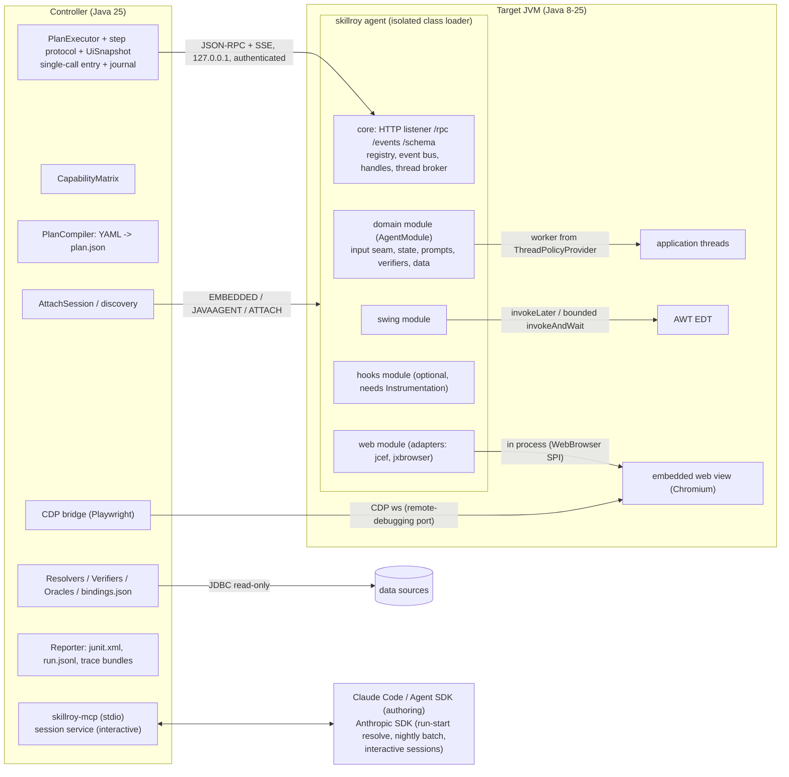

# Skillroy Test (Java): Base Framework Design

Skillroy Test tests long-lived Java desktop applications (Swing, optionally with embedded web views) whose valid test inputs depend on the live environment: which user holds which permission, or which item triggers which rule. Rather than hardcoding fragile test fixtures, a scenario declares what it needs, resolves a matching candidate from the environment, verifies that candidate in-process using the application's own code, and freezes the verified bindings for deterministic, zero-LLM CI replay.

Related documentation:

- [`README.md`](../../README.md) — quick start, zero-code onboarding (`pack: base`), CLI walkthrough, and build instructions
- [`../guides/integration-guide.md`](../guides/integration-guide.md) — building a private product layer (`AgentModule` + `DomainPack`) and tenant overlays (`DomainPackOverlay`)
- [`threat-model.md`](threat-model.md) and [`../../SECURITY.md`](../../SECURITY.md) — trust boundaries, security model, and operational guidance
- [`../licence-audit.md`](../licence-audit.md) — third-party dependency and licence inventory

## Glossary

| Term | Meaning |
|---|---|
| CDP | Chrome DevTools Protocol, exposed by Chromium on a remote-debugging port |
| JCEF | Open-source Java binding of the Chromium Embedded Framework (`org.cef.*`) |
| OSR | Off-screen rendering: an embedded browser paints into a lightweight Swing component |
| DKFM | `java.awt.DefaultKeyboardFocusManager` |
| XTEST | X11 extension `java.awt.Robot` uses to inject native input |
| WM | X11 window manager (CI Xvfb runs without one) |
| ZDR | Zero data retention (model provider API policy) |
| EDT | AWT event dispatch thread |
| HMAC | Keyed hash; here HMAC-SHA256 over request and reply fields using the agent's shared secret (§2.3) |
| SPI | Extension point defined by the base framework and implemented by an agent module or domain pack |
| rung | One fidelity level of an input ladder (§3.7) |
| load mode | How the agent enters the target JVM: `EMBEDDED`, `JAVAAGENT`, or `ATTACH` |
| domain pack | Application-specific integration: an `AgentModule` (target JVM) plus a `DomainPack` (controller) |
| tenant pack | A `DomainPackOverlay` for one customer or deployment variant of an application |
| capability matrix | Per-run probe report classifying every primitive and feature as `OK`, `DEGRADED`, or `UNAVAILABLE` |
| binding | A resolved, verified value for a scenario slot, frozen in `<scenario>.bindings.json` |
| oracle | A committed, pure Java function that computes an expected outcome from resolved bindings |
| profile | Execution profile: CI (`replay`, zero model calls) or interactive (a model may act between steps) (§3.4) |
| session service | Controller component that drives an interactive session, calling the model and executing primitives (§5) |
| journal | Record of calls executed in an interactive session; exports deterministic scenario YAML and bindings (§3.4) |

---

## 1. Summary

The framework is split into two planes across a strict Java version and class-loader boundary:

1. **Java 8 in-JVM agent (`--release 8`)**: zero unshaded third-party classes visible to the host application (unless the user explicitly loads optional Byteman), an isolated class-loader hierarchy, a custom loopback HTTP/1.1 listener with mutual HMAC-SHA256 authentication (`Skillroy-HMAC`), Swing, embedded-web, device, and in-process SQL primitives, an optional shaded Byte Buddy hook module, and a clean `AgentModule` SPI. It supports three load modes (`EMBEDDED`, `JAVAAGENT`, `ATTACH`) with identical primitives.
2. **Java 25 controller (`--release 25`)**: target discovery and attach, capability matrix evaluation, YAML scenario compilation (`plan.json` or on-the-fly execution), deterministic event-driven step execution, candidate resolution, in-process verification and oracles, Playwright over CDP for embedded web views, JUnit 5 `@TestFactory` integration, MCP server, OpenTelemetry span export, and optional vision/interactive tooling.

**Models never run in the CI loop.** An LLM can author scenarios, resolve environment bindings in `live` or `approve` mode, triage failures, or drive an interactive session, but every binding is verified by deterministic application logic and frozen into `<scenario>.bindings.json`. CI runs exclusively in `replay` mode with zero model calls, enforced by a cost-ledger assertion.

**Interactive sessions bridge exploration and regression testing** (§3.4, §5). A developer, an MCP client, or an in-application assistant drives a live target through the controller's `ExecutorSession`. Every action uses the same event-driven step protocol, respects safety and masking policies, is recorded in a `StepJournal`, and exports to an ordinary deterministic YAML scenario.

**Zero-code bring-up to full domain packs.** New targets can run immediately using the built-in `BaseDomainPack` (`pack: base`) with generic Swing, web, event, and device verbs, and progressively layer on a custom `AgentModule`, `DomainPack`, and `DomainPackOverlay` as domain semantics are modeled. The base proves every SPI against its own Swing + HSQLDB sample lending desk (§4) and JCEF sample host.

### 1.1 Stack

| Layer | Choice | Version | Java |
|---|---|---|---|
| Target JVM | HotSpot, Java 8 through 25 (gated on Java 8 and Java 25 targets) | – | 8–25 |
| Agent build | `maven-compiler-plugin` `<release>8</release>`; JDK APIs only (`java.net`, `javax.crypto`, `java.awt`, `javax.swing`, `java.sql`) | – | 8 |
| Agent transport | JSON-RPC 2.0 + SSE over loopback on the agent's own minimal HTTP/1.1 `ServerSocket` listener with mutual `Skillroy-HMAC` authentication (protocol `0.2`) | JDK built-ins | 8 |
| Agent JSON | Minimal reader/writer in `skillroy-protocol`, shared with the controller | – | 8 |
| Hooks (optional) | Byte Buddy + ASM shaded and relocated under `ai.skillroy.testjava.agent.hooks.shaded` in `optional/skillroy-agent-hooks.jar`; `RETRANSFORMATION` + `disableClassFormatChanges` + inline `Advice` + bootstrap `Spy` | 1.18.14 | 8 |
| Ad-hoc rules (optional) | Byteman loaded in-process via reflection with `listener:false` and a curated `RuleHelper` when user supplies `byteman.jar` (LGPL-2.1-or-later, never bundled) | 4.0.27 | 8 |
| Controller | Java 25 bytecode (`--release 25`), built and run on JDK >= 25; Maven >= 3.9 | 25 | 25 |
| Attach | `jdk.attach` (`VirtualMachine`), discovery files, startup margin, JDK 8 `0` reply mapping | JDK built-in | 25 |
| Controller JSON / YAML / schema | Jackson, SnakeYAML Engine (`StrictYaml`), victools `jsonschema-generator` | 2.22.3 / 2.9 / 4.38.0 | 25 |
| Test runner | JUnit Jupiter `@TestFactory` dynamic tests; Surefire / Failsafe `junit.xml` | 5.14.4 | 25 |
| Embedded web views | Controller-side Playwright Java `connectOverCDP` (`skillroy-cdp`) + agent-side `WebEngineAdapter` / `WebBrowser` SPI with reflective `jcef` and `jxbrowser` adapters (`skillroy-agent-web`) | 1.63.0 | 25 / 8 |
| MCP | MCP Java SDK (`mcp-core`, spec `2025-11-25`) over `stdio` | 2.0.1 | 25 |
| Model gateway | Anthropic Java SDK behind `InferenceGateway` SPI (plus recorded and scripted gateways) | 2.70.0 | 25 |
| Vision (optional) | `skillroy-vision` in controller + `swing.capture` / `swing.hitTest` / `swing.pointer` and `web.hitTest` / `web.pointer` in agent; JDK `java.awt.image` / `javax.imageio` | – | 25 / 8 |
| SQL guard / DB | JSqlParser AST allow-list (`SELECT`-only), read-only roles, statement timeouts | 5.4 | 25 |
| Observability | `run.jsonl`, `capabilities.json`, W3C `traceparent`; optional controller-only OpenTelemetry SDK (`otlp` HTTP or `file` exporter, off by default) | 1.66.0 | 8 / 25 |
| CI display (Linux) | `eclipse-temurin:25-jdk` with mounted JDK 8, `Xvfb` (`1024x768x24`, no WM), `fontconfig` + DejaVu fonts | – | – |
| Licence | Apache-2.0 (`LICENSE`, `NOTICE`, `CONTRIBUTING.md` with DCO sign-off; headers verified by `ci/license-headers.sh`) | – | – |

### 1.2 Architecture



### 1.3 Key design choices

| Topic | Options | Choice and rationale |
|---|---|---|
| Loading in CI | Dynamic attach vs launch-time loading | Launch-time loading in CI: `EMBEDDED` where the host has a plugin mechanism (zero launch-flag or bytecode changes) and `JAVAAGENT` for hook-dependent suites and Java 21+ targets (exempt from JEP 451 dynamic-attach warnings). `ATTACH` is for ad-hoc work on running targets. The capability matrix keeps modes explicit (`jvm.instrumentation` and `hook.engine` report `UNAVAILABLE` without `Instrumentation`). |
| Byteman integration | Separate TCP listener vs in-process rule manager | Byteman 4.0.27 loaded in-process on demand with `listener:false` and a custom `RuleManager` / `RuleHelper`. Rules travel exclusively over the agent's HMAC-authenticated control channel, opening no extra port, while keeping the LGPL jar unbundled and user-supplied. |
| Playwright version skew | Pin older version vs newest with capability checks | Pin newest baseline (1.63.0) so `setIsLocal` (1.58+), `setNoDefaults` (1.60+), and `artifactsDir` (1.61+) are available. Options are probed reflectively by field presence so a pack that must pin an older Playwright version degrades cleanly (and refuses < 1.60 without explicit `-Dskillroy.cdp.allowDefaultOverrides=true`). |
| Mode-dependent expectations | Implicitly skip hook checks vs declare capabilities | Hook-dependent expectations are declared in `requires:` (hard precondition) or guarded by `capability:` on an expectation (yielding `DEGRADED` when absent), so `PASS` means the same thing on every target. |
| Agent HTTP server | JDK `com.sun.net.httpserver` vs custom listener | Custom minimal HTTP/1.1 listener on loopback `ServerSocket` (§2.3, §9). Bounds header size, open connections, and pre-auth deadlines before reading bodies, avoids initializing `java.util.logging` in `premain` on Java 8, and writes single-segment `TCP_NODELAY` responses (~1–5 ms vs 45 ms delayed-ACK stalls). |
| In-process web access | Separate module per browser vendor vs single SPI | Single `WebEngineAdapter` / `WebBrowser` SPI in `skillroy-agent-api` with two built-in reflective adapters (`jcef` and `jxbrowser`) in `skillroy-agent-web`, requiring zero vendor compile-time dependencies (§3.8). |
| Default Swing click | `COMPONENT` with window activation vs `ACTION` | `ACTION` is the primitive default; `COMPONENT` with window activation is an opt-in scenario setting (`ui: { clickRung: COMPONENT }`, §3.7). Window activation brings frames to the front, which suits dedicated UI suites on Xvfb but disturbs interactive desktop use. |
| Models during execution | Never vs everywhere | Never in CI (`replay`). Allowed in interactive sessions through `ExecutorSession` with every action journaled for deterministic export (§3.4, §5). |

---

## 2. Agent (in-JVM, Java 8)

### 2.1 Modules (all `--release 8`)

| Module | Contents |
|---|---|
| `skillroy-protocol` | Wire DTOs, JSON-RPC and SSE event envelopes, error codes, schema-catalogue format, shared `Skillroy-HMAC` signing/verification helpers, `PayloadMatch`, JS-injected web helper scripts, and shared SQL statement guard / value conversion (`…protocol.sql`). Shared with the controller. |
| `skillroy-agent-api` | Public agent SPI: `AgentModule`, `Primitive`, `EventSink`, `HandleRegistry`, `ThreadPolicy`, `ProbeResult`, `Capability`, and all SPI interfaces in `…agent.api.spi`, `…spi.web`, and `…spi.hook` (§2.6). Loaded inside the isolated agent class loader, never on the host class path. |
| `skillroy-agent-spy` | Single bootstrap bridge class `Spy` (`Spy.Handler`, `Spy.Stub`, weak set-once handler slot released by identity, `VERSION = 1`). Ships as `skillroy-agent-spy.jar` at the agent home root and is appended to the bootstrap class-loader search path at most once per JVM on the first `hook.install`. |
| `skillroy-agent-bootstrap` | Manifest (`Agent-Class`, `Premain-Class`, `Launcher-Agent-Class`, `Can-Retransform-Classes`, `Can-Redefine-Classes`, `Can-Set-Native-Method-Prefix`), idempotent `premain` / `agentmain`, re-entrant `EmbeddedAgent.start` / `startAsync` / `stop`, isolated loader creation, enable gate, and `mainClassGuard`. |
| `skillroy-agent-core` | Custom loopback HTTP/1.1 `ControlServer`, `JsonRpcDispatcher`, `SseBroadcaster` (10k ring buffer, `Last-Event-ID` resume), `PrimitiveRegistry` and schema catalogue, `EventBus` (with publish-time secret and `MaskPolicy` redaction), `ObjectRegistry` (weak handles), `ThreadBroker` (including named lanes and `QuiescentPoint`), `ProbeRunner`, `ModuleLoader`, and `ProductionMarker` safety gate. |
| `skillroy-agent-swing` | Window/tree/accessibility snapshot, locators (including effective visible-area filtering), click rungs (`ACTION`, `COMPONENT`, `DISPATCH`, `ROBOT`), AWT `Button`/`Checkbox` semantic firing, `InputVeto` enforcement, non-posted key dispatch, dialog inspection/dismissal (`DialogLocator`, `DialogTextExtractor`), redacted root-pane `PAINT` and `ROBOT` capture, `swing.hitTest`, routed and Robot `swing.pointer`, `swing.rendering`, AWT event tap, and EDT settle. |
| `skillroy-agent-web` | Generic `web.*` primitives implemented against `WebEngineAdapter` / `WebBrowser` / `BrowserMask` plus two zero-dependency reflective adapters (`jcef` and `jxbrowser`). Publishes a `test-jar` containing the `WebEngineAdapterContract` test kit. |
| `skillroy-agent-data` | `data.sources` and `data.query` over `DataSourceProvider` (single guarded `SELECT`, row cap <= 200, `QueryControl` cancellation, named lanes, positional column derivation, `MaskPolicy`). |
| `skillroy-agent-bytebuddy` | Shading-only module that relocates Byte Buddy and ASM under `ai.skillroy.testjava.agent.hooks.shaded` and strips JNA references. |
| `skillroy-agent-hooks` | Optional hook engine (`optional/skillroy-agent-hooks.jar`, loaded via `optionalModules=skillroy-agent-hooks`): `hook.probe`, `hook.install`, `hook.stub`, `hook.remove`, `hook.health`, `hook.events`; `OBSERVE`, `CAPTURE`, and `STUB` modes; `codeSource` and class `deny` enforcement; byte-verified class restoration on remove/detach. |
| `skillroy-agent-byteman-sys` | Optional system-classpath bridge (`RuleManager` and curated `RuleHelper` with observe-only `fired`, counters, flags, and bounded `format`), compiled against Byteman at `provided` scope without bundling Byteman. |
| `skillroy-agent-byteman` | Optional module (`optional/skillroy-agent-byteman.jar`): reflects into user-supplied `byteman.jar` in-process (`listener:false`), enforces the class deny-list, and serves `rule.check`, `rule.submit` (requires `confirm`), `rule.unload`, and `rule.list`. |
| `skillroy-agent-dist` | Assembles the versionless agent home directory and `.zip` (`skillroy-agent-bootstrap.jar`, `skillroy-agent-spy.jar`, `lib/`, `modules/`, `optional/`), verified by constant-pool and class-loader isolation integration tests. |

### 2.2 Load modes and lifecycle

**1. Load.** Three modes expose identical primitives; `/ping` reports the active mode.

- **`EMBEDDED`.** The host's plugin mechanism invokes `EmbeddedAgent.start(Properties, ClassLoader, Object)` or non-blocking `EmbeddedAgent.startAsync(...)` (callable by reflection using JDK types only). `hostContext` is passed to modules via `AgentContext.hostContext()`. Idempotent, re-entrant, and never throws. Because `Instrumentation` is absent in `EMBEDDED` mode, `jvm.instrumentation` and `hook.engine` report `UNAVAILABLE`.
- **`JAVAAGENT`.** `-javaagent:<home>/skillroy-agent-bootstrap.jar=<options>` (directly or via `JAVA_TOOL_OPTIONS`). `premain` stores `Instrumentation` and starts the core. When injected broadly through `JAVA_TOOL_OPTIONS`, `mainClassGuard=<mainClassOrJar>` ensures `premain` returns immediately in unrelated JVMs (such as build tools or wrapper scripts). Neither the `-javaagent` argument string nor its options file can enable the agent; an explicit property or env var is required. Launch-time `-javaagent` is exempt from JEP 451 warnings on Java 21+.
- **`ATTACH`.** Dynamic load into a running JVM via `VirtualMachine.attach` (`skillroy attach <pid>`).
  - *Discovery:* `VirtualMachine.list()` (same OS user) and per-user discovery files. Attach targets the application child JVM, never a supervisor launcher.
  - *Argument cap:* HotSpot caps attach arguments at 1024 bytes, so `AttachSession` writes options, nonce, and token path into an owner-only options file and passes only `t=<options-file>`, refusing payloads >= 1024 bytes upfront.
  - *Startup margin:* Sending an attach signal too early can terminate a starting JVM; `AttachSession` waits until a target JVM is at least 5 s old.
  - *JDK 8 `0` reply:* Attaching from JDK 10+ to a JDK 8 target raises `AgentLoadException("0")` on success; `AttachSession` maps `"0"` / `": 0"` to success for Java <= 8 targets and maps `100`/`101`/`102`/`-4` to structured load errors.
  - *JEP 451:* JDK 21+ targets warn on dynamic attach and reject it under `-XX:-EnableDynamicAgentLoading`; prefer `JAVAAGENT` on modern targets.
  - *Windows:* Requires matching user, logon session, integrity level, and bitness; `JAVAAGENT` is recommended for CI and services (Windows paths are unverified on a live Windows host).

**2. Mutual handshake and discovery.** Attachment is confirmed only after a mutual `GET /ping?nonce=...` check signed with `Skillroy-HMAC` and verifying matching protocol major (`0.2`). Connection metadata (loopback port, session ID, token file path) is written to an owner-only (`0600` / single-ACE) discovery file `skillroy-<pid>-<jvmStartTimeMs>.json` inside `${java.io.tmpdir}/skillroy-<user>` (falling back to `~/.skillroy/run`). Stale discovery files for dead PIDs or superseded start times are cleaned up automatically.

**3. Readiness gate.** `AgentModule.install` runs at agent start and may only register primitives, SPIs, and capabilities — never touching application singletons or AWT. `ProbeRunner` polls all `ReadinessSource`s every 250 ms and invokes `onTargetReady` on a worker thread once all report ready (marking `target.ready` `UNAVAILABLE` after `readyTimeoutMs`, default 120 s, while continuing to poll).

**4. Module wiring.** `onTargetReady` wires application listeners (typically at an application quiescent point) and chains any occupied seams (input sources, prompt handlers) so prior occupants are preserved and restored on detach. If the application boots directly into a modal prompt before reaching a quiescent point, the module reports ready without its listener so the agent can answer the prompt first, then attaches the listener once answered.

**5. Probes and capability matrix.** Every primitive and hook declares a `Probe` yielding `OK`, `DEGRADED(reason)`, or `UNAVAILABLE(reason)`, served at `/capabilities` and archived per run in `capabilities.json`.

**6. Disable and detach.** Triggered by `agent.disable`, `EmbeddedAgent.stop()`, or `cmd=stop`. Restores chained seams, removes listeners, disarms `Spy` handlers, retransforms hooked classes back to their original bytes within `hooks.detachBudgetMs` (8 s, byte-verified against pre-transform captures), stops the HTTP listener, and drops module class loaders so zero agent threads remain.

**7. Safety gates.**
- *Enable gate:* Checked before starting any thread or socket. Requires `-Dskillroy.agent.enabled=true` or `SKILLROY_AGENT_ENABLED=true` (plus `enabled=true` in `EMBEDDED` `Properties` or `ATTACH` options).
- *Production gate:* Evaluated at readiness before `onTargetReady`. Until all `ProductionMarker`s pass, mutating primitives answer `NOT_READY`. If any marker matches (returns a non-null reason) or throws, or if `requireProductionMarker=true` and none is registered, the agent records `skillroy.agent.error` and shuts down immediately.
- *Runtime guards:* `readOnly=true` blocks all `mutating` and `script` primitives and `STUB` hooks; destructive primitives require `confirm: true` from a human operator; `InputVeto` blocks delivery to dangerous UI controls across every input route; every wait is bounded; secret keys in properties, JVM args, options, and event payloads are redacted before leaving the JVM.

### 2.3 Control channel and protocol

`skillroy-agent-core` runs a custom minimal HTTP/1.1 server on a `127.0.0.1` `ServerSocket` using Java 8 built-ins only (`java.net`, `javax.crypto`):

- **Pre-authentication bounds:** One acceptor thread dispatches to a bounded, zero-queue worker pool (`httpThreads`, default 32; at most 8 concurrent `/events` SSE streams). When full, the oldest unauthenticated connection is evicted first. Request headers are read into a fixed 16 KB buffer (max 64 headers) under a 5 s deadline. `Host` must match `127.0.0.1:<port>` or `localhost:<port>`, and any request carrying a browser `Origin` header is rejected with `403`.
- **Mutual HMAC authentication (`Skillroy-HMAC`):** The 32-byte random token in the owner-only token file never travels on the wire. Every request carries `Authorization: Skillroy-HMAC` with a client nonce, `X-Skillroy-Body-Sha256`, and an HMAC-SHA256 over the agent's session ID, nonce, HTTP method, path/query, and body SHA-256. The agent verifies the MAC on the request head *before* reading any request body (bodies require `Content-Length` <= 8 MB under a 30 s deadline). Every authenticated reply carries `X-Skillroy-Mac` and `X-Skillroy-Session`, which `AgentClient` verifies before parsing the response. On session change, invalid MAC, `401`, or target exit, `AgentClient` transitions to a terminal *lost* state.
- **Low-latency framing:** Every socket sets `TCP_NODELAY`, keep-alive is restricted to authenticated connections (`httpIdleTimeoutMs`, default 120 s), and every HTTP response and SSE frame is written in a single buffer write.

```text
POST /rpc           JSON-RPC 2.0 (single or batch)
GET  /events        SSE (?since=<seq>&topics=...), 15 s heartbeat, Last-Event-ID resume from 10k ring, explicit gap event
GET  /schema        Primitive catalogue (JSON Schema 2020-12 in/out, flags, timeoutMs, thread, capabilityId)
GET  /capabilities  Capability matrix {id: {state, reason, strategyInUse}}
GET  /ping?nonce=   Mutual HMAC handshake and protocol-major check
```

Example `/rpc` call and reply:

```json
{"jsonrpc":"2.0","id":"c-17","method":"lending.input","params":{"source":"Key.DUE",
  "ackTimeoutMs":5000,"_meta":{"correlationId":"s1-step4","traceparent":"00-...-01"}}}
{"jsonrpc":"2.0","id":"c-17","result":{"value":{"accepted":true,"inputId":"in-4","consumed":"CONSUMED"},
  "events":[{"seq":1042,"topic":"state.changed","payload":{"from":"LOAN","to":"DEPOSIT"}}],
  "seq":{"before":1041,"after":1043},"durationMs":4,"thread":"skillroy-lending-worker"}}
```

**Error codes:** Standard JSON-RPC (`-32700..-32600`), `-32001 TIMEOUT`, `-32002 FORBIDDEN_THREAD`, `-32003 STALE_HANDLE`, `-32004 MODAL_OPEN`, `-32005 INPUT_REJECTED`, `-32006 NOT_FOUND`, `-32007 AMBIGUOUS`, `-32010 CAPABILITY_DEGRADED`, `-32011 CAPABILITY_UNAVAILABLE`, `-32020 HOOK_VERIFY_FAILED`, `-32030 CONFIRM_REQUIRED`, `-32031 READ_ONLY`, `-32032 NOT_READY`.

### 2.4 Primitive catalogue

`*` denotes primitives requiring `Instrumentation` (`JAVAAGENT` or `ATTACH`).

```text
agent.info / agent.capabilities / agent.log / agent.selftest / agent.disable
jvm.info / jvm.threads / jvm.properties / jvm.logTail / jvm.classes.find*
app.state
obj.grab / obj.call / obj.describe / obj.get / obj.release
hook.probe* / hook.install* / hook.stub* / hook.remove / hook.health / hook.events
rule.check / rule.submit* / rule.unload / rule.list
swing.windows / swing.snapshot / swing.find / swing.click / swing.type / swing.key
swing.dialogs / swing.dismiss / swing.capture / swing.hitTest / swing.pointer / swing.rendering / swing.edtState / swing.settle
web.browsers / web.evaluate / web.waitFlag / web.ariaSnapshot / web.dom.click / web.dom.fill / web.dom.text
web.dispatchEvent / web.tap / web.resize / web.bitmap / web.reload / web.initScript / web.cdp.status / web.hitTest / web.pointer
data.sources / data.query
device.list / device.state / device.act
sync.await / sync.quiescence / evt.query / trace.mark / trace.bundle
```

Domain modules contribute their own `<domain>.*` namespace (for example `lending.input`, `lending.state`, `lending.loan`, `lending.prompt`, `lending.prompt.answer`, `lending.signOn`, `lending.scanChecked`, `lending.access.check`, `lending.deposit`, `lending.waiver.evaluate`). Raw hook/rule mutation primitives (`hook.probe`, `hook.install`, `hook.stub`, `hook.remove`, `rule.check`, `rule.submit`, `rule.unload`) are never projected to MCP clients or LLMs.

### 2.5 Observation model and step protocol

`UiSnapshot {seq, ts, app{...}, surfaces[SWING | WEB | DEVICE], text}` provides a unified, token-bounded (~4k tokens) representation with stable refs consumed identically by the executor, CLI, and models. Swing component names resolve from the first non-empty of `NameEnricher`, `AccessibleContext`, and `Component.getName()`.

The step protocol uses zero `Thread.sleep` calls. Parameterized by the pack's `SyncPolicy`, each step executes:

> **act -> await `ackTopic` (optionally correlated by `{inputId}`) -> await first of `{readyTopics, web.ready, window.opened}` -> `swing.settle` (EDT round-trip) -> evaluate expectations (retried until step timeout, default 10 s)**

Each planned call specifies its `Sync` mode: `NONE`, `ACK`, `READY`, `SETTLE`, or `EVENT` (matching scalar equality or `{has: scalar}` list membership via `PayloadMatch`, starting from `seq.before`).

- **Publish-time event masking:** Before storing any event in the ring buffer, `EventBus` redacts values under secret-looking keys and runs every registered `MaskPolicy` with `sourceId = "event:<topic>"` and dotted field paths.
- **Warnings and `events` fact root:** Primitives can attach structured warnings (`inv.warn(code, message, data)`, e.g. `VALUE_COERCED`, `VALUE_DROPPED`), which fail the step unless listed in `accept: [...]`. Scenarios can also assert directly over the run's event bus window via the `events` fact root (e.g. `"events[*topic=prompt.waiting]": { size: 0 }`).

### 2.6 Extension SPI and hook policy

```java
public interface AgentModule {
  String id();
  String version();
  Set<String> requires();
  void install(AgentContext ctx);       // register primitives, SPIs, capabilities only
  void onTargetReady(AgentContext ctx); // wire listeners and seams once ReadinessSources pass
  void uninstall();                     // detach listeners and close registration handles
}
```

| SPI | Purpose |
|---|---|
| `ReadinessSource` | Reports when application singletons are safe to touch (polled every 250 ms) |
| `ThreadPolicyProvider` | Routes `ThreadPolicy.APP` calls, identifies forbidden threads, and optionally exposes a `QuiescentPoint` for `APP_QUIESCENT` reads |
| `AppStateProvider` | Contributes domain state to `app.state` and `UiSnapshot.app` |
| `NameEnricher` | Supplies accessible names for icon-only or custom-painted Swing components |
| `LocatorResolver` | Resolves custom locator strategies (e.g. `{action: "DUE"}`) and `describe()`s components for hit-testing |
| `ActionFirer` | Fires custom widgets semantically on the `ACTION` rung without requiring window focus |
| `DialogTextExtractor` | Extracts title, message text, and option labels from custom dialogs |
| `DialogLocator` | Discovers in-window modal overlays (glass panes, internal frames) so `MODAL_OPEN` and `swing.dismiss` work uniformly |
| `RegionResolver` | Maps custom-painted sub-areas (such as keypad regions) to stable region IDs and bounds |
| `CaptureMask` | Blanks sensitive Swing components in captures and withholds their text across all tree/dialog readers |
| `InputVeto` | Refuses input delivery to dangerous controls (such as exit/shutdown actions) across every Swing, key, and pointer route |
| `MaskPolicy` | Masks sensitive columns in `data.query`, `CAPTURE` hook arguments/results, Byteman bindings, and `event:<topic>` payloads |
| `RedactionKeys` | Contributes application-specific secret key patterns for property, argument, and option redaction |
| `DataSourceProvider` | In-process read-only SQL channel (`open()` JDBC connection or 5-arg cancellable `query(..., QueryControl)` with optional `lane()`, `columns(table)`, and `exposesErrorText()`, which defaults to `true`) |
| `DeviceAdapter` | Exposes simulated or physical peripherals (`device.list`, `device.state`, `device.act`) with optional rung ladders |
| `ProductionMarker` | Identifies production installations and forces the agent to shut down before serving mutating calls |
| `WebEngineAdapter` | Reflective bridge to an embedded browser engine (`jcef` and `jxbrowser` built in) |
| `BrowserRegistryAdapter` | Supplies `BrowserSeed`s (with optional tags) for off-tree or pre-loaded embedded browsers |
| `BrowserMask` | Masks (`TRUE`) or releases (`FALSE`) embedded browsers by seed tag or vendor instance (view-less browsers default to masked when any mask is active) |
| `SurfaceSource` | Identifies non-Swing surfaces (such as embedded browsers) for capture metadata, masking, and hit-testing |
| `HookEngine` | Programmatic hook access via `ctx.hooks()` for domain modules on agent worker threads |
| `ClassDeny` | Refuses bytecode instrumentation of named classes before class bytes are read |

**Hook policy:**
- **Zero hooks on the default path.** Every catalogued hook in `META-INF/skillroy/hooks/<packId>.yaml` declares ordered fallbacks whose first entry must be a public `seam` primitive.
- **Strict bounds and scoping.** The hook engine never loads unloaded target classes, refuses JDK/agent/Byteman packages and strict-delegation loaders that cannot see bootstrap `Spy`, caps targets at 256 KiB / 2,000 methods and 64 hooked classes total, filters by optional JAR `codeSource` regexes, and enforces additive class `deny` patterns (`hooks.deny` option, catalogue `deny:`, and `ClassDeny` SPI — also enforced by Byteman before loading).
- **Safe advice and verified detach.** Inlined Byte Buddy `Advice` delegates in two lines to bootstrap `Spy`; `CAPTURE` values are bounded and masked without invoking arbitrary `toString()`; detach retransforms and verifies byte-for-byte restoration.

---

## 3. Controller (Java 25)

### 3.1 Modules

| Module | Contents |
|---|---|
| `skillroy-controller` | `AttachSession`, target discovery, `TargetLauncher`, `AgentClient` (mutual `Skillroy-HMAC` over HTTP/1.1 + SSE resume), `CapabilityMatrix`, `SecureFiles`. |
| `skillroy-data` | `DataChannel` (`data.query` and controller-side read-only JDBC), `Credentials` (`credentials.yaml`), `SecretMask`, `RowMask`, `StrictYaml`. |
| `skillroy-scenario` | YAML scenario loader, `PlanCompiler` (`plan.json`, plan version 7), `ResolutionEngine` and `Binder` (`.bindings.json`), `PlanExecutor`, `ExecutorSession` and `StepJournal`, expectation path/filter evaluator, `UiSnapshot` renderer, `DomainPack` / `DomainPackOverlay` / `DelegatingDomainPack`, built-in zero-code `BaseDomainPack` (`pack: base`), `HookCatalogues` and `HookInstaller`, image baseline comparison, `RunObserver` SPI, and JSON Schema generator (`ScenarioSchema`). |
| `skillroy-inference` | `InferenceGateway` SPI (`ClaudeGateway`, `RecordedGateway`, `ScriptedGateway`), `LlmSqlResolver` (`inference.sql`) + `SqlGuard` + `AllowListCheck`, `PromptMask`, `BudgetMeter` and `PriceTable` (with fallback pricing for unlisted model IDs), batch `re-resolve`, failure `triage`, headless authoring planner, `SessionService`, and `OverlayBridge`. |
| `skillroy-cdp` | Optional Playwright `connectOverCDP` `WebPath` implementation (`ServiceLoader`): liveness probe, external deadline, target-id page mapping, readiness, tracing, and reflective Playwright version-floor gating. |
| `skillroy-junit` | `ScenarioTests` JUnit 5 `@TestFactory` harness (one dynamic test per scenario, `environment` check, `skillroy: zero model calls` assertion in `replay`, and `OutputScan` leak testing). |
| `skillroy-mcp` | Stdio MCP server (`skillroy mcp`) projecting domain verbs, permitted primitives, workflow/session tools, and `skillroy://` resources under `Origin.Kind.CLIENT`. |
| `skillroy-cli` | `skillroy` distribution (`bin/skillroy`, `bin/skillroy.bat`): `jvms`, `attach`, `info`, `caps`, `schema`, `call`, `snapshot`, `events`, `compile`, `run`, `resolve`, `diff-bindings`, `re-resolve`, `mcp`, `author`, `triage`, `session`, `hooks`, `packs`. |
| `skillroy-telemetry` | Optional OpenTelemetry `RunObserver` (`otlp` HTTP sender and `skillroy-spans/1` `file` exporter, attribute allow-list, zero target-JVM footprint). |
| `skillroy-vision` | Optional controller vision bolt-on (`VisionSessionTools` via `SessionTools`, V1/V2/V3 screenshot-act grounding, custom and computer-use tool adapters, mark rendering, coordinate-to-locator `Recorder`, `VisualQuestion`, `ScenarioPlayer`). |

### 3.2 Scenario DSL

Scenarios are authored in YAML:

| Key | Meaning |
|---|---|
| `scenario`, `pack`, `tags` | Scenario ID, `DomainPack` ID (optional when using built-in `base` pack), and filter tags |
| `requires` | Required capability IDs (`a \| b` for alternatives); missing -> `PRECONDITION_FAILED` |
| `launchProperties` | System properties the target JVM must have been launched with (verified, never mutated) |
| `resolve` | DAG of typed queries (`$slot.field`), strategies (`fixture`, `sql`, `java`, `llm-sql`), verifiers, and `credential` joins |
| `oracle` | Committed pure Java functions over resolved slots, optionally with `must_equal` guards or `crossCheck`s |
| `steps` | Sequence of base or pack verbs, optional `expect` blocks, and step modifiers (`accept: [WARN]`, `minRung: NAME`) |
| `verify` | End-of-scenario assertions over fact roots and allow-listed `db.<table>` rows (including aggregates) |
| `on_prompt` | Handling of unexpected prompts: `{ unexpected: fail \| pack }` |
| `ui`, `web` | Scenario click fidelity (`{ clickRung: ACTION \| COMPONENT, strict: bool }`) and web routing (`{ path: auto \| cdp \| agent, ... }`) |
| `artifacts`, `timeouts` | Evidence retention (`capture`) and `step` / `bind` timeouts |

`PlanCompiler` compiles YAML deterministically into `plan.json` (version 7). Both `skillroy run` and `ScenarioTests` can execute `.yaml` scenarios directly in memory or validate committed `plan.json` files via `skillroy compile --check`. Expectations support path navigation, list filters (`[*field=value]`) with `size`, `captureFacts` deltas, `anyOf`, `containsWhere`, `[json]` parsing, `expectImage` baseline checks, and `events` bus queries. Plans containing live runtime vision steps (`aiAct`, compiled with `inference: run`) are reported `SKIPPED` in `replay`.

### 3.3 Resolver, verifier, and oracle model

Resolvers return ordered `ResolverCandidate<T>` lists; `ResolutionEngine` runs the configured `Verifier`s in the target JVM and constructs the `Resolution`:

- **Tier (a) (`sql`, `java`):** Deterministic SQL or Java queries from the pack's `ResolutionCatalogue` over `data.query` or controller-side read-only JDBC.
- **Tier (b) (`llm-sql`):** Model-generated `SELECT` validated by `SqlGuard` and `AllowListCheck`, executed with an injected deterministic `ORDER BY`, decoded leniently into `Record` candidates (ignoring extra `ORDER BY` projection columns), gated by in-process `Verifier`s and confidence threshold (default `0.6`), and marked `REQUIRED` until human approval.
- **Tier (c) (interactive):** Model reasoning over live primitives during authoring or `skillroy session`, exported as ordinary deterministic steps.

**Oracles and cross-checks:** `Oracle<I, O>` implementations are pure, unit-tested Java functions. `must_equal` acts as a bind-time precondition on candidate selection; `CrossCheck` compares the oracle's output against a dry run of the application's own rule in-process at bind time, raising `ORACLE_SUSPECT` (`ERROR`) on any discrepancy.

### 3.4 Record and replay

`<bindingsRoot>/<envId>/<scenario>.bindings.json` stores resolved slot values (semantic IDs only, never secrets), provenance, verifier results, approval records, oracle outputs, and the `EnvFingerprint`. Bindings are keyed to `resolveHash` (the hash of `resolve:` and `oracle:` definitions) and per-slot `argsHash` rather than the full `planHash`, so editing steps or expectations does not invalidate committed bindings.

| Mode | Profile | Model calls | Behaviour |
|---|---|---|---|
| `replay` | CI | Zero (asserted) | Re-verifies frozen bindings and checks `EnvFingerprint`; any mismatch fails fast as `REBIND_NEEDED`. |
| `approve` | Interactive | Tier (b) on unapproved/stale slots | Prompts operator with value, SQL, rationale, verifier proof, and cost; writes approved `.bindings.json`. |
| `live` | Interactive | Allowed | Resolves on demand; writes bindings only when `--write-bindings` is passed. |
| `re-resolve` | Scheduled batch | Anthropic Batch API (budgeted) | Re-resolves stale environments in graph rounds and emits updated `.bindings.json` files + review report for a PR. |

All interactive hosts (`skillroy session`, `skillroy mcp`, `skillroy author`, `OverlayBridge`, and `skillroy-vision`) act exclusively through `ExecutorSession` (the single-call entry to the step protocol) and record every step in `StepJournal` for clean YAML export. MCP clients and models run under restricted `CallPolicy` origins that can never supply `confirm: true`, `force: true`, `redact: false`, or Robot flags.

### 3.5 Failure taxonomy

Classification is deterministic and runs before any optional LLM triage:

| Kind | Status | Meaning |
|---|---|---|
| `ASSERTION` | `FAIL` | Expectation mismatch, unexpected prompt, `MODAL_OPEN`, `INPUT_REJECTED`, unaccepted warning, or rung below `minRung` |
| `SYNC_TIMEOUT` | `FAIL` | Expected ack, ready, or settle condition timed out |
| `PRECONDITION_FAILED` | `ERROR` | Missing `requires:` capability, unsatisfied `minRung` capability, or mismatched `launchProperties` |
| `REBIND_NEEDED` | `ERROR` | `EnvFingerprint`, `resolveHash`, verifier, or `IMAGE` render-key baseline mismatch in `replay` |
| `RESOLUTION_FAILED` | `ERROR` | No candidate in the environment satisfied a slot's query, verifier, or budget |
| `ORACLE_SUSPECT` | `ERROR` | Committed `Oracle` disagreed with its in-process `CrossCheck` |
| `TARGET_RESTARTED` | `ERROR` | Target JVM PID changed mid-run |
| `AGENT_LOST` | `ERROR` | Control channel or HMAC session dropped while target PID remained alive |
| `ENVIRONMENT` | `ERROR` | Handshake, database, credentials, hook install, or `PreflightCheck` failure |

Runs whose expectations hold while skipping a capability-guarded check or falling back on a click/device rung finish as `DEGRADED`. Plans with `inference: run` finish as `SKIPPED` in `replay`.

### 3.6 `DomainPack` SPI and tenant overlays

`DomainPack` defines the controller-side contract for an application: `steps()`, `syncPolicy()`, `facts()`, `promptPolicy()`, `preflight()`, `capabilities()`, `warningCodes()`, `recover()`, `resolution()`, `fingerprinter()`, `storedTables()`, `rowMasks()`, `sqlAllowLists()`, `assistAnswerPrimitive()`, `hooks()`, `settings()`, and `screenLegend()`. Eight base fact roots (`app`, `ui`, `dialogs`, `caps`, `devices`, `web`, `hooks`, `events`) are built in, and `BaseDomainPack` (`pack: base`) lets scenarios run before any custom Java pack is written.

Deployment variants use `DomainPackOverlay` + `DelegatingDomainPack`, discovered via `ServiceLoader` from a separate overlay JAR. Overlays preserve the base pack ID (recording `<baseVersion>+<overlayId>@<overlayVersion>` in plans) while overriding `PackSettings`, SQL resolvers, allow-lists, or hook catalogues (`HookCatalogues.overlay`) without modifying scenario YAML files.

### 3.7 Swing driving

**Input ladder** (every action reports the rung and fidelity that fired):

1. `SEMANTIC` — domain primitive (`<domain>.input`) feeding the application's own input seam, or `swing.type` in `SET` mode.
2. `ACTION` — custom `ActionFirer`, `AbstractButton.doClick()`, or semantic `ActionEvent`/`ItemEvent` for AWT `Button`/`Checkbox` (primitive default; independent of window focus).
3. `COMPONENT` — optional window activation (`toFront()` + `requestFocus()`), `requestFocusInWindow()`, bounded focus wait, then `doClick()` (opt-in per scenario via `ui: { clickRung: COMPONENT, strict: bool }`, falling back to `ACTION` as `DEGRADED` unless `strict: true`).
4. `DISPATCH` — synthetic `MouseEvent` / `KeyEvent` dispatched directly to the target component on the EDT (`Component.dispatchEvent`), bypassing DKFM focus drops.
5. `ROBOT` — native OS pointer input via `java.awt.Robot` behind a double opt-in (`robot=true` on agent + `--allow-robot` on controller).

**Visibility, vetoes, dialogs, EDT, and capture:**
- Locators match only components with a non-empty effective visible area (excluding zero-size or clipped-away panes while keeping `JViewport`-scrolled views reachable).
- `InputVeto` is checked on the target and its ancestor chain (including popup invokers and `ENTER` default buttons) before and during every posted task and pointer event.
- Dialogs are dismissed via `SEAM` (domain prompt answer), `BUTTON_ACTION`, or `OPTION_VALUE` (`JOptionPane`), never bare `dispose()`, and `DialogLocator` extends modal detection to in-window overlays.
- Reads use bounded `invokeAndWait`; mutating UI actions use `invokeLater` + `swing.settle` so opening a modal dialog never deadlocks an agent worker.
- `swing.capture` defaults to `PAINT` from the window's `JRootPane` (avoiding Linux X11 toolkit imitation decorations) and blanks `JPasswordField`s, `CaptureMask` components, and masked browser surfaces grey before bytes leave the JVM. Routed `swing.pointer` events source from the innermost unclaimed heavyweight container so AWT `Panel`-hosted UIs work alongside Swing.

### 3.8 Embedded web views: CDP and in-process SPI

Every `web.*` verb runs over either controller-side CDP (`skillroy-cdp`) or the agent's in-process SPI (`skillroy-agent-web`), controlled by `web: { path: auto | cdp | agent }`:

- **CDP path (`skillroy-cdp`):** Attaches Playwright (`connectOverCDP` with `noDefaults` and `isLocal`) to an engine remote-debugging port configured at launch. Runs an upfront `/json/list` + per-target `Runtime.evaluate("1")` liveness probe under an external deadline so frozen renderers fail fast as `FROZEN_TARGETS` rather than hanging Playwright, never calls `newContext()`/`newPage()`, and maps pages deterministically by `cdpTargetId`.
- **In-process path (`skillroy-agent-web`):** Implements `WebEngineAdapter` and `WebBrowser` (`…agent.api.spi.web`) with two zero-dependency reflective adapters:
  - `jcef`: Uses JCEF's in-process DevTools protocol methods (`executeDevToolsMethod` + dedicated DevTools message observer to avoid `CefDevToolsClient` early-reply races, falling back to `getDevToolsClient()`), needing no remote-debugging port. Tested in CI under `-Pjcef` against real JCEF 152 on Linux.
  - `jxbrowser`: Reflectively resolves the common API across JxBrowser lines 7, 8, and 9 from `BrowserRegistryAdapter` seeds without shipping vendor code or reading licence keys; tested publicly against a shape-compatible fake and verified with `WebEngineAdapterContract` against JxBrowser 8.18.3 on macOS arm64.
- **Masking:** Because DOM elements are not individually masked in rasters, `CaptureMask` (on the Swing host component) and `BrowserMask` (by seed tag or vendor object; view-less browsers masked by default when any mask is active) mask sensitive pages across captures, snapshots, hit-tests, events, and locator actions.

### 3.9 Devices, data, and thread lanes

- **Devices:** `DeviceAdapter` exposes peripherals (`PrinterDevice`, `ScannerDevice`) with state snapshots, events, and optional rung ladders (`PHYSICAL` vs `SEMANTIC`) enforced via `minRung`.
- **Data channels:** In-process `data.query` (`DataSourceProvider`) runs on dedicated named lanes (`ThreadBroker.declareLane`) or nested workers with `QueryControl` cancellation so a slow query cannot starve unrelated calls, and derives column names from SQL aliases or `columns(table)` for positional sources. Controller-side read-only JDBC connects using credentials from `credentials.yaml` and masks results with `DomainPack.rowMasks()`.
- **`SqlGuard`:** Enforces single `SELECT` ASTs (procedure `CALL`/`EXEC` statements are refused), allow-listed tables/columns (`AllowListCheck` verifies declared columns exist while tolerating extra unenumerated database columns), deterministic `ORDER BY`, and `LIMIT <= 200`.
- **`APP_QUIESCENT`:** Primitives reading state confined to an application thread between inputs run via `QuiescentPoint` with a strict millisecond budget driven by the application's idle callback.

### 3.10 Vision and coordinate input

`skillroy-vision` integrates into `SessionService` via `SessionTools` / `SessionActions` across three tiers:

- **V1 (ref grounding, default):** Model views a redacted `PAINT` capture annotated with component marks alongside the text snapshot and selects a component ref, executing through standard deterministic Swing/web rungs.
- **V2 (JVM-routed pixel):** Model selects `(x, y)` on a window capture; `Recorder` runs `swing.hitTest` / `web.hitTest`, resolves the preferred domain/component locator (or `RegionResolver` region, or fractional coordinate crop guard), and executes the replayable step so recording and CI replay exercise identical paths.
- **V3 (Robot glass input, double opt-in):** Uses `java.awt.Robot` within target window bounds when both `robot=true` and `--allow-robot` are set.

Visual assertions use deterministic `expectImage` (exact pixel match after masks, keyed per rendering environment by a render key under `<scenarioId>.images/`) or live-only `aiExpect` (guarded by `inference.vision`, yielding `DEGRADED` in `replay`). Images never leave the controller for a model provider unless `images: true` is set in `inference.yaml`.

---

## 4. The sample lending desk

The sample lending desk (`samples/`, domain ID `lending`) is a self-contained `--release 8` Swing + HSQLDB application modeling a community tool library issue desk. Staff sign on, scan items for loans or returns, apply `BORROW_N_WAIVE_M` deposit waivers, enforce per-role return limits under a system ceiling (prompting for supervisor override when exceeded), and print loan slips. A second deployment variant ("branch edition", `skillroy-sample-lending-pack-branch`) exercises `DomainPackOverlay` over a modified schema, setting key, and hooked method.

| Sample feature | Framework capability exercised |
|---|---|
| Blocking engine input queue that drops invalid state inputs | `ReadinessSource`, `ThreadPolicyProvider`, `QuiescentPoint`, `SyncPolicy` (`ackByInputId`), `SEMANTIC` rung, `INPUT_REJECTED`, warnings, composite primitives |
| Icon-only focus-sensitive keypad buttons (`DUE`, `DEPOSIT`, `RETURN`, ...) and custom painted pad | `NameEnricher`, `LocatorResolver`, `ActionFirer`, `RegionResolver`, `CaptureMask`, `InputVeto` |
| Custom modal prompts ("Supervisor required", induction check) | `prompt.waiting`, `DialogTextExtractor`, `PromptPolicy`, seam vs button dismissal |
| Role permissions, return limits, and waiver rules across two distinct DB seeds (`A` and `B`) | Tier (a) and recorded tier (b) `llm-sql` resolvers, in-process `Verifier`s, `ExpectedAuthorisation` (`must_equal`), `ExpectedWaiver` (`CrossCheck` / `ORACLE_SUSPECT`), `PackCapability` |
| Embedded HSQLDB + simulated printer and barcode scanner | `DataSourceProvider` (JDBC and positional lane sources), `MaskPolicy`, `DeviceAdapter` (`PHYSICAL` / `SEMANTIC` rungs) |

Authoritative scenarios, compiled plans, and seed `A`/`B` bindings live in `samples/skillroy-sample-lending-scenarios/`. Below are two representative scenarios illustrating environment-independent resolution and bind-time verification:

### 4.1 Deposit return above assistant limit requiring supervisor override

```yaml
scenario: return-over-limit-needs-supervisor
pack: lending
requires: [lending.input, lending.state, lending.loan, lending.loan.authorisations, lending.prompt,
           lending.prompt.answer, lending.slip, lending.returns.ceiling]
resolve:
  systemMax:
    query: SystemLimit
    args: { type: RETURN }
  item:
    query: LendableItem
    args: { deposit: { between: ["20.00", "200.00"], lte: $systemMax } }
    strategy: [sql]
    verify: lending.deposit
  assistant:
    query: StaffWithPermission
    args: { perform: [SIGN_ON, RETURN], limit: { type: RETURN, lt: $item.deposit }, interactiveSignOn: true }
    verify: lending.access.check
    credential: { realm: staff, key: code }
  supervisor:
    query: StaffWithPermission
    args: { perform: [RETURN_OVERRIDE], limit: { type: RETURN, gte: $item.deposit },
            distinctFrom: [$assistant], interactiveSignOn: true }
    verify: lending.access.check
    credential: { realm: staff, key: code }
oracle:
  auth:
    fn: ExpectedAuthorisation
    args: { staffLimit: $assistant.limits.RETURN, systemMax: $systemMax, amount: $item.deposit }
    must_equal: SUPERVISOR_PROMPT
  returnLine:
    fn: MoneyNegate
    args: { amount: $item.deposit }
steps:
  - signOn: { staff: $assistant }
  - key: { action: RETURN }
  - scan: { item: $item }
  - expectPrompt: { id: supervisor-required, within: 10s }
  - authorise: { staff: $supervisor }
  - expect:
      "loan.lines[code=$item.code].returned": true
      "loan.lines[code=$item.code].amount": $oracle.returnLine
      "loan.authorisations[kind=RETURN_OVERRIDE].staffCode": $supervisor.code
  - key: { action: DUE }
  - deposit: {}
  - waitFor: { topic: loan.posted, within: 10s, capture: { id: id }, as: loan }
verify:
  - db.loan_line: { where: { loan_id: $loan.id, item_code: $item.code }, returned: true, amount: $oracle.returnLine }
  - db.loan: { where: { id: $loan.id }, staff_code: $assistant.code }
  - db.loan_authorisation: { where: { loan_id: $loan.id }, kind: RETURN_OVERRIDE, staff_code: $supervisor.code }
  - { "slip.last.text": { contains: $item.title } }
on_prompt: { unexpected: fail }
```

### 4.2 Waiver rule cross-checked against application dry run

```yaml
scenario: borrow-2-waive-1-slip
pack: lending
requires: [lending.input, lending.state, lending.loan, lending.deposit, lending.waiver.evaluate, lending.slip]
resolve:
  assistant:
    query: StaffWithPermission
    args: { perform: [SIGN_ON], interactiveSignOn: true }
    verify: lending.access.check
    credential: { realm: staff, key: code }
  rule:
    query: ActiveWaiverRuleWithTriggers
    args: { kind: BORROW_N_WAIVE_M, borrowQty: 2, waivedQty: 1, exclusiveItems: true }
    verify: lending.waiver.evaluate
  item:
    query: ItemsTriggering
    args: { rule: $rule, count: 1, active: true, perDay: false, inductionRequired: false }
    verify: lending.deposit
oracle:
  needed: { fn: LoanFromTrigger, args: { rule: $rule, item: $item } }
  waiver:
    fn: ExpectedWaiver
    args: { rule: $rule, loan: $oracle.needed }
    crossCheck: { verifier: lending.waiver.evaluate, tolerance: "0.00" }
  due: { fn: ExpectedTotals, args: { loan: $oracle.needed, waivers: [$oracle.waiver.amount] } }
steps:
  - signOn: { staff: $assistant }
  - scan: { item: $item, times: $oracle.needed.qty }
  - key: { action: DUE }
  - expect:
      "loan.waivers[ruleCode=$rule.code].amount": $oracle.waiver.amount
      "loan.total": $oracle.due
  - deposit: { amount: $oracle.due }
  - waitFor: { topic: loan.posted, within: 10s, capture: { id: id }, as: loan }
verify:
  - { "slip.last.text": { contains: $rule.code } }
  - db.loan_waiver: { where: { loan_id: $loan.id, rule_code: $rule.code }, "sum(amount)": $oracle.waiver.amount }
  - db.loan: { where: { id: $loan.id }, total: $oracle.due }
```

---

## 5. AI layer

Models participate only outside CI `replay`:

- **Authoring (`skillroy author`):** Runs headless `claude -p` against `skillroy-mcp` (read-only tools + capability matrix + `ScenarioSchema`) to emit structured YAML scenarios for human review.
- **Run-start resolution (`live`, `approve`, `re-resolve`):** `LlmSqlResolver` synthesizes guarded `SELECT` queries against `sqlAllowLists()`, metered by `BudgetMeter` and verified in-process.
- **Post-failure diagnosis (`skillroy triage`):** Classifies failures deterministically first, then optionally summarizes evidence and proposes reviewable patches without auto-applying them.
- **Interactive sessions (`skillroy session`, `skillroy mcp`, `OverlayBridge`):** `SessionService` drives `ExecutorSession` one step at a time with `confirm` stripped, session caps (default USD 1.00, 30 UI actions, 20 model turns), and full journaling to export deterministic scenarios. `OverlayBridge` lets an optional tenant-supplied in-JVM assistant UI publish `assist.requested` over SSE and receive replies via `DomainPack.assistAnswerPrimitive()` without loading any AI SDK into the target JVM.

**MCP surface (`skillroy-mcp`):** Uses MCP Java SDK 2.0.1 over `stdio`. Read-only by default (`--mutating` enables pack verbs and safe mutating primitives; destructive and hook/rule-installing primitives are never offered). Exposes `<domain>_<verb>` tools, `skillroy_*` workflow/session tools, and `skillroy://` resources (`env/profile`, `state/current`, `events/recent`, `schema/primitives`, `schema/scenario`, `run/<id>/...`).

**Cost, privacy, and gateways:**
- `BudgetMeter` enforces `scenarioUsd` (default $0.50), `sessionUsd` (default $1.00), and `jobUsd` (required for `re-resolve`) using `PriceTable` (with automatic fallback pricing for newer model IDs not yet listed in custom `prices:`). Prompt caching places static schemas and catalogues before dynamic state, and `re-resolve` uses the Anthropic Batch API.
- `PromptMask` strips credentials, personal columns, and secret-named subtrees before building any model request.
- `InferenceGateway` decouples callers from provider SDKs, shipping `ClaudeGateway` (`ANTHROPIC_API_KEY` from environment only), `RecordedGateway` (offline CI tests), and `ScriptedGateway`.

---

## 6. CI integration

| Aspect | Contract |
|---|---|
| Target lifecycle | Start target **once** per suite with the agent loaded at launch (`JAVAAGENT` or `EMBEDDED`); `DomainPack.recover` resets state between scenarios without restarting the JVM. |
| Command | `mvn -pl <scenarios-module> verify -Dskillroy.mode=replay -Dskillroy.env=<envId>` on JDK >= 25. |
| Replay isolation | Zero model calls allowed (enforced by cost-ledger check and JUnit `skillroy: zero model calls` test); `ANTHROPIC_API_KEY` absent in CI; `inference: run` plans reported `SKIPPED`. |
| Hooks | `-Dskillroy.hooks=auto\|on\|off` (`auto` installs the pack's catalogue idempotently when `skillroy-agent-hooks` is loaded; `replay` fails closed if any `STUB` hook is armed). |
| Reporting | JUnit XML (`one testcase per scenario` + `environment` testcase), `run.jsonl`, `capabilities.json`, `cost-ledger.jsonl`, and failure snapshot/PNG bundles. |
| Telemetry | Off by default; `--telemetry otlp` or `--telemetry file` (`spans.jsonl`) exports allow-listed span metadata without touching the target JVM. |
| Linux container | `ci/Dockerfile` (`eclipse-temurin:25-jdk`, mounted JDK 8 for legacy targets, 24-bit `Xvfb`, `fontconfig` + DejaVu fonts, JCEF runtime libs) driven by `ci/run-in-linux.sh`. |

---

## 7. Repository layout

```text
skillroy-test-java/
  LICENSE  NOTICE  CONTRIBUTING.md  SECURITY.md  CLAUDE.md  README.md
  pom.xml                                  # Maven reactor (32 modules including -Pjcef)
  agent/                                   # --release 8; zero unshaded third-party host exposure
    skillroy-protocol/                     # shared JSON-RPC/SSE wire types, HMAC, SQL guard, web JS helpers
    skillroy-agent-api/                    # AgentModule and agent-side SPIs
    skillroy-agent-spy/                    # bootstrap Spy bridge for bytecode hooks
    skillroy-agent-bootstrap/              # premain / agentmain / EmbeddedAgent + isolated class loaders
    skillroy-agent-core/                   # loopback HTTP/1.1 listener, EventBus, ThreadBroker, probes
    skillroy-agent-swing/                  # Swing inspection, input rungs, capture, hitTest, pointer, vetoes
    skillroy-agent-data/                   # in-process data.query over DataSourceProvider
    skillroy-agent-web/                    # web.* primitives + reflective jcef/jxbrowser adapters + test kit
    skillroy-agent-bytebuddy/              # shaded/relocated Byte Buddy + ASM
    skillroy-agent-hooks/                  # optional HookEngine module (optional/)
    skillroy-agent-byteman-sys/            # optional system-classpath RuleManager / RuleHelper
    skillroy-agent-byteman/                # optional in-process Byteman module (optional/)
    skillroy-agent-dist/                   # versionless agent home directory & zip assembly
  controller/                              # --release 25
    skillroy-controller/                   # attach, launcher, discovery, AgentClient, CapabilityMatrix
    skillroy-data/                         # DataChannel, Credentials, RowMask, StrictYaml
    skillroy-scenario/                     # YAML compiler, executor, resolution, DomainPack, BaseDomainPack
    skillroy-inference/                    # InferenceGateway, LlmSqlResolver, SqlGuard, MCP/session/author/triage
    skillroy-cdp/                          # optional Playwright connectOverCDP WebPath
    skillroy-junit/                        # JUnit 5 @TestFactory glue and OutputScan
    skillroy-mcp/                          # stdio MCP server
    skillroy-cli/                          # skillroy CLI distribution
    skillroy-telemetry/                    # optional OpenTelemetry RunObserver (otlp / file)
    skillroy-vision/                       # optional V1-V3 vision grounding, recorder, ScenarioPlayer
  samples/
    skillroy-sample-lending-app/           # Java 8 Swing + HSQLDB sample lending desk
    skillroy-sample-lending-agent/         # sample AgentModule + EmbeddedAgent plugin
    skillroy-sample-lending-pack/          # sample DomainPack, resolvers, oracles, hooks
    skillroy-sample-lending-pack-branch/   # sample DomainPackOverlay ("branch edition")
    skillroy-sample-lending-scenarios/     # scenarios, plans, A/B bindings, recorded LLM fixtures, ITs
    skillroy-sample-web-host/              # Java 8 JCEF sample host (-Pjcef)
    skillroy-sample-web-host-agent/        # web host AgentModule (-Pjcef)
    skillroy-sample-web-host-scenarios/    # JCEF + CDP/in-process web ITs (-Pjcef)
  ci/                                      # Dockerfile, run-in-linux.sh, run-on-windows.cmd, license-headers.sh
  docs/
    release-checklist.md
    licence-audit.md
    design/                                # base-framework-design.md, threat-model.md
    guides/                                # integration-guide.md
```

---

## 8. Risks and mitigations

| Risk | Mitigation |
|---|---|
| Hook signature drift across application versions or variants | Per-version YAML catalogues, install-time signature probes, mandatory public-seam fallbacks, `DEGRADED`/`UNAVAILABLE` reporting, and zero hooks on the default path |
| Third-party bytecode/licensing boundaries (LGPL Byteman, shaded Byte Buddy) | Hooks and Byteman live in `optional/`, third-party packages are off by default with `codeSource` and `deny:` controls, and Byteman is never bundled (`../licence-audit.md`) |
| Dynamic attach quirks (JDK 8 `0` reply, 1024-byte option limit, startup crash window, JEP 451, Windows sessions) | Mandatory mutual `/ping` handshake, `t=<options-file>` indirection, 5 s startup margin, `JAVAAGENT` launch-time loading for CI and modern JDKs |
| Chromium / Playwright version skew and hung renderers | Reflective Playwright option floor, `noDefaults` + `isLocal`, pre-connect `Runtime.evaluate("1")` liveness probe under an external deadline, and full in-process `skillroy-agent-web` fallback |
| Oracle bias (model-drafted oracle encoding buggy behavior) | Oracles are committed, reviewed Java unit-tested against expected rules and verified at bind time via `CrossCheck` (`ORACLE_SUSPECT` on disagreement) |
| EDT deadlocks and application thread hazards | Bounded `invokeAndWait` for reads, `invokeLater` + `swing.settle` for actions, `FORBIDDEN_THREAD` checks, named worker lanes, and budgeted `QuiescentPoint` execution |
| CI flakiness or model nondeterminism | `replay` runs zero model calls (ledger-asserted), `EnvFingerprint` fails fast on drift, `SqlGuard` enforces deterministic `ORDER BY`, and `inference: run` plans skip cleanly |
| Prompt injection via untrusted screen or DB content | `PromptMask`, `CaptureMask`, `BrowserMask`, and `MaskPolicy` redact data upfront; models act through restricted `CallPolicy` facades that strip `confirm`, `force`, `redact: false`, and Robot flags, and cannot invoke raw SQL, hooks, or scripts |

---

## 9. Rejected alternatives

- **Attach-only, instrumentation-first CI.** Introduces startup attach races and couples suites to internal method signatures when public seams cover almost every need.
- **JMX/RMI, Jolokia, gRPC, third-party HTTP servers, or JDWP/JDI for the agent channel.** RMI opens multiple ports and is Java-specific; Jolokia 2 requires Java 11+; gRPC pulls Netty/protobuf into Java 8 targets; JDWP is unauthenticated single-client debug plumbing.
- **JDK `com.sun.net.httpserver` or bearer tokens on the wire.** `HttpServer` parses unbounded headers on Java 8 before handler authentication, has no connection cap, initializes `java.util.logging` early in `premain`, and suffers 45 ms Nagle/delayed-ACK stalls on two-segment responses; bearer tokens expose the secret if a port is recycled after target exit. Replaced by the custom loopback HTTP/1.1 listener and mutual `Skillroy-HMAC` (§2.3).
- **Mockito on live target singletons.** `mockStatic` is thread-local and `spy` copies instances rather than observing live application objects.
- **AssertJ Swing, Jemmy, FEST, or OS-level `Robot` / `xdotool` as primary UI drivers.** Focus-fragile, unusable in locked/headless sessions, or GPL-licensed; retained only as an opt-in V3 bolt-on behind deterministic semantic/EDT rungs.
- **Models in the CI loop, self-healing locators, or runtime LLM assertions.** Masks regressions and introduces run-to-run divergence and latency.
- **Vendor-specific web modules or compile-time commercial browser dependencies.** Replaced by a single reflective `WebEngineAdapter` SPI tested via the portable `WebEngineAdapterContract` kit.
- **A sealed `Query` hierarchy or per-variant page-object trees.** Would couple the base framework to domain packs or duplicate the application's state machine.
